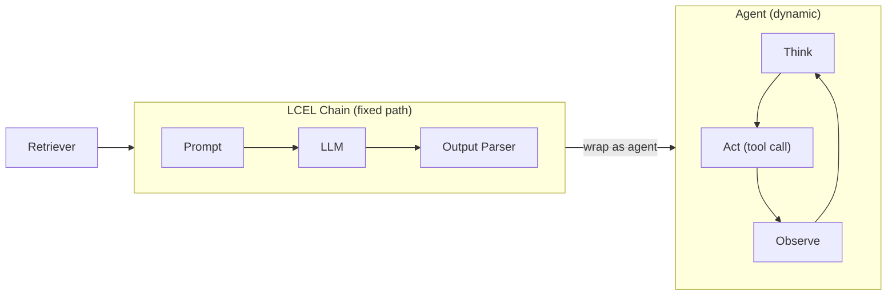

# Chains e agents de LLM

Chains combinam componentes de LLM em pipelines com um caminho de execução fixo. Agents ampliam
esse padrão permitindo que o LLM escolha dinamicamente quais ferramentas invocar e quando. Ambos
os padrões são integrados ao Databricks pelo conector `ChatDatabricks` do LangChain e pelo Mosaic
AI Agent Framework.

> [!note] Atualização da plataforma (out. 2026)
> A documentação atual do Databricks importa o modelo de chat do LangChain como `from databricks_langchain import ChatDatabricks` (pacote `databricks-langchain`); a importação `langchain_community.chat_models` abaixo é o caminho antigo. O endpoint `databricks-meta-llama-3-1-70b-instruct` usado nestes exemplos não consta mais na [lista de modelos compatíveis](https://docs.databricks.com/aws/en/machine-learning/foundation-model-apis/supported-models) — substitua-o por um endpoint atual, como `databricks-meta-llama-3-3-70b-instruct`. Atualmente, agents baseados nessas chains são desenvolvidos com `ResponsesAgent`; consulte [Sistemas agentic com MLflow, Agent Framework e Genie](./05-agentic-systems-mlflow-and-genie.md). Fonte: [Usar ferramentas MCP em um agent Python](https://docs.databricks.com/aws/en/agents/custom-agents/use-mcp-tools).

## Diagrama geral



## LangChain Expression Language (LCEL)

**LCEL** usa o operador pipe `|` para combinar objetos executáveis em chains. Cada componente deve
implementar a interface `Runnable`, com um método `invoke()`.

```python
from langchain_community.chat_models import ChatDatabricks
from langchain_core.prompts import ChatPromptTemplate
from langchain_core.output_parsers import StrOutputParser

llm = ChatDatabricks(
    endpoint="databricks-meta-llama-3-1-70b-instruct",
    temperature=0.1,
)

prompt = ChatPromptTemplate.from_messages([
    ("system", "Answer based on the context:\n{context}"),
    ("human", "{question}"),
])

chain = prompt | llm | StrOutputParser()

response = chain.invoke({"context": "Databricks was founded in 2013.", "question": "When was Databricks founded?"})
print(response)  # "Databricks was founded in 2013."
```

### Regras de composição do LCEL

- Cada componente de um pipe deve aceitar o **tipo de saída** do componente anterior
- `ChatPromptTemplate` produz `ChatPromptValue` → aceito por `ChatDatabricks`
- `ChatDatabricks` produz `AIMessage` → `StrOutputParser` converte para uma string simples
- Use `RunnableParallel` para executar vários componentes em paralelo sobre a mesma entrada

## ChatDatabricks

`ChatDatabricks` é a classe de integração do LangChain para endpoints do Databricks Model Serving.

| Parâmetro | Tipo | Descrição |
| --------- | ---- | ----------- |
| `endpoint` | `str` | Nome do endpoint de serving do Databricks |
| `temperature` | `float` | Temperatura de amostragem (0 = determinístico) |
| `max_tokens` | `int` | Número máximo de tokens da saída |
| `extra_params` | `dict` | Passa parâmetros adicionais específicos do modelo |

**Dica para o exame**: `ChatDatabricks` funciona tanto com endpoints das Foundation Model APIs
quanto com endpoints de serving de modelos personalizados — do ponto de vista da chain, a interface é idêntica.

## Padrão de chain RAG

Uma chain RAG completa conecta um retriever do Vector Search a um pipeline LCEL:

```python
from langchain_community.chat_models import ChatDatabricks
from langchain_community.vectorstores import DatabricksVectorSearch
from langchain_core.prompts import ChatPromptTemplate
from langchain_core.output_parsers import StrOutputParser
from langchain_core.runnables import RunnablePassthrough
from databricks.vector_search.client import VectorSearchClient

# Build retriever from Databricks Vector Search index

vs_client = VectorSearchClient()
index = vs_client.get_index(
    endpoint_name="my_vs_endpoint",
    index_name="catalog.schema.docs_index",
)
vectorstore = DatabricksVectorSearch(index, text_column="content")
retriever = vectorstore.as_retriever(search_kwargs={"k": 5})

# Prompt template

prompt = ChatPromptTemplate.from_messages([
    (
        "system",
        "Answer the question using ONLY the context below.\n"
        "If the answer is not in the context, say 'I don't know'.\n\n"
        "Context:\n{context}",
    ),
    ("human", "{question}"),
])

# LLM

llm = ChatDatabricks(endpoint="databricks-meta-llama-3-1-70b-instruct", temperature=0)


def format_docs(docs):
    return "\n\n".join(doc.page_content for doc in docs)


# Compose chain

rag_chain = (
    {"context": retriever | format_docs, "question": RunnablePassthrough()}
    | prompt
    | llm
    | StrOutputParser()
)

answer = rag_chain.invoke("What is Delta Lake?")
```

**Componentes principais**:

- `retriever | format_docs` — recupera documentos e depois os formata como uma única string
- `RunnablePassthrough()` — encaminha a pergunta sem alterações ao prompt
- O dicionário `{"context": ..., "question": ...}` é `RunnableParallel` — os dois ramos são executados em paralelo

## Mosaic AI Agent Framework

O Mosaic AI Agent Framework oferece integração nativa com MLflow para chains do LangChain e agents
personalizados.

### Registrar uma chain do LangChain

```python
import mlflow
from mlflow.models.resources import (
    DatabricksVectorSearchIndex,
    DatabricksServingEndpoint,
)

with mlflow.start_run():
    model_info = mlflow.langchain.log_model(
        lc_model=rag_chain,
        artifact_path="rag_chain",
        input_example={"question": "What is Delta Lake?"},
        resources=[
            DatabricksVectorSearchIndex(index_name="catalog.schema.docs_index"),
            DatabricksServingEndpoint(
                endpoint_name="databricks-meta-llama-3-1-70b-instruct"
            ),
        ],
    )
```

A lista `resources` informa ao Databricks de quais serviços externos a chain depende, para que as
permissões corretas sejam concedidas quando o modelo for implantado.

## Tool calling (function calling)

O **tool calling** permite que um LLM invoque funções predefinidas. O modelo emite uma
especificação de chamada JSON estruturada; o runtime executa a função e devolve o resultado ao modelo.

```python
from langchain_core.tools import tool
from databricks.vector_search.client import VectorSearchClient

vs_client = VectorSearchClient()
index = vs_client.get_index(
    endpoint_name="my_vs_endpoint",
    index_name="catalog.schema.docs_index",
)


@tool
def search_policy(query: str) -> str:
    """Search the policy database for relevant information."""
    results = index.similarity_search(
        query_text=query,
        columns=["content"],
        num_results=3,
    )
    rows = results.get("result", {}).get("data_array", [])
    return "\n".join(row[0] for row in rows)


@tool
def get_ticket_status(ticket_id: str) -> str:
    """Look up the current status of a support ticket by its ID."""
    # In production: query a Delta table or REST API
    return f"Ticket {ticket_id} is OPEN — assigned to Tier 2 support."


llm_with_tools = llm.bind_tools([search_policy, get_ticket_status])
```

**Como funciona o tool calling**:

1. O usuário envia uma mensagem
2. O LLM decide se deve chamar uma ferramenta; se sim, emite `tool_calls` na resposta
3. O runtime extrai a especificação da chamada, executa a ferramenta e acrescenta o resultado como mensagem com a função `tool`
4. O LLM gera a resposta final incorporando os resultados das ferramentas

## Padrão ReAct (Reasoning + Acting)

**ReAct** é uma arquitetura de agent na qual o modelo alterna entre raciocinar (Thought) e agir
(invocar ferramentas) até chegar a uma resposta final.

```text
Thought: I need to find the company's refund policy.
Action: search_policy("refund policy 30 days")
Observation: "Customers can request refunds within 30 days of purchase..."
Thought: I now have the relevant policy. I can answer the user.
Final Answer: You are eligible for a refund within 30 days of purchase.
```

### Agent ReAct do LangChain

```python
from langchain.agents import AgentExecutor, create_react_agent
from langchain import hub

# Pull a standard ReAct prompt from LangChain Hub

react_prompt = hub.pull("hwchase17/react")

agent = create_react_agent(llm=llm, tools=[search_policy, get_ticket_status], prompt=react_prompt)

agent_executor = AgentExecutor(
    agent=agent,
    tools=[search_policy, get_ticket_status],
    verbose=True,
    max_iterations=5,
    handle_parsing_errors=True,
)

result = agent_executor.invoke({"input": "Is ticket T-1042 eligible for a refund?"})
print(result["output"])
```

**`max_iterations`**: evita loops infinitos. Se o agent não terminar dentro desse número de etapas,
ele retorna uma resposta parcial. Defina esse parâmetro sempre que usar agents em produção.

## Agent vs. chain

| Dimensão | Chain | Agent |
| --------- | ----- | ----- |
| Caminho de execução | Fixo — definido em tempo de compilação | Dinâmico — o LLM decide em tempo de execução |
| Uso de ferramentas | As ferramentas devem ser conectadas explicitamente | O LLM seleciona quais ferramentas chamar |
| Latência | Previsível | Variável (depende da profundidade do raciocínio) |
| Caso de uso | RAG, sumarização, extração | Perguntas e respostas em várias etapas, automação de tarefas |
| Depuração | Simples — rastreie cada etapa | Mais difícil — requer inspeção dos traces |

**Dica para o exame**: se uma questão descrever um sistema no qual o LLM decide qual fonte externa
consultar, trata-se de um **agent**. Se o fluxo for sempre retriever → prompt → LLM, trata-se de uma **chain**.

## mlflow.langchain.log_model()

Assinatura completa com parâmetros comuns:

```python
mlflow.langchain.log_model(
    lc_model=chain,            # The LCEL chain or agent executor
    artifact_path="rag_chain", # Path in the MLflow run artifact store
    input_example={            # Sample input for schema inference
        "question": "What is RAG?"
    },
    resources=[                # Databricks resources for auto-permissioning
        DatabricksVectorSearchIndex(index_name="catalog.schema.my_index"),
        DatabricksServingEndpoint(
            endpoint_name="databricks-meta-llama-3-1-70b-instruct"
        ),
    ],
    pip_requirements=[         # Optional: pin dependency versions
        "langchain==0.2.0",
        "langchain-community==0.2.0",
    ],
)
```

Após o registro, a chain é registrada no MLflow Model Registry e pode ser implantada no Databricks
Model Serving com `agents.deploy()`.

## Questões de prática

> [!success]- Question 1
> **P:** Em uma chain LCEL definida como `prompt | llm | StrOutputParser()`, o que o componente
> `StrOutputParser()` faz?
>
> A) Converte a pergunta em string do usuário para o formato de mensagem de chat
> B) Converte o objeto `AIMessage` retornado pelo LLM em uma string Python simples
> C) Valida se a saída do LLM corresponde a um schema JSON
> D) Divide a string do prompt em segmentos com as funções system e user
>
> **Resposta correta: B**
>
> `StrOutputParser` extrai o conteúdo de texto do objeto `AIMessage` retornado por
> `ChatDatabricks`, produzindo uma `str` simples. O template de prompt (não o parser) trata da
> formatação de mensagens. A validação JSON requer um parser dedicado, como `JsonOutputParser`.

---

> [!success]- Question 2
> **P:** Um agent que usa o padrão ReAct chama uma ferramenta três vezes antes de responder à
> pergunta de um usuário. Qual parâmetro em `AgentExecutor` impede que o agent entre em loop indefinidamente?
>
> A) `temperature=0`
> B) `max_tokens=500`
> C) `max_iterations=5`
> D) `handle_parsing_errors=True`
>
> **Resposta correta: C**
>
> `max_iterations` limita o número de ciclos Thought/Action/Observation que o agent pode executar.
> `temperature` controla a aleatoriedade, `max_tokens` limita o tamanho da saída por chamada ao LLM e
> `handle_parsing_errors` oferece tratamento de erros adequado, mas não impede loops.

---

> [!success]- Question 3
> **P:** Ao registrar uma chain RAG do LangChain com `mlflow.langchain.log_model()`, qual é a
> finalidade do parâmetro `resources`?
>
> A) Especifica os pacotes Python a instalar quando o modelo for servido
> B) Declara quais serviços do Databricks (índice do Vector Search, endpoint de serving) a chain
> usa para que as permissões sejam concedidas automaticamente durante a implantação
> C) Limita o número de solicitações simultâneas que o modelo servido aceitará
> D) Define o tamanho dos chunks que o retriever usa durante a busca por similaridade
>
> **Resposta correta: B**
>
> A lista `resources` declara dependências externas do Databricks. Quando o modelo é implantado por
> `agents.deploy()`, o Databricks usa essa lista para conceder ao endpoint de serving as permissões
> necessárias para chamar o Vector Search e o Model Serving. `pip_requirements` trata dos pacotes
> Python; simultaneidade e tamanho do chunk são configurações separadas.

## Casos de uso

- **Agent de pesquisa em várias etapas**: um agent que divide perguntas complexas do usuário em subconsultas, chama uma ferramenta do Vector Search para cada subconsulta, agrega o contexto recuperado e gera uma resposta sintetizada — lidando com perguntas como “Compare as tendências de receita do primeiro e do segundo trimestre”, que exigem várias etapas de recuperação.
- **Chain RAG com guardrails**: uma chain LCEL que encaminha a entrada do usuário por uma etapa de filtragem de conteúdo, recupera chunks relevantes, gera uma resposta e passa a saída por um classificador de segurança antes de retorná-la — garantindo respostas em conformidade com políticas em um chatbot de um setor regulamentado.

## Problemas e erros comuns

### Respostas com alta latência

**Cenário:** os endpoints de LLM demoram demais para retornar o texto gerado.
**Correção:** mude para throughput provisionado, reduza o tamanho do contexto ou otimize o tamanho dos chunks.

### Agent preso em um loop infinito de chamadas a ferramentas

**Cenário:** um agent ReAct chama repetidamente a mesma ferramenta com argumentos idênticos, nunca produz uma resposta final, consome tokens e aumenta os custos.
**Correção:** defina um limite de `max_iterations` no executor do agent (por exemplo, de 5 a 10 iterações). Adicione uma instrução ao prompt system: “If you have already called a tool and received its result, do not call the same tool again with the same arguments.” Monitore os traces do agent no MLflow para identificar padrões de loop durante o desenvolvimento.

## Principais conclusões

- **Chain LCEL**: usa o operador pipe `|` para combinar componentes `Runnable` em um pipeline de caminho fixo
- **Chains vs. agents**: chains têm um caminho de execução predeterminado; agents decidem dinamicamente quais ferramentas invocar e quando
- **Loop ReAct**: Think (planejar) → Act (chamada de ferramenta com argumentos JSON) → Observe (resultado da ferramenta como mensagem com função `tool`) → repetir até terminar
- **Tool calling**: o LLM retorna uma chamada estruturada de ferramenta em JSON; a aplicação executa a ferramenta; o resultado é acrescentado como mensagem com função `tool`; o LLM é chamado novamente
- **Conector `ChatDatabricks`**: classe do LangChain que se conecta à Foundation Model API do Databricks ou a um endpoint personalizado de model serving
- **`mlflow.langchain.autolog()`**: habilita traces automáticos do MLflow para todas as chamadas do LangChain com uma única linha
- **Função da mensagem de resultado da ferramenta**: depois de executar uma ferramenta, acrescente o resultado com a função `"tool"` — não `"user"` nem `"assistant"`

---

**[← Anterior: Engenharia de prompts](./01-prompt-engineering.md) | [↑ Voltar para Desenvolvimento de aplicações](./README.md) | [Próximo: Estratégias de recuperação e augmentação](./03-retrieval-augmentation-strategies.md) →**
