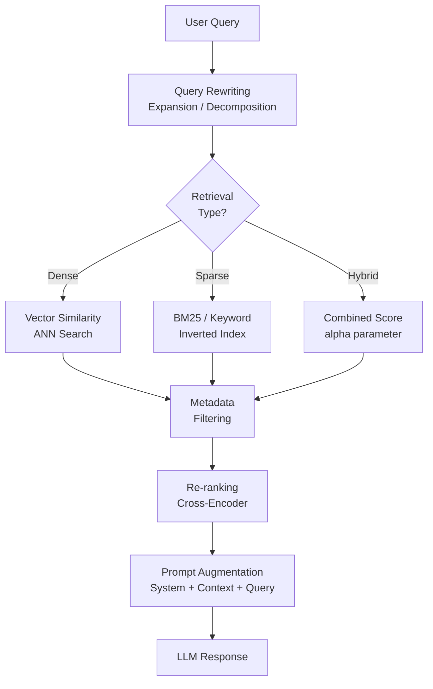

# Estratégias de recuperação e augmentação

A qualidade da recuperação determina a qualidade da resposta. Este arquivo aborda todo o espectro
das abordagens de recuperação — desde busca vetorial densa até métodos híbridos esparsos/densos — e
padrões de augmentação de prompts que ajudam o LLM a usar o contexto recuperado de forma eficaz.

## Visão geral



## Busca densa vs. esparsa vs. híbrida

### Busca densa (similaridade vetorial)

A busca densa codifica a consulta e os documentos em vetores contínuos e encontra os K vizinhos
mais próximos usando similaridade de cosseno ou produto escalar.

**Pontos fortes**: lida com sinônimos, paráfrases e significado semântico. Uma consulta por
“eficiência de combustível de carro” encontrará documentos sobre “quilometragem de veículos”.

**Pontos fracos**: tem dificuldade com correspondências exatas de termos. Uma consulta por “chave
de API `sk-abc123`” pode não encontrar o documento exato se ele estiver distante no espaço de embeddings.

### Busca esparsa (BM25 / palavras-chave)

A busca esparsa usa um índice invertido (como um mecanismo de busca tradicional). BM25 é a função
de classificação padrão.

**Pontos fortes**: correspondência exata de termos. Excelente para nomes próprios, códigos de
produtos, IDs, números de versão e jargões técnicos que os modelos de embedding talvez não codifiquem com precisão.

**Pontos fracos**: não lida com sinônimos ou semântica. “automobile” não corresponderá a “car”.

### Busca híbrida

A busca híbrida combina as duas pontuações, normalmente por meio de uma soma ponderada:

```text
hybrid_score = alpha * dense_score + (1 - alpha) * sparse_score
```

`alpha = 1.0` corresponde à busca totalmente densa; `alpha = 0.0`, à totalmente esparsa; e
`alpha = 0.5` equilibra as duas.

| Cenário | Valor de alpha recomendado | Motivo |
| :--- | :--- | :--- |
| Perguntas e respostas gerais | 0.5–0.7 | Equilibra semântica e termos exatos |
| Documentação técnica com IDs/códigos | 0.2–0.4 | Dá mais peso à correspondência exata de palavras-chave |
| Conversacional / semântica | 0.7–0.9 | Correspondência principalmente semântica |

### Busca híbrida com Databricks Vector Search

```python
from databricks.vector_search.client import VectorSearchClient

vsc = VectorSearchClient()
index = vsc.get_index(
    endpoint_name="my_endpoint",
    index_name="catalog.schema.docs_index"
)

results = index.similarity_search(
    query_text="What is the policy for expense reimbursement?",
    columns=["content", "source", "chunk_id"],
    num_results=5,
    query_type="HYBRID",    # dense + sparse
    filters={"document_type": "policy"}
)
```

**Observação**: o parâmetro `query_type` aceita `"ANN"` (totalmente denso) ou `"HYBRID"`.
O parâmetro `alpha` controla a combinação quando `query_type="HYBRID"`.

## Estratégias de reescrita de consultas

A reescrita de consultas transforma a consulta original antes da recuperação para melhorar o recall.

### Expansão da consulta

Adicione à consulta termos relacionados e sinônimos para aumentar a chance de encontrar
documentos que usam terminologia diferente.

```python
def expand_query(query: str) -> str:
    """Ask the LLM to rewrite the query with additional relevant terms."""
    import mlflow.deployments
    client = mlflow.deployments.get_deploy_client("databricks")

    prompt = (
        f"Rewrite the following query to include related terms and synonyms "
        f"that might appear in relevant documents. Keep it concise.\n\n"
        f"Original query: {query}\n\nExpanded query:"
    )
    response = client.predict(
        endpoint="databricks-meta-llama-3-1-70b-instruct",
        inputs={"messages": [{"role": "user", "content": prompt}]}
    )
    return response["choices"][0]["message"]["content"].strip()
```

### Decomposição da consulta

Divida uma pergunta complexa com várias partes em subperguntas mais simples, faça a recuperação
para cada uma e, em seguida, combine o contexto antes da resposta final.

```python
def decompose_query(query: str) -> list[str]:
    """Break a complex query into independent sub-questions."""
    import mlflow.deployments
    import json
    client = mlflow.deployments.get_deploy_client("databricks")

    prompt = (
        f"Break the following complex question into 2-4 simpler, independent "
        f"sub-questions that together cover the full question. "
        f"Return a JSON array of strings.\n\nQuestion: {query}"
    )
    response = client.predict(
        endpoint="databricks-meta-llama-3-1-70b-instruct",
        inputs={"messages": [{"role": "user", "content": prompt}]}
    )
    content = response["choices"][0]["message"]["content"]
    try:
        return json.loads(content)
    except json.JSONDecodeError:
        return [query]  # fallback to original
```

### Prompting step-back

Em vez de buscar a resposta específica, primeiro recupere informações gerais de contexto sobre o
tópico e, depois, use esse contexto para responder à pergunta específica.

```python
def step_back_query(query: str) -> str:
    """Generate a more general 'step back' question for background context."""
    import mlflow.deployments
    client = mlflow.deployments.get_deploy_client("databricks")

    prompt = (
        f"Given the following specific question, generate a more general "
        f"background question about the broader topic. This helps retrieve "
        f"foundational context.\n\nSpecific question: {query}\n\nGeneral question:"
    )
    response = client.predict(
        endpoint="databricks-meta-llama-3-1-70b-instruct",
        inputs={"messages": [{"role": "user", "content": prompt}]}
    )
    return response["choices"][0]["message"]["content"].strip()
```

## Filtragem de metadados

Filtros de metadados pré-filtram o índice antes do cálculo da similaridade vetorial. Isso é mais
rápido do que filtrar depois e restringe a busca ao subconjunto relevante de documentos.

### Usar filtros em similarity_search

```python
# Single field filter

results = index.similarity_search(
    query_text="how do I configure Auto Loader?",
    columns=["content", "source"],
    num_results=5,
    filters={"source": "engineering_docs"}
)

# Multiple field filter (AND logic)

results = index.similarity_search(
    query_text="expense reimbursement limit",
    columns=["content", "source", "document_date"],
    num_results=5,
    filters={
        "document_type": "policy",
        "department": "finance"
    }
)

# Range filter for dates (using string comparison)

results = index.similarity_search(
    query_text="latest security guidelines",
    columns=["content", "document_date"],
    num_results=5,
    filters={"document_date >": "2024-01-01"}
)
```

**Dica para o exame**: a filtragem de metadados usa **pré-filtragem** (aplicada antes da busca
ANN), o que é mais eficiente, mas pode deixar de encontrar documentos próximos ao limite se o
filtro for restritivo demais. Garanta que os metadados sejam preenchidos de forma consistente durante a indexação.

## Métricas de contexto do RAGAS

RAGAS (RAG Assessment) oferece avaliação automatizada da qualidade da recuperação.

| Métrica | O que mede | Como é calculada |
| :--- | :--- | :--- |
| **Precisão do contexto** | Fração dos chunks recuperados relevantes para a consulta | Recuperados relevantes / Total recuperado |
| **Recall do contexto** | Fração das informações relevantes de referência que foram recuperadas | Recuperados relevantes / Total relevante |
| **Fidelidade** | Se a resposta final está fundamentada no contexto recuperado | Afirmações da resposta que aparecem no contexto |
| **Relevância da resposta** | Se a resposta realmente aborda a pergunta | Similaridade de embeddings: resposta ↔ pergunta |

### Compromisso entre precisão e recall do contexto

Aumentar `num_results` melhora o **recall do contexto** (maior chance de incluir o chunk correto),
mas reduz a **precisão do contexto** (mais chunks irrelevantes incluídos). O re-ranking ajuda a
manter a precisão mesmo com um conjunto maior de resultados recuperados.

## Padrões de augmentação de prompts

### Estrutura padrão de prompt system para RAG

```python
SYSTEM_PROMPT = """You are a helpful assistant for Acme Corporation.

Rules:
1. Answer ONLY from the provided context.
2. If the context does not contain enough information, say: "I don't have enough
   information to answer this question."
3. Do not use knowledge outside the provided context.
4. Be concise and factual."""

def build_rag_messages(context: str, question: str) -> list[dict]:
    """Build the message list for a RAG prompt."""
    user_content = (
        f"Context:\n{context}\n\n"
        f"Question: {question}"
    )
    return [
        {"role": "system", "content": SYSTEM_PROMPT},
        {"role": "user", "content": user_content}
    ]
```

### Citações e atribuição de fontes

```python
CITATION_SYSTEM_PROMPT = """You are a helpful assistant. Answer based on the provided
context. After your answer, cite the sources you used in this format:

Sources: [source_1], [source_2]

If no relevant sources exist, say "I don't know."
"""

def build_rag_with_citations(chunks: list[dict], question: str) -> list[dict]:
    """Build prompt that instructs the LLM to cite source documents."""
    context_parts = []
    for i, chunk in enumerate(chunks):
        source = chunk.get("metadata", {}).get("source", f"Document {i+1}")
        context_parts.append(f"[{source}]\n{chunk['content']}")

    context = "\n\n---\n\n".join(context_parts)
    return [
        {"role": "system", "content": CITATION_SYSTEM_PROMPT},
        {"role": "user", "content": f"Context:\n{context}\n\nQuestion: {question}"}
    ]
```

### Degradação controlada (nenhum contexto encontrado)

```python
def build_rag_prompt_with_fallback(
    chunks: list[str], question: str, min_chunks: int = 1
) -> list[dict]:
    """Handle case where retrieval returns no relevant results."""
    if len(chunks) < min_chunks:
        # No useful context was retrieved
        no_context_message = (
            f"Question: {question}\n\n"
            f"Note: No relevant information was found in the knowledge base for this "
            f"question. Please answer based on general knowledge if applicable, or "
            f"indicate that this topic is not covered."
        )
        return [
            {"role": "system", "content": SYSTEM_PROMPT},
            {"role": "user", "content": no_context_message}
        ]

    context = "\n\n".join(chunks)
    return build_rag_messages(context, question)
```

## Exemplo completo de pipeline de recuperação

```python
import mlflow.deployments
from databricks.vector_search.client import VectorSearchClient

class RAGPipeline:
    """Complete RAG pipeline with hybrid search and metadata filtering."""

    def __init__(self, endpoint_name: str, index_name: str):
        self.vsc = VectorSearchClient()
        self.index = self.vsc.get_index(
            endpoint_name=endpoint_name,
            index_name=index_name
        )
        self.deploy_client = mlflow.deployments.get_deploy_client("databricks")

    def retrieve(
        self,
        query: str,
        num_results: int = 5,
        filters: dict | None = None,
        use_hybrid: bool = True
    ) -> list[str]:
        """Retrieve relevant chunks with optional hybrid search and filters."""
        kwargs = {
            "query_text": query,
            "columns": ["content", "source"],
            "num_results": num_results,
            "query_type": "HYBRID" if use_hybrid else "ANN",
        }
        if filters:
            kwargs["filters"] = filters

        results = self.index.similarity_search(**kwargs)
        return [
            row[0]
            for row in results.get("result", {}).get("data_array", [])
        ]

    def answer(
        self,
        question: str,
        filters: dict | None = None
    ) -> str:
        """End-to-end RAG: retrieve then generate."""
        chunks = self.retrieve(question, filters=filters)
        messages = build_rag_messages(
            context="\n\n".join(chunks),
            question=question
        )
        response = self.deploy_client.predict(
            endpoint="databricks-meta-llama-3-1-70b-instruct",
            inputs={"messages": messages, "temperature": 0.0}
        )
        return response["choices"][0]["message"]["content"]
```

## Questões de prática

**Questão 1**: Um sistema RAG recebe a consulta “etapas de solução de problemas do código de erro
DB-4321”. A busca vetorial pura retorna resultados de baixa qualidade porque o código de erro não
está bem representado no espaço de embeddings. Qual abordagem de recuperação melhora isso mais diretamente?

A) Aumentar `num_results` para recuperar mais candidatos
B) Mudar para busca híbrida com maior peso para a recuperação esparsa (BM25)
C) Usar HyDE para gerar uma resposta hipotética antes da busca
D) Adicionar uma etapa de re-ranking após a recuperação

> [!success]- Resposta
> **Resposta correta: B**
>
> Códigos de erro e identificadores técnicos exigem correspondência exata — a string “DB-4321”
> pode não gerar um embedding semelhante ao da documentação que também contém “DB-4321” se o modelo
> de embedding distribuir esses caracteres por outra região do espaço vetorial.
> **A recuperação esparsa/BM25 é excelente para correspondência exata de palavras-chave e códigos**.
>
> Definir `query_type="HYBRID"` com um alpha menor (mais peso para a busca esparsa) melhorará
> diretamente o recall de correspondências exatas. HyDE (C) ajuda com a incompatibilidade semântica
> entre o estilo da pergunta e o do documento, não com a correspondência exata de códigos.
> Re-ranking (D) melhora a ordenação dos resultados recuperados, mas não consegue recuperar documentos
> que já foram deixados de fora.

**Questão 2**: Você avalia o pipeline RAG e descobre que a precisão do contexto é 0,9 (muito alta),
mas o recall do contexto é 0,4 (baixo). O que isso indica e o que deve ser ajustado?

A) Os chunks recuperados são em sua maioria relevantes, mas informações importantes estão sendo ignoradas
   — aumente `num_results` ou use recuperação multi-consulta
B) Muitos chunks irrelevantes estão sendo recuperados — reduza `num_results`
C) O LLM está alucinando apesar da boa recuperação — reduza a temperatura
D) As dimensões do modelo de embedding são pequenas demais — mude para um modelo maior

> [!success]- Answer
> **Resposta correta: A**
>
> **Precisão alta + recall baixo** significa que os poucos chunks recuperados são quase todos
> relevantes (precisão = 0,9), mas há chunks relevantes no índice que NÃO estão sendo recuperados
> (recall = 0,4).
>
> A correção é ampliar a recuperação: aumente `num_results`, use recuperação multi-consulta para
> abranger mais possibilidades ou use busca híbrida. Como a precisão já é alta, adicionar um
> re-ranker pode mantê-la enquanto permite um conjunto inicial de recuperação maior.
>
> Reduzir `num_results` (B) pioraria ainda mais o recall. A temperatura (C) afeta a geração, não a
> recuperação. As dimensões do embedding (D) não causam diretamente esse desequilíbrio entre precisão e recall.

**Questão 3**: Qual das práticas de augmentação de prompts a seguir reduz melhor as alucinações em
uma aplicação RAG?

A) Incluir instruções de raciocínio chain-of-thought para melhorar a qualidade da resposta
B) Usar temperatura alta (0,8–1,0) para que o LLM gere respostas mais variadas
C) Instruir o LLM no prompt system a responder SOMENTE com base no contexto fornecido e
   dizer “I don't know” quando o contexto for insuficiente
D) Aumentar `max_tokens` para dar espaço ao LLM para explicar todo o seu raciocínio

> [!success]- Answer
> **Resposta correta: C**
>
> As alucinações em RAG ocorrem quando o LLM usa conhecimento além do contexto fornecido.
> Instruir explicitamente o modelo a responder **somente com base no contexto** e a dizer “I don't
> know” quando faltarem informações é o principal controle de fidelidade no nível do prompt.
>
> Chain-of-thought (A) pode melhorar a qualidade do raciocínio, mas não impede que o modelo use
> conhecimentos externos. A temperatura alta (B) aumenta a aleatoriedade e o risco de alucinações.
> Aumentar `max_tokens` (D) permite respostas mais longas, mas não afeta o quanto a resposta
> continua fundamentada no contexto.

## Casos de uso

- **Busca híbrida para perguntas e respostas sobre catálogo de produtos**: combinar embeddings densos (para descrições semânticas de produtos) com BM25 esparso (para consultas exatas de SKU e número do modelo), usando `alpha=0.5` para equilibrar os dois sinais em um chatbot de suporte ao cliente.
- **Recuperação em várias etapas para relatórios financeiros**: recuperar 50 chunks candidatos com uma busca ANN rápida e, em seguida, aplicar re-ranking com um cross-encoder para selecionar as 5 passagens mais relevantes antes de passá-las ao LLM para sumarizar uma teleconferência de resultados financeiros.

## Problemas e erros comuns

### Re-ranking aumenta a latência além do SLA

**Cenário:** adicionar um re-ranker cross-encoder ao pipeline de recuperação aumenta a latência de ponta a ponta de 400 ms para 1,2 s, violando o SLA de 500 ms da aplicação.
**Correção:** reduza o `num_results` da recuperação inicial para que o re-ranker tenha menos candidatos para pontuar (por exemplo, 20 em vez de 50). Como alternativa, use um re-ranker leve (cross-encoder destilado) ou transfira o re-ranking para um endpoint com GPU para acelerar a inferência.

### Busca híbrida retorna chunks duplicados

**Cenário:** combinar recuperação densa e esparsa retorna o mesmo chunk pelos dois caminhos, desperdiçando espaço na janela de contexto com conteúdo duplicado.
**Correção:** remova duplicatas por ID do chunk depois de combinar os dois conjuntos de resultados e antes de passá-los ao LLM. Aplique a pontuação Reciprocal Rank Fusion (RRF) para combinar classificações e tratar automaticamente resultados sobrepostos.

## Principais conclusões

- **Busca densa**: similaridade semântica por embeddings — excelente para paráfrases e correspondências conceituais
- **Busca esparsa (BM25)**: índice invertido baseado em palavras-chave — excelente para correspondências exatas de termos, códigos de produtos e nomes próprios
- **Busca híbrida**: combina pontuações densas e esparsas com o parâmetro `alpha` (0 = totalmente esparsa; 1 = totalmente densa)
- **Filtragem de metadados**: pré-filtra o índice antes da busca ANN para restringir o conjunto de candidatos de forma eficiente
- **Re-ranking**: um cross-encoder pontua novamente todo o conjunto de candidatos recuperados após a recuperação inicial — é mais preciso, mas acrescenta latência
- **Recupere mais resultados do que retorna**: defina `num_results` acima da quantidade final de contexto para que o re-ranking tenha candidatos para selecionar
- **Reescrita/expansão de consultas**: parafrasear, decompor ou expandir a consulta melhora o recall antes do início da recuperação

---

**[← Anterior: Chains e agents de LLM](./02-chains-agents.md) | [↑ Voltar para Desenvolvimento de aplicações](./README.md) | [Próximo: Vector Search em produção](./04-vector-search-runtime.md) →**
