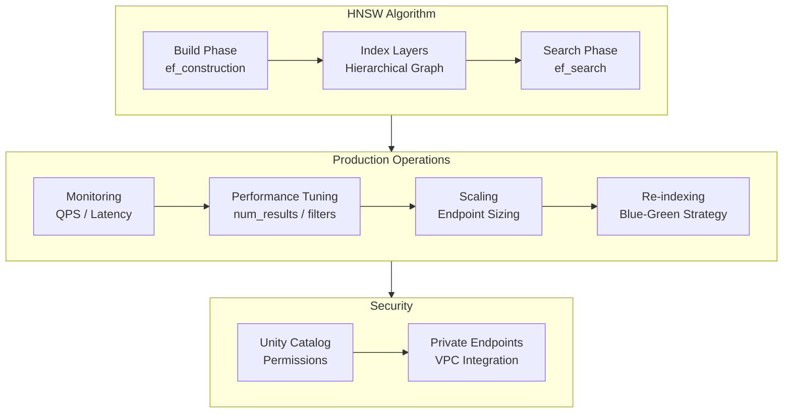
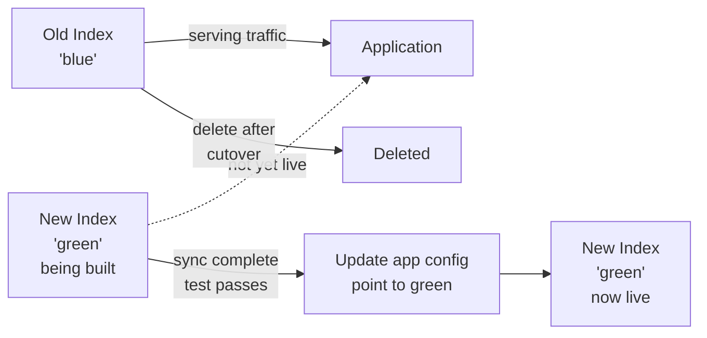

# Vector Search em produção

Executar o Databricks Vector Search em produção exige compreender o algoritmo ANN subjacente,
o comportamento de escalonamento, o ajuste de desempenho, o gerenciamento de custos e a
configuração de segurança.

## Visão geral



## HNSW — Hierarchical Navigable Small World

O Databricks Vector Search usa internamente HNSW para a busca aproximada de vizinhos mais
próximos (ANN). Compreender o HNSW ajuda a explicar os compromissos entre precisão e latência.

### Como funciona o HNSW

O HNSW cria um grafo hierárquico com várias camadas:

- **Camadas superiores**: grafo esparso para navegação ampla (conexões de longo alcance)
- **Camada inferior**: grafo denso com conexões de curto alcance para busca detalhada
- No momento da consulta, o algoritmo entra pela camada superior, navega de forma gulosa em direção
  à consulta, desce para camadas inferiores e retorna os candidatos finais

### Principais parâmetros do HNSW

| Parâmetro | Fase | Efeito | Valor mais alto |
| :--- | :--- | :--- | :--- |
| `ef_construction` | Construção do índice | Número de candidatos explorados ao criar a lista de vizinhos de cada nó | Melhor qualidade do índice, construção mais lenta, mais memória |
| `ef_search` | Consulta | Número de candidatos explorados durante uma busca | Melhor recall, maior latência de consulta |
| `M` | Construção do índice | Número de conexões bidirecionais por nó | Melhor recall, mais memória, construção mais lenta |

### ANN vs. busca exata

O HNSW realiza uma busca **aproximada** de vizinhos mais próximos — encontra resultados muito
próximos dos vizinhos realmente mais próximos, mas não garante que sejam exatos. Na prática, o recall
é de 95–99 % com configurações de `ef_search` próprias para produção, o que é suficiente para RAG.

**Dica para o exame**: o Databricks Vector Search usa busca ANN (não exata) por padrão. Para
melhorar o recall, aumente `num_results` (recupere mais candidatos) ou ajuste `ef_search`.

## Tamanho do índice e escalonamento

### Estimativa de memória

```text
Approximate index memory:
  Number of vectors × Dimensions × 4 bytes (float32)
  + HNSW graph overhead (~1.1–1.5x multiplier)

Example:
  1,000,000 vectors × 1024 dimensions × 4 bytes = ~4 GB raw
  + HNSW overhead → ~5–6 GB total
```

O Databricks Vector Search gerencia o escalonamento automaticamente — não é necessário provisionar
memória manualmente. O endpoint escala de acordo com o tamanho do índice e a carga de consultas.

### Diretrizes de dimensionamento

| Requisito | Tipo de endpoint recomendado | Observações (documentação atual do AI Search) |
| :--- | :--- | :--- |
| Menor latência de consulta, QPS alto e contínuo | STANDARD | ~320 milhões de vetores com 768 dimensões por endpoint (~160 milhões com 1536); destino High QPS opcional |
| Corpus muito grande (centenas de milhões até ~1 bilhão de vetores), custo por vetor relevante | STORAGE_OPTIMIZED | Mais de 1 bilhão de vetores com 768 dimensões; indexação 10–20x mais rápida; consultas acrescentam ~250 ms de latência |
| Mais de ~1 bilhão de vetores | Entre em contato com sua equipe de conta | — |

A capacidade escala aproximadamente de forma linear com a dimensão. A resposta à questão de exemplo
oficial do exame (100 milhões de itens, 80 consultas por segundo e latência como métrica mais
importante) é um endpoint **standard**, sem busca híbrida nem re-ranking, para proteger a latência.
Fonte: [Databricks AI Search](https://docs.databricks.com/aws/en/ai-search/ai-search).

> [!note] Atualização da plataforma (out. 2026)
> **Mosaic AI Vector Search foi renomeado Databricks AI Search em 2026-06-01** ([notas de versão de junho de 2026](https://docs.databricks.com/aws/en/release-notes/product/2026/june)). O guia do exame ainda usa o nome *Vector Search*, e o código deste guia usa o cliente da época do exame `databricks-vectorsearch` (`VectorSearchClient`); a documentação atual instala `databricks-ai-search` e importa `AISearchClient` de `databricks.ai_search.client` ([Criar endpoints e índices do AI Search](https://docs.databricks.com/aws/en/ai-search/create-ai-search)). Os conceitos deste arquivo não mudaram. O AI Search também adicionou índices de texto completo (somente palavras-chave) (Beta) e, em 2026-07-15, disponibilizou **High QPS** para endpoints standard ([notas de versão de julho de 2026](https://docs.databricks.com/aws/en/release-notes/product/2026/july)).

## Estratégia de reindexação

Ao trocar o modelo de embedding (por outro modelo ou pesos retreinados), é necessário reconstruir
o índice com os novos vetores. Use uma **estratégia blue-green** para evitar indisponibilidade.



### Etapas da reindexação blue-green

```python
from databricks.vector_search.client import VectorSearchClient

vsc = VectorSearchClient()

# Step 1: Create new "green" index with the new embedding model

green_index = vsc.create_delta_sync_index(
    endpoint_name="rag_endpoint",
    index_name="catalog.schema.docs_index_v2",    # new name
    source_table_name="catalog.schema.document_chunks",
    pipeline_type="TRIGGERED",
    primary_key="chunk_id",
    embedding_source_column="content",
    embedding_model_endpoint_name="databricks-bge-large-en"  # new model
)
green_index.sync()

# Step 2: Wait for green index to be online

import time
while True:
    state = green_index.describe()["status"]["detailed_state"]
    if state == "ONLINE":
        break
    time.sleep(15)

# Step 3: Run smoke tests against green index

test_results = green_index.similarity_search(
    query_text="test query",
    columns=["content"],
    num_results=3
)
assert len(test_results.get("result", {}).get("data_array", [])) > 0

# Step 4: Cut over — update application to use new index name
# (update environment variable, config file, or MLflow model parameter)

print("Cutover to catalog.schema.docs_index_v2 — update application config")

# Step 5: After validation, delete old index
# vsc.delete_index(
#     endpoint_name="rag_endpoint",
#     index_name="catalog.schema.docs_index_v1"
# )

```

## Monitoramento do Vector Search

### Métricas do endpoint

O Databricks disponibiliza métricas do endpoint do Vector Search pela interface do workspace e
pelas System Tables (disponíveis no Unity Catalog).

| Métrica | Descrição | Limite de alerta |
| :--- | :--- | :--- |
| **QPS (consultas por segundo)** | Taxa de solicitações ao endpoint | > 80 % da capacidade |
| **Latência P50** | Latência mediana das consultas | > 100 ms em cargas de trabalho típicas |
| **Latência P95** | Latência no percentil 95 | > 500 ms indica degradação |
| **Latência P99** | Latência no percentil 99 | > 1 s é perceptível para o usuário |
| **Taxa de erros** | Fração de solicitações com falha | > 0,1 % exige investigação |

### Atualização do índice (Delta Sync)

Em pipelines TRIGGERED, acompanhe o intervalo entre a última gravação na tabela Delta e a última
sincronização bem-sucedida.

```python
def check_index_freshness(index_name: str, endpoint_name: str) -> dict:
    """Return sync status and timestamp for a Delta Sync index."""
    vsc = VectorSearchClient()
    index = vsc.get_index(
        endpoint_name=endpoint_name,
        index_name=index_name
    )
    description = index.describe()
    return {
        "state": description["status"]["detailed_state"],
        "last_sync_time": description["status"].get("index_url"),
        "num_records": description["status"].get("num_records_indexed")
    }
```

## Otimização de desempenho

### Reduzir a latência

| Técnica | Mecanismo | Impacto |
| :--- | :--- | :--- |
| Reduzir `num_results` | Menos candidatos para pontuar e retornar | Médio — evita buscar resultados em excesso |
| Aplicar filtros de metadados | Pré-filtrar antes de ANN — espaço de busca menor | Alto com filtros seletivos |
| Armazenar consultas frequentes em cache | Cache no nível da aplicação para consultas repetidas | Alto para consultas comuns |
| Usar `query_vector` em vez de `query_text` | Ignora a chamada interna de embedding | Médio — economiza uma ida e volta |
| Dimensionar `ef_search` adequadamente | Valor menor = mais rápido, mas menor recall | Troca recall por velocidade |

### Boas práticas para filtros de metadados

Os filtros de metadados são mais eficazes quando são **altamente seletivos** (filtram menos de 10 %
do índice). Filtros que correspondem à maior parte do índice oferecem pouco benefício de desempenho.

```python
# Good: highly selective filter — reduces search space significantly

results = index.similarity_search(
    query_text="expense reimbursement",
    num_results=5,
    filters={"department": "hr", "document_type": "policy"}
)

# Less effective: low selectivity — nearly the whole index is searched

results = index.similarity_search(
    query_text="configuration guide",
    num_results=5,
    filters={"language": "en"}  # 95% of documents are English
)
```

### Pré-calcular embeddings de consultas

Quando a mesma consulta é enviada várias vezes (por exemplo, em cenários de cache), pré-calcule
o embedding uma vez e use `query_vector` para evitar gerá-lo novamente.

```python
import mlflow.deployments

deploy_client = mlflow.deployments.get_deploy_client("databricks")

def get_query_embedding(query: str) -> list[float]:
    """Embed a query text once, reuse the vector for multiple searches."""
    response = deploy_client.predict(
        endpoint="databricks-gte-large-en",
        inputs={"input": [query]}
    )
    return response["data"][0]["embedding"]

query_vector = get_query_embedding("How does Delta Lake handle ACID transactions?")

# Use pre-computed vector for multiple filtered searches

for department in ["engineering", "legal", "finance"]:
    results = index.similarity_search(
        query_vector=query_vector,           # skip embedding
        columns=["content"],
        num_results=3,
        filters={"department": department}
    )
```

## Otimização de custos

| Estratégia | Descrição | Compromisso |
| :--- | :--- | :--- |
| **TRIGGERED vs. CONTINUOUS** | TRIGGERED custa menos — é executado somente durante a sincronização | Índice fica desatualizado por mais tempo |
| **Dimensionar o endpoint adequadamente** | Comece com STANDARD; atualize somente para índices grandes | Redimensionar causa breve indisponibilidade |
| **Reduzir `num_results`** | Menos resultados = menos computação por consulta | Pode reduzir o recall |
| **Pausar o endpoint quando não estiver em uso** | Parar o endpoint fora do horário de operação | Tempo para reiniciar (minutos) |
| **Filtrar antes da busca** | A pré-filtragem reduz o escopo da busca ANN | Requer bons metadados |

### Comparação de custos: TRIGGERED vs. CONTINUOUS

```text
TRIGGERED:
  - Sync pipeline runs only when triggered (e.g., nightly batch job)
  - Endpoint compute: always on for query serving
  - Pipeline compute: billed only during sync window

CONTINUOUS:
  - Streaming pipeline runs 24/7 monitoring Delta CDF
  - Endpoint compute: always on
  - Pipeline compute: billed continuously
  - Typical cost increase: 20-40% higher than TRIGGERED for same index
```

## Segurança

### Permissões do Unity Catalog

O Vector Search integra-se ao Unity Catalog para controle de acesso.

```sql
-- Grant permission to use (query) the endpoint
GRANT EXECUTE ON VECTOR SEARCH ENDPOINT rag_endpoint
  TO `data-science-team`;

-- Grant permission to manage (create/delete indexes) the endpoint
GRANT MANAGE ON VECTOR SEARCH ENDPOINT rag_endpoint
  TO `ml-platform-team`;

-- Grant read access to the backing table (required for Delta Sync)
GRANT SELECT ON TABLE catalog.schema.document_chunks
  TO `rag-service-principal`;
```

### Endpoints privados (integração com VPC)

Para implantações de produção em setores regulamentados, configure o Vector Search para usar
endpoints privados, de modo que o tráfego nunca passe pela internet pública.

A configuração de endpoints privados é feita nas configurações administrativas do workspace do Databricks.
Depois de configurado, o `VectorSearchClient` encaminha automaticamente as solicitações pelo endpoint privado.

## Solução de problemas

| Sintoma | Causa provável | Correção |
| :--- | :--- | :--- |
| Índice preso em `PROVISIONING` | Endpoint ainda não está online | Aguarde; verifique o estado de `vsc.get_endpoint(name)` |
| Resultados desatualizados após atualização dos dados | A sincronização TRIGGERED não foi executada | Chame `index.sync()` ou verifique a agenda de sincronização |
| Erro de incompatibilidade de dimensões | Dimensões do vetor da consulta ≠ dimensões do índice | Garanta que o mesmo modelo de embedding seja usado no índice e na consulta |
| Recall baixo (documentos relevantes não são recuperados) | `num_results` muito baixo ou filtros de metadados inadequados | Aumente `num_results`; remova filtros restritivos |
| Latência alta (> 500 ms) | Índice grande demais para o tamanho do endpoint; `ef_search` alto | Atualize o tipo do endpoint; ajuste `ef_search` |
| Erro `PERMISSION_DENIED` | Falta a permissão UC EXECUTE no endpoint | `GRANT EXECUTE ON VECTOR SEARCH ENDPOINT ...` |
| Resultados vazios | Índice ainda não sincronizado; todas as linhas foram filtradas | Verifique o estado da sincronização; confirme se os valores dos filtros correspondem aos dados |

## Questões de prática

**Questão 1**: Uma aplicação RAG consulta um índice do Vector Search 1.000 vezes por segundo.
A latência média das consultas é de 80 ms no P50, mas de 900 ms no P99. Qual é a causa mais provável
e qual é a correção recomendada?

A) O modelo de embedding é lento — mude para um modelo de embedding menor
B) O índice é grande demais para o endpoint — atualize para um endpoint STORAGE_OPTIMIZED
C) Latência de pontos críticos causada por algumas consultas caras (por exemplo, `num_results` alto ou ausência de filtros)
   — analise as consultas, reduza `num_results` e adicione filtros de metadados
D) `ef_construction` do HNSW está alto demais — reconstrua o índice com um valor menor

> [!success]- Answer
> **Resposta correta: C**
>
> Uma grande diferença entre P50 (80 ms) e P99 (900 ms) indica que **a maioria das consultas é
> rápida, mas uma pequena porcentagem é muito lenta** — um comportamento clássico de ponto crítico.
> Causas comuns incluem consultas com `num_results` muito alto, ausência de filtros de metadados
> que força uma varredura ANN do índice inteiro ou filtros complexos com vários campos.
>
> Analisar e otimizar as consultas mais lentas (reduzindo `num_results`, adicionando filtros
> seletivos ou armazenando consultas frequentes em cache) reduzirá o P99 sem afetar as consultas rápidas.
>
> `ef_construction` (D) afeta a qualidade da construção do índice, não a latência das consultas.
> Atualizar o endpoint (B) ajudaria se o P50 geral estivesse alto, não apenas o P99.

**Questão 2**: Sua equipe está migrando o sistema RAG para um novo modelo de embedding.
O índice antigo usa `databricks-gte-large-en` (1024 dimensões); o novo modelo é
`databricks-bge-large-en` (também com 1024 dimensões). Qual é a estratégia de migração mais segura
para evitar indisponibilidade para os usuários?

A) Excluir o índice antigo, recriá-lo com o novo modelo, aguardar a sincronização e depois reimplantar
B) Atualizar in-place o campo `embedding_model_endpoint_name` no índice existente
C) Criar um novo índice com o novo modelo, testá-lo, alterar a configuração da aplicação
   e excluir o índice antigo somente após a validação
D) Executar os dois modelos em paralelo e calcular a média das pontuações de similaridade

> [!success]- Answer
> **Resposta correta: C**
>
> Esse é o padrão de **implantação blue-green**. Criar um novo índice ao lado do antigo (sem
> indisponibilizar o índice antigo), testá-lo completamente, atualizar a aplicação para apontar
> para o novo índice e só então excluir o índice antigo é a abordagem mais segura.
>
> Excluir primeiro (A) causa indisponibilidade durante a sincronização. As configurações de índices
> Delta Sync são imutáveis — não é possível atualizar `embedding_model_endpoint_name` in-place (B).
> Calcular a média de pontuações de espaços vetoriais diferentes (D) não tem significado matemático.

**Questão 3**: Um índice do Vector Search está configurado com `pipeline_type="TRIGGERED"`.
Novos documentos são adicionados à tabela Delta de origem todas as noites. Na manhã seguinte,
os usuários informam que as consultas não retornam os novos documentos. Qual etapa foi esquecida?

A) O Change Data Feed não está habilitado na tabela Delta
B) O método `index.sync()` não foi chamado após a ingestão noturna dos documentos
C) O endpoint foi pausado durante a noite para reduzir custos e não foi reiniciado
D) O parâmetro `num_results` está baixo demais para incluir os novos documentos

> [!success]- Answer
> **Resposta correta: B**
>
> `pipeline_type="TRIGGERED"` significa que o índice só é sincronizado quando acionado explicitamente.
> Depois que o job de ingestão noturna grava novos registros na tabela Delta, é necessário chamar
> `index.sync()` (ou agendá-lo como uma etapa subsequente do job) para atualizar o índice vetorial.
> Sem essa chamada, o índice permanece desatualizado.
>
> O CDF (A) é necessário para o Delta Sync funcionar — se estivesse ausente, a criação do índice
> teria falhado. Um endpoint pausado (C) causaria falhas nas consultas, não resultados desatualizados.
> `num_results` (D) controla a quantidade de resultados recuperados, não quais documentos são indexados.

## Casos de uso

- **Assistente de busca empresarial**: dar suporte a um chatbot personalizado com documentação específica do domínio por meio de índices de busca vetorial, ajustando o parâmetro HNSW (`ef_search=128`) para equilibrar recall e latência sob cargas de QPS de produção.
- **Implantação blue-green de índice**: criar um novo índice vetorial com um modelo de embedding atualizado, ao lado do índice ativo, validar a qualidade da recuperação em um conjunto de teste de referência e, em seguida, alternar o tráfego atomicamente para evitar indisponibilidade durante a reindexação.

## Problemas e erros comuns

### Respostas com alta latência

**Cenário:** os endpoints de LLM demoram demais para retornar o texto gerado.
**Correção:** mude para throughput provisionado, reduza o tamanho do contexto ou otimize o tamanho dos chunks.

### Consulta do Vector Search retorna pontuações de relevância baixas

**Cenário:** `similarity_search()` retorna resultados, mas as pontuações de similaridade são constantemente baixas (por exemplo, <0,5), e o LLM gera respostas ruins com base no contexto recuperado.
**Correção:** verifique se a consulta está sendo convertida em embedding com o mesmo modelo usado para criar o índice. Confirme se os vetores estão normalizados em L2 (exigência da similaridade de cosseno). Se as pontuações continuarem baixas apesar da configuração correta, o tamanho ou o conteúdo dos chunks pode estar ruidoso demais — divida-os novamente em segmentos menores e mais focados e reconstrua o índice.

## Principais conclusões

- **Algoritmo HNSW**: Hierarchical Navigable Small World para ANN; `ef_construction` controla a qualidade da construção do índice; `ef_search` controla o compromisso entre recall e latência no momento da consulta
- **`ef_search` mais alto**: melhora o recall (retorna vizinhos mais próximos mais precisos), mas aumenta a latência de consulta
- **Reindexação blue-green**: crie um novo índice ao lado do índice ativo; redirecione o tráfego somente depois de validar completamente o novo índice
- **Monitore QPS e latência P99**: acompanhe essas métricas nos painéis de monitoramento do Databricks para detectar saturação do endpoint
- **Endpoints privados**: use endpoints privados do Databricks ou emparelhamento de VPC para evitar exposição à internet pública
- **Filtros de metadados são aplicados antes da busca**: aplicados antes do cálculo da similaridade vetorial — uma forma eficiente de restringir o conjunto de candidatos
- **Ajuste de `num_results`**: equilibre recall (valor maior) com custo da janela de contexto/latência do LLM (valor menor)

---

**[← Anterior: Estratégias de recuperação e augmentação](./03-retrieval-augmentation-strategies.md) | [↑ Voltar para Desenvolvimento de aplicações](./README.md) | [Próximo: Sistemas agentic com MLflow, Agent Framework e Genie](./05-agentic-systems-mlflow-and-genie.md) →**
