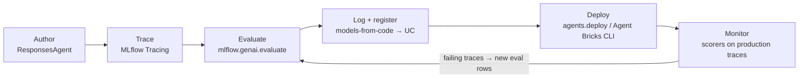
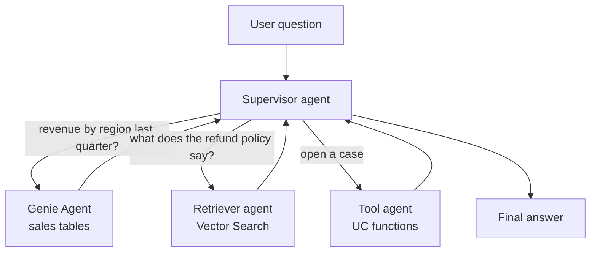

# Sistemas agentic com MLflow, Agent Framework e Genie

## Visão geral

Três itens de Desenvolvimento de aplicações no guia do exame de 2026 abordam agents code-first:
*"Utilize MLflow and Agent Framework for developing agentic systems"*, *"Enable multi-agent
systems to leverage Genie Spaces or conversational API to retrieve data"* e *"Compare the
evaluation and monitoring phases of the Gen AI application life cycle."* Este arquivo mostra como
criar um agent com a interface MLflow `ResponsesAgent`, instrumentá-lo com MLflow Tracing,
combiná-lo com o Genie para dados estruturados e levá-lo da avaliação ao monitoramento.

> [!abstract]
>
> - **Agent Framework + MLflow** — desenvolva o agent em qualquer framework, envolva-o em `mlflow.pyfunc.ResponsesAgent`, rastreie-o com MLflow Tracing, registre-o com *models-from-code* e registre-o no Unity Catalog
> - **Genie para dados estruturados** — um Genie Agent (antigo *Genie Space*) converte perguntas em linguagem natural em SQL sobre tabelas selecionadas; agents acessam-no pela **Genie Conversation API**, por um `GenieAgent` do LangChain ou por um **servidor MCP do Genie**
> - **Padrão multiagente** — um supervisor delega tarefas a workers especializados (Genie para tabelas, agent retriever para documentos, agents com tool calling para ações)
> - **Avalie e depois monitore** — os mesmos scorers do MLflow são executados offline em um conjunto de dados de avaliação e online em traces de produção amostrados

> [!tip] O que o exame avalia
>
> - Qual interface MLflow deve ser subclassificada para um novo agent (`ResponsesAgent`) e por quê (inferência de assinatura, tracing, itens de saída de chamadas a ferramentas)
> - Como o MLflow Tracing captura cada etapa de LLM, retriever e ferramenta, e onde os traces são armazenados
> - Como um sistema multiagente obtém **dados estruturados** do Genie (Genie Agent como subagent ou ferramenta, ou a Conversation API), em vez de um LLM escrever SQL bruto
> - A diferença entre a fase de **avaliação** (pré-implantação, conjunto de dados selecionado, ground truth) e a fase de **monitoramento** (pós-implantação, tráfego ativo, amostragem)

---

> [!note] Atualização da plataforma (out. 2026)
> **Interface de autoria:** o Databricks considera `ChatAgent` e `ChatModel` interfaces de autoria *legacy* e recomenda migrar para **`ResponsesAgent`** ([schema legacy de agents](https://learn.microsoft.com/en-us/azure/databricks/generative-ai/agent-framework/agent-legacy-schema)); o MLflow recomenda `ResponsesAgent` em vez de `ChatModel` desde o MLflow 3.0 ([guia do ChatModel do MLflow](https://mlflow.org/docs/latest/genai/flavors/chat-model-intro/)).
> **Destino da implantação:** em **2026-10-05**, agents implantados no **Model Serving** e o **MLflow AgentServer** passaram para a seção *Legacy* da documentação. Novos agents code-first são estruturados e implantados com o **Agent Bricks CLI** (Beta), que os serve com `DurableAgentServer` no **Agent Runtime** (Databricks Apps) ([Agent Bricks CLI](https://docs.databricks.com/aws/en/agents/custom-agents/agent-bricks-cli), [Implantar agents no Databricks](https://docs.databricks.com/aws/en/agents/deploy/)).
> **Nomenclatura:** *Genie Spaces* foram renomeados **Genie Agents** em 2026-07-08, sem alteração de recursos ([notas de versão de julho de 2026](https://docs.databricks.com/aws/en/release-notes/product/2026/july)).
> O guia do exame (18 de março de 2026) ainda usa os termos *Agent Framework*, *Model Serving* e *Genie Spaces*; o código abaixo usa as interfaces esperadas no exame e indica onde o produto atual é diferente.

## Ciclo de desenvolvimento do agent



## Criar um agent com `ResponsesAgent`

`ResponsesAgent` é uma interface MLflow PyFunc para agents. Você pode manter seu agent em
LangGraph, OpenAI Agents SDK ou Python simples e envolvê-lo com essa interface; o MLflow então
**infere uma assinatura** compatível com `ResponsesAgentRequest` / `ResponsesAgentResponse` e
marca o modelo com a tarefa `agent/v1/responses` ([introdução a ResponsesAgent](https://mlflow.org/docs/latest/genai/flavors/responses-agent-intro/)).

```python
# agent.py — models-from-code file
import mlflow
from mlflow.pyfunc import ResponsesAgent
from mlflow.types.responses import ResponsesAgentRequest, ResponsesAgentResponse

mlflow.openai.autolog()  # trace every LLM call made through the OpenAI client


class SupportAgent(ResponsesAgent):
    def __init__(self, llm_client, tools):
        self.llm = llm_client
        self.tools = tools

    def predict(self, request: ResponsesAgentRequest) -> ResponsesAgentResponse:
        answer = self._run_loop(request.input)  # your own tool-calling loop
        return ResponsesAgentResponse(
            output=[self.create_text_output_item(text=answer, id="msg_1")]
        )


mlflow.models.set_model(SupportAgent(llm_client=..., tools=...))
```

Principais recursos da interface:

| Recurso | Como funciona |
| :--- | :--- |
| Respostas sem streaming | Implemente `predict(request) -> ResponsesAgentResponse` |
| Streaming | Implemente `predict_stream(request)` para produzir `ResponsesAgentStreamEvent` (deltas de texto e, em seguida, `response.output_item.done`) |
| Chamadas a ferramentas na saída | Helpers `create_function_call_item(...)` e `create_function_call_output_item(...)` |
| Entradas/saídas adicionais | Campos `custom_inputs` e `custom_outputs` (por exemplo, `session_id`, links de origem) |
| Independente de framework | Envolva um agent LangGraph ou OpenAI Agents SDK existente dentro de `predict` |

### Registrar e catalogar o agent

Use **models-from-code**: passe o *caminho do arquivo* do agent e declare todos os recursos do
Databricks chamados pelo agent para que a implantação possa provisionar credenciais (consulte
[Controle de acesso e inferência em lote](../02-assembling-and-deploying-apps/05-access-control-and-batch-inference.md)).

```python
import mlflow
from mlflow.models.resources import DatabricksServingEndpoint, DatabricksGenieSpace

mlflow.set_registry_uri("databricks-uc")

with mlflow.start_run():
    info = mlflow.pyfunc.log_model(
        name="agent",
        python_model="agent.py",  # models-from-code
        resources=[
            DatabricksServingEndpoint(endpoint_name="databricks-claude-sonnet-4-5"),
            DatabricksGenieSpace(genie_space_id="<space-id>"),
        ],
        registered_model_name="main.agents.support_agent",
    )
```

## Rastrear sistemas agentic com MLflow

O MLflow Tracing registra cada etapa executada por um agent — chamadas ao LLM, recuperações e
chamadas a ferramentas — como uma árvore de **spans** dentro de um **trace**. Os scorers de
avaliação e o monitoramento de produção leem esses traces ([página conceitual de scorers](https://docs.databricks.com/aws/en/mlflow3/genai/eval-monitor/concepts/scorers)).

| Instrumentação | Uso |
| :--- | :--- |
| **Autologging** — `mlflow.langchain.autolog()`, `mlflow.openai.autolog()` | Uma linha cria traces para cada chamada feita por uma biblioteca compatível |
| **Decorator `@mlflow.trace`** | Envolve suas próprias funções (ferramentas personalizadas, lógica de roteamento) |
| **Gerenciador de contexto `mlflow.start_span()`** | Spans detalhados dentro de uma função |

```python
import mlflow

@mlflow.trace(span_type="TOOL")
def lookup_order(order_id: str) -> dict:
    ...

@mlflow.trace(span_type="RETRIEVER")
def search_docs(query: str) -> list[dict]:
    ...
```

Ler um trace responde às perguntas de depuração comuns no exame: *qual etapa foi lenta*, *qual
ferramenta retornou dados incorretos*, *o retriever retornou os chunks certos* e *quantos tokens
cada chamada ao LLM usou*.

## Sistemas multiagente com Genie

Um **Genie Agent** (chamado *Genie Space* no guia do exame) é um conjunto selecionado de até 50
tabelas, views ou metric views do Unity Catalog, além de instruções e exemplos de consulta. O Genie
escreve e executa SQL para perguntas em linguagem natural, aplicando as permissões do Unity Catalog
a cada solicitação ([servidor MCP do Genie Agent](https://docs.databricks.com/aws/en/agents/mcp-tools/genie-agent)). Em um sistema multiagente, o Genie é o **especialista em dados estruturados**: é mais confiável do que um LLM escrevendo SQL bruto para tabelas que nunca viu.



### Três formas de um agent acessar o Genie

| Opção | Como funciona | Escolha quando |
| :--- | :--- | :--- |
| **Genie Conversation API** (REST) | `POST /api/2.0/genie/spaces/{space_id}/start-conversation`; depois, chamadas subsequentes em `.../conversations/{conversation_id}/messages`; consulte a mensagem até `COMPLETED` e, então, obtenha o resultado SQL do anexo `query-result` | Seu próprio app, bot ou agent precisa de conversas com estado e perguntas de acompanhamento |
| **`GenieAgent` em um supervisor LangGraph** | `from databricks_langchain.genie import GenieAgent` envolve um Genie Agent como nó worker; declare `DatabricksGenieSpace(genie_space_id=...)` como recurso registrado | Sistema multiagente code-first com LangGraph |
| **Servidor MCP do Genie** | Genie Agent MCP: `https://<host>/api/2.0/mcp/genie/{genie_space_id}`; Genie One MCP para todo o workspace: `system.ai.genie_one_mcp` via Unity Gateway | Agents nativos de MCP e assistentes de programação — consulte [Servidores MCP](../02-assembling-and-deploying-apps/04-mcp-servers.md) |

Caminhos de API verificados na [referência da API Genie](https://docs.databricks.com/api/workspace/genie/startconversation) e em [Usar a API Genie Agents](https://docs.databricks.com/aws/en/genie-agents/conversation-api).

```python
from databricks_langchain.genie import GenieAgent

sales_genie = GenieAgent(
    genie_space_id="<space-id>",
    genie_agent_name="sales_analyst",
    description="Answers questions about bookings, revenue, and pipeline from the sales tables.",
)
# Add sales_genie as a worker node in a LangGraph supervisor graph,
# then wrap the compiled graph in a ResponsesAgent for logging and deployment.
```

O [notebook multiagente do Databricks com Genie](https://docs.databricks.com/aws/en/notebooks/source/generative-ai/langgraph-multiagent-genie.html) segue exatamente esse padrão: `langgraph-supervisor` para roteamento, workers `GenieAgent` e um wrapper `ResponsesAgent`.

### Boas práticas da Conversation API (segundo a documentação)

- Requer pelo menos **CAN VIEW** no Genie Agent
- **Consulte o estado** a cada 1–5 segundos com recuo exponencial; pare após cerca de 10 minutos
- **Inicie uma conversa nova por sessão do usuário** — reutilizar threads entre sessões reduz a precisão
- Respeite o limite de **200 000 conversas** por Genie Agent, excluindo conversas antigas
- Implemente novas tentativas com recuo exponencial — a API não faz novas tentativas por você

### Permissões: de quem são os dados retornados pelo Genie?

Use a autorização **on-behalf-of-user (OBO)** quando cada usuário puder ver somente as linhas às
quais tem direito; nesse caso, o Genie é executado com as permissões do usuário final ([Genie
multiagente, Model Serving](https://docs.databricks.com/aws/en/agents/custom-agents/model-serving/multi-agent-genie)). Com autorização de app ou service principal, todos os usuários veem o que o service principal pode ver.

## Fase de avaliação vs. fase de monitoramento

Item do guia do exame: *"Compare the evaluation and monitoring phases of the Gen AI application life cycle."*

| Dimensão | Avaliação (pré-implantação) | Monitoramento (pós-implantação) |
| :--- | :--- | :--- |
| **Pergunta respondida** | Esta versão está pronta para ser lançada? A v2 é melhor que a v1? | A aplicação em operação continua boa? O que está falhando agora? |
| **Dados** | **Conjunto de dados de avaliação** selecionado, frequentemente com **expectativas** de referência | **Traces de produção ativos** — a maioria das solicitações não tem ground truth |
| **Cobertura** | Cada linha do conjunto de dados | Uma **amostra** do tráfego (`sample_rate`), 100 % para verificações críticas de segurança |
| **Scorers** | Qualquer judge, inclusive judges com ground truth (`Correctness`, `RetrievalSufficiency`) | Judges que não precisam de ground truth (`Safety`, `RelevanceToQuery`, `RetrievalGroundedness`, `Guidelines`) e scorers baseados em código |
| **API** | `mlflow.genai.evaluate(data=..., predict_fn=..., scorers=[...])` | `scorer.register(...)` e, em seguida, `.start(sampling_config=...)` no experimento |
| **Também acompanhado** | Qualidade em relação à linha de base, gates de regressão no CI | Latência, erros, uso de tokens e custo (inference tables, tabelas de sistema de uso) |
| **Participação humana** | Especialistas no assunto (SMEs) rotulam o conjunto de dados e calibram os judges | Feedback dos usuários e análise de traces sinalizados por SMEs |

As duas fases formam um loop: os problemas encontrados no monitoramento tornam-se novas linhas de
avaliação, e os **mesmos scorers** são reutilizados em ambas para que os resultados continuem
comparáveis ([monitoramento de produção](https://docs.databricks.com/aws/en/mlflow3/genai/eval-monitor/production-monitoring)). Os detalhes estão em [Scorers, judges e feedback de SMEs do MLflow](../05-evaluation-and-monitoring/03-mlflow-scorers-judges-and-feedback.md).

## Casos de uso

- **Assistente de analytics e políticas** — um supervisor direciona perguntas sobre métricas a um Genie Agent e perguntas sobre políticas a um retriever do Vector Search e, depois, combina as respostas
- **Bot do Teams ou Slack com Genie** — o backend do bot chama a Genie Conversation API, inicia uma conversa nova por sessão de chat e consulta o estado até obter os resultados
- **Depuração de um agent lento** — o trace mostra uma chamada de ferramenta que leva 6 s; a equipe armazena a consulta em cache e reduz o P95
- **Gate de promoção** — `mlflow.genai.evaluate()` é executado no CI a cada alteração do agent; a implantação só prossegue se a correção e a fundamentação superarem a versão atual em produção

## Problemas e erros comuns

### Agent escreve SQL incorreto para tabelas brutas

**Cenário:** um agent com tool calling gera SQL diretamente e faz join com as tabelas erradas.
**Correção:** delegue perguntas estruturadas a um **Genie Agent** selecionado (instruções, exemplos de SQL e metric views), acessado como subagent, worker `GenieAgent` ou servidor MCP do Genie.

### Resultados do Genie ignoram a segurança em nível de linha

**Cenário:** todos os usuários veem a receita de todas as regiões pelo agent.
**Correção:** o agent está chamando o Genie com um service principal compartilhado. Mude para a autorização **on-behalf-of-user** para que o Genie seja executado com as permissões de cada usuário final.

### Traces ausentes após a implantação

**Cenário:** os traces aparecem durante o desenvolvimento, mas não para o agent implantado.
**Correção:** confirme se o autologging ou `@mlflow.trace` está no próprio arquivo models-from-code (e não somente no notebook) e se a implantação aponta para um experimento MLflow no qual a identidade do agent pode gravar.

## Dicas para o exame

> [!tip] Dicas para o exame
>
> - Agent novo → **`ResponsesAgent`**. `ChatAgent` e `ChatModel` são interfaces legacy que ainda podem aparecer nos enunciados.
> - **Models-from-code**: `mlflow.pyfunc.log_model(python_model="agent.py", resources=[...])` e depois registre em `catalog.schema.model`.
> - **Dados estruturados em um sistema multiagente → Genie** (como subagent, `GenieAgent`, Conversation API ou MCP). Para documentos não estruturados, use um retriever.
> - Conversation API: `start-conversation` → consulte o estado da mensagem → obtenha o resultado da consulta; **inicie uma conversa nova por sessão**.
> - **Avaliação** = conjunto de dados selecionado + ground truth antes do lançamento; **monitoramento** = traces ativos amostrados após o lançamento; os mesmos scorers são usados nas duas fases.

## Principais conclusões

- `ResponsesAgent` é a interface MLflow recomendada para agents; o MLflow infere sua assinatura e oferece suporte a streaming e itens de saída de chamadas a ferramentas
- MLflow Tracing (autolog, `@mlflow.trace`, spans) é a base para depuração, avaliação e monitoramento
- Genie Agents (antigos Genie Spaces) oferecem aos agents acesso governado em linguagem natural a dados estruturados via Conversation API, `GenieAgent` ou MCP
- Sistemas multiagente usam um supervisor para direcionar solicitações a workers especializados
- Avaliação e monitoramento diferem nos dados, na cobertura e no ground truth, mas compartilham scorers e formam um loop de feedback

## Tópicos relacionados

- [Chains e agents de LLM](./02-chains-agents.md)
- [Agent Bricks](../03-design-applications/03-agent-bricks.md)
- [MLflow para GenAI](../02-assembling-and-deploying-apps/02-mlflow-for-genai.md)
- [Servidores MCP](../02-assembling-and-deploying-apps/04-mcp-servers.md)
- [Scorers, judges e feedback de SMEs do MLflow](../05-evaluation-and-monitoring/03-mlflow-scorers-judges-and-feedback.md)

## Documentação oficial

- [Introdução a ResponsesAgent (MLflow)](https://mlflow.org/docs/latest/genai/flavors/responses-agent-intro/)
- [Schema legacy de entrada e saída de agents](https://learn.microsoft.com/en-us/azure/databricks/generative-ai/agent-framework/agent-legacy-schema)
- [Usar a API Genie Agents](https://docs.databricks.com/aws/en/genie-agents/conversation-api)
- [Usar Genie em sistemas multiagente (Model Serving, legacy)](https://docs.databricks.com/aws/en/agents/custom-agents/model-serving/multi-agent-genie)
- [Implantar agents no Databricks](https://docs.databricks.com/aws/en/agents/deploy/)
- [Configurar monitoramento de produção](https://docs.databricks.com/aws/en/mlflow3/genai/eval-monitor/production-monitoring)

---

**[← Anterior: Vector Search em produção](./04-vector-search-runtime.md) | [↑ Voltar para Desenvolvimento de aplicações](./README.md) | [Próximo: Seleção de modelos e qualidade das respostas](./06-model-selection-and-response-quality.md) →**
