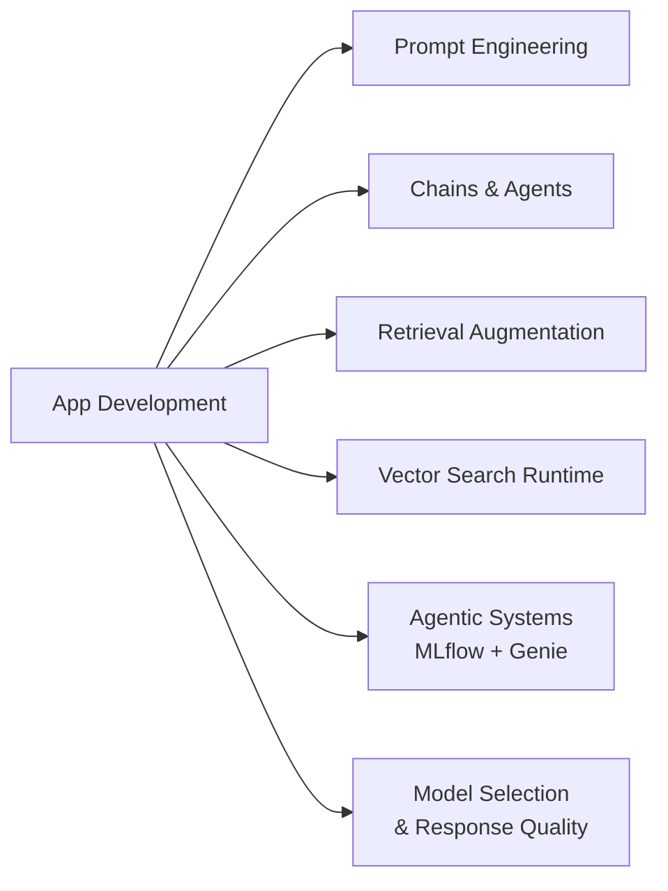

# Desenvolvimento de aplicações (30 % do exame)

O maior domínio do guia do exame (Seção 3). Abrange como **escrever** aplicações de GenAI no Databricks — engenharia de prompts, chains e agents, augmentação de recuperação, busca vetorial em tempo de execução, sistemas agentic com abordagem code-first usando MLflow e o Agent Framework, acesso multiagente ao Genie e escolha de modelos com base em evidências.

## Visão geral dos tópicos

## Conteúdo da seção

| Arquivo | Tópico | Prioridade |
| :--- | :--- | :--- |
| [01-prompt-engineering.md](./01-prompt-engineering.md) | Padrões de prompt, few-shot, saída estruturada, prompt injection, fundamentos do Prompt Registry | Alta |
| [02-chains-agents.md](./02-chains-agents.md) | Chains LangChain / LCEL, agents, tool calling, ReAct | Alta |
| [03-retrieval-augmentation-strategies.md](./03-retrieval-augmentation-strategies.md) | Busca híbrida, reescrita de consultas, filtros de metadados, augmentação de prompts com base na intenção do usuário | Alta |
| [04-vector-search-runtime.md](./04-vector-search-runtime.md) | Recuperação em produção: HNSW, dimensionamento de endpoints, reindexação, latência, custo | Alta |
| [05-agentic-systems-mlflow-and-genie.md](./05-agentic-systems-mlflow-and-genie.md) | `ResponsesAgent`, MLflow Tracing, sistemas multiagente com Genie (Conversation API, `GenieAgent`, MCP), fases de avaliação e monitoramento *(guia de 2026)* | Alta |
| [06-model-selection-and-response-quality.md](./06-model-selection-and-response-quality.md) | Escolha de LLMs, comprimento de contexto de embeddings, model cards, seleção com base em métricas, chunking a partir da avaliação, análise qualitativa *(guia de 2026)* | Alta |

## Cobertura do guia do exame

| Item do guia do exame (Seção 3) | Onde é abordado |
| :--- | :--- |
| Selecionar ferramentas LangChain ou similares para uso em uma aplicação de IA generativa | [02](./02-chains-agents.md) |
| Avaliar qualitativamente as respostas para identificar problemas comuns, como qualidade e segurança | [06](./06-model-selection-and-response-quality.md#avaliar-respostas-qualitativamente) |
| Selecionar uma estratégia de chunking com base no modelo e na avaliação da recuperação | [06](./06-model-selection-and-response-quality.md#selecionar-uma-estratégia-de-chunking-com-base-nos-resultados-da-avaliação) |
| Aumentar um prompt com contexto adicional da entrada do usuário, com base em campos-chave, termos e intenções | [03](./03-retrieval-augmentation-strategies.md) |
| Criar um prompt que ajuste a resposta de um LLM, partindo de uma resposta-base até chegar à saída desejada | [01](./01-prompt-engineering.md) |
| Implementar guardrails de LLM para evitar resultados negativos | [01](./01-prompt-engineering.md), [Governança](../06-governance/01-governance-overview.md) |
| Selecionar o melhor LLM com base nos atributos da aplicação a ser desenvolvida | [06](./06-model-selection-and-response-quality.md#selecionar-o-melhor-llm-para-a-aplicação) |
| Selecionar o comprimento de contexto de um modelo de embedding com base nos documentos de origem, nas consultas esperadas e na estratégia de otimização | [06](./06-model-selection-and-response-quality.md#selecionar-o-comprimento-de-contexto-de-um-modelo-de-embedding) |
| Selecionar um modelo em um hub ou marketplace para uma tarefa, com base nos metadados ou model cards | [06](./06-model-selection-and-response-quality.md#selecionar-um-modelo-de-um-hub-ou-marketplace-usando-model-cards) |
| Selecionar o melhor modelo para uma tarefa com base em métricas comuns geradas em experimentos | [06](./06-model-selection-and-response-quality.md#selecionar-o-melhor-modelo-com-base-em-métricas-de-experimentos) |
| Utilizar MLflow e Agent Framework para desenvolver sistemas agentic | [05](./05-agentic-systems-mlflow-and-genie.md) |
| Comparar as fases de avaliação e monitoramento do ciclo de vida de uma aplicação de GenAI | [05](./05-agentic-systems-mlflow-and-genie.md#fase-de-avaliação-vs-fase-de-monitoramento) |
| Permitir que sistemas multiagente usem Genie Spaces ou a API conversacional para recuperar dados | [05](./05-agentic-systems-mlflow-and-genie.md#sistemas-multiagente-com-genie) |

## Conceitos-chave

| Conceito | Por que é importante |
| :--- | :--- |
| **Engenharia de prompts** | Prompts estruturados (turnos de system / user / assistant) e exemplos few-shot moldam o comportamento do modelo |
| **Tool calling / function calling** | Permite que o LLM escolha qual ferramenta chamar (função, API, retriever) — a base dos agents |
| **Chain vs Agent** | Chains são pipelines fixos; agents são loops conduzidos por LLM que decidem a próxima etapa |
| **`ResponsesAgent`** | A interface MLflow recomendada para agents; `ChatAgent` / `ChatModel` são legados |
| **Genie para dados estruturados** | Sistemas multiagente delegam perguntas sobre tabelas a um Genie Agent (antigo Genie Space) |
| **Busca híbrida e re-ranking** | Recuperação por palavras-chave e vetores, seguida de um re-ranker para melhorar a precisão no topo |
| **Escolha de modelo baseada em evidências** | Mesmo conjunto de dados e mesmos scorers para todos os candidatos; escolha o modelo mais barato que atenda aos requisitos |

## Recursos relacionados

- [Fundamentos de RAG / Vector Search (compartilhado)](../../../../../shared/fundamentals/rag-vector-search-basics.md)
- [Documentação das Mosaic AI Foundation Model APIs](https://docs.databricks.com/en/machine-learning/foundation-models/index.html)
- [Documentação do Databricks AI Search (antigo Vector Search)](https://docs.databricks.com/aws/en/ai-search/ai-search)
- [Desenvolvimento de agents no Databricks](https://docs.databricks.com/aws/en/agents/)

---

**[↑ Voltar para GenAI Engineer Associate](../README.md) | [Próximo: Montagem e implantação de aplicações](../02-assembling-and-deploying-apps/README.md) →**
