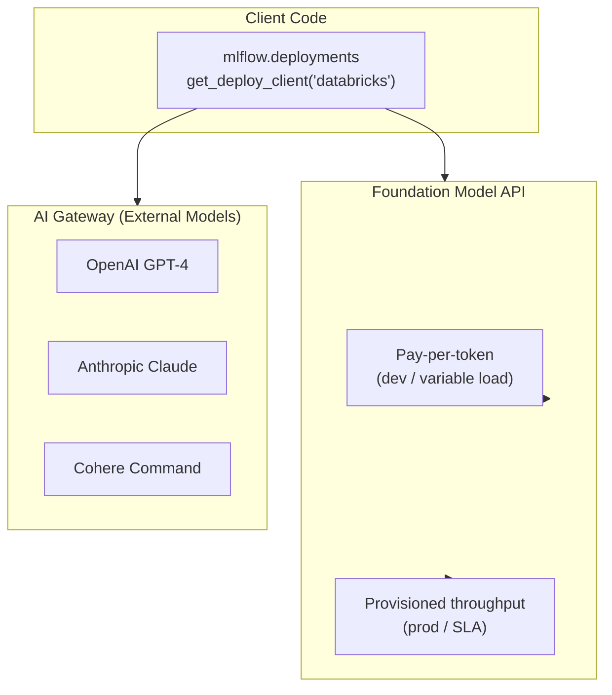

# Mosaic AI e Foundation Models

Mosaic AI é a marca que reúne a plataforma de IA/ML do Databricks. Este arquivo aborda as **Foundation Model APIs** — LLMs e modelos de embedding hospedados pelo Databricks — e o **AI Gateway** (External Models), que encaminha solicitações a provedores terceirizados.

## Diagrama geral



## Foundation Model APIs

As **Foundation Model APIs** fornecem acesso a LLMs e modelos de embedding hospedados pelo Databricks e totalmente gerenciados. Não é necessário provisionar clusters; o modelo é executado na infraestrutura compartilhada do Databricks.

### Modos de preço

| Modo | Como funciona | Ideal para |
| ---- | ------------ | --------- |
| **Pagamento por token** | Cobrança por token de entrada/saída; capacidade compartilhada entre clientes; início imediato | Desenvolvimento, testes, aplicações com pouco tráfego |
| **Throughput provisionado** | Computação reservada; latência previsível; tokens por minuto (TPM) garantidos; cobrança por minuto | Produção, aplicações com SLA, tráfego consistente |

**Dica para o exame**: o exame cobra a diferença entre esses dois modos. Principais distinções:

- Pagamento por token: **sem configuração**, **latência variável**, **menor custo com baixo volume**
- Provisionado: **capacidade reservada**, **garantias de SLA**, **custo fixo mais alto**

### Endpoints relevantes para o exame

| Nome do endpoint | Tipo | Caso de uso |
| ------------- | ---- | ----------- |
| `databricks-meta-llama-3-3-70b-instruct` | LLM de chat | Seguir instruções gerais, geração para RAG |
| `databricks-meta-llama-3-1-8b-instruct` | LLM de chat (menor) | Menor latência, tarefas sensíveis a custo |
| `databricks-claude-sonnet-4-5`, `databricks-gpt-5-mini`, … | LLM de chat (hospedado por parceiros) | Qualidade de ponta pela mesma API |
| `databricks-gte-large-en` | Embedding | Embeddings de texto para busca vetorial |
| `databricks-bge-large-en` | Embedding | Modelo de embedding alternativo |

**Regra de consistência dos embeddings**: use sempre o **mesmo modelo de embedding** ao criar o índice e ao consultar. Misturar modelos compromete os resultados da busca por similaridade.

> [!note] Atualização da plataforma (out. de 2026)
> A lista de modelos hospedados muda com frequência e os modelos são retirados de uso de forma programada — por exemplo, `databricks-meta-llama-3-1-70b-instruct`, usado em exemplos de código mais antigos deste guia, não consta mais na lista de modelos compatíveis. Consulte [Modelos foundation compatíveis](https://docs.databricks.com/aws/en/machine-learning/foundation-model-apis/supported-models) antes de escolher um nome de endpoint. Os modelos hospedados pelo Databricks também são expostos como **model services** do Unity Catalog no schema `system.ai` e governados pelo **Unity Gateway** ([Governança de IA com Unity Gateway](https://docs.databricks.com/aws/en/ai-gateway/)).

### Consultar Foundation Models

Todos os endpoints das Foundation Model APIs usam o mesmo cliente `mlflow.deployments`:

```python
import mlflow.deployments

client = mlflow.deployments.get_deploy_client("databricks")

# Chat completion

response = client.predict(
    endpoint="databricks-meta-llama-3-1-70b-instruct",
    inputs={
        "messages": [
            {"role": "system", "content": "You are a helpful assistant."},
            {"role": "user",   "content": "Summarise the Delta Lake documentation."},
        ],
        "temperature": 0.1,
        "max_tokens": 512,
    },
)
answer = response["choices"][0]["message"]["content"]

# Embedding

embed_response = client.predict(
    endpoint="databricks-gte-large-en",
    inputs={"input": ["Delta Lake is an open-source storage layer."]},
)
vector = embed_response["data"][0]["embedding"]
```

## Modelos externos (AI Gateway)

**External Models** permitem encaminhar solicitações a LLMs de terceiros por meio da infraestrutura de serving do Databricks. O endpoint do Databricks atua como proxy e oferece:

- **Autenticação unificada**: credenciais para OpenAI, Anthropic, Cohere armazenadas com segurança nos secrets do Databricks; o código cliente nunca lida diretamente com chaves de API
- **Limitação de taxa**: limites de tokens por usuário ou endpoint evitam custos descontrolados
- **Acompanhamento de uso**: contagens de tokens e solicitante por chamada na tabela de sistema `system.serving.endpoint_usage`
- **Registro de payloads**: solicitações e respostas capturadas em uma tabela de inferência (consulte [AI Gateway: acompanhamento de uso e controle de custos](../05-evaluation-and-monitoring/04-ai-gateway-usage-and-cost-control.md))

### Consultar um modelo externo

Depois que um administrador cria um endpoint External Model na interface do Databricks ou pela API REST, o código cliente usa a mesma interface `mlflow.deployments`:

```python
from mlflow.deployments import get_deploy_client

client = get_deploy_client("databricks")

# Query an OpenAI GPT-4 endpoint routed through AI Gateway

response = client.predict(
    endpoint="my-openai-gpt4-endpoint",   # External model endpoint name
    inputs={
        "messages": [{"role": "user", "content": "What is vector search?"}],
        "max_tokens": 200,
    },
)
print(response["choices"][0]["message"]["content"])
```

**Dica para o exame**: o código cliente não muda entre endpoints das Foundation Model APIs e endpoints External Model. A única diferença é o nome do `endpoint`. Esse é o principal benefício da abstração do AI Gateway.

### Limitação de taxa

Os limites de taxa são configurados no nível do endpoint como consultas por minuto (QPM) e/ou tokens por minuto (TPM):

| Escopo | Configuração | Efeito |
| ----- | ------------- | ------ |
| Por endpoint | QPM / TPM para todos os solicitantes em conjunto | Limita o gasto total em um único endpoint |
| Por usuário (padrão) | QPM / TPM por usuário do Databricks | Evita uso excessivo por uma pessoa |
| Personalizado | Usuários, service principals ou grupos específicos | Limites por usuário têm precedência sobre limites de grupo |

Quando um limite de taxa é excedido, a API retorna HTTP `429 Too Many Requests`.

## Model Serving para modelos personalizados

Além das Foundation Model APIs, o Databricks Model Serving implanta LLMs personalizados ou modelos ajustados como endpoints REST:

```python
# After logging a custom model with MLflow:

import mlflow

with mlflow.start_run():
    mlflow.pyfunc.log_model(
        artifact_path="custom_llm",
        python_model=MyFineTunedModel(),
        input_example={"messages": [{"role": "user", "content": "Hello"}]},
    )

# Register in Unity Catalog

mlflow.register_model(
    model_uri="runs:/<run_id>/custom_llm",
    name="catalog.schema.my_fine_tuned_llm",
)
```

Depois de registrado, implante-o pela interface do Databricks (Serving > Create Endpoint > Unity Catalog model) ou pela API REST. O endpoint resultante é consultado com o mesmo cliente `mlflow.deployments`.

## Fundamentos de fine-tuning de LLMs

O Databricks oferece fine-tuning de Foundation Models pela interface Mosaic AI Training. Fatos importantes para o exame:

- O fine-tuning é iniciado pela interface do Databricks ou pelo SDK `databricks.model_training`
- Os dados de treinamento devem estar no formato JSONL (formato de chat completions: mensagens com funções)
- O resultado é um novo modelo registrado no Unity Catalog, pronto para implantação como endpoint do Model Serving
- Casos de uso: terminologia específica do domínio, formato de saída consistente, menor necessidade de engenharia de prompts

```text
Fine-tuning workflow:
  1. Prepare training data (JSONL in Unity Catalog volume)
  2. Launch training job (UI or SDK)
  3. MLflow auto-logs training metrics (loss, eval perplexity)
  4. Output model registered to Unity Catalog
  5. Deploy as Model Serving endpoint
```

## Comparação de padrões de acesso

| Cenário | Abordagem recomendada |
| -------- | -------------------- |
| Protótipo com o LLM mais recente | Foundation Model API — pagamento por token |
| RAG em produção com SLA | Foundation Model API — throughput provisionado |
| A empresa exige OpenAI GPT-4 | External Model pelo AI Gateway |
| Modelo personalizado ajustado | Endpoint do Model Serving (personalizado) |
| Embedding para Vector Search | Endpoint de embedding das Foundation Model APIs |

## Questões de prática

> [!success]- Questão 1
> **P:** Uma equipe de dados está criando um protótipo RAG e espera um volume baixo e esporádico de consultas durante o desenvolvimento. Qual modo de preço das Foundation Model APIs é mais adequado?
>
> A) Throughput provisionado — para garantir latência
> B) Pagamento por token — para iniciar imediatamente e reduzir custos com baixo volume
> C) External Models — para evitar totalmente os custos do Databricks
> D) Endpoint de modelo ajustado — para obter precisão específica do domínio
>
> **Resposta correta: B**
>
> O pagamento por token não exige configuração, começa imediatamente e custa menos com baixo volume de consultas. O throughput provisionado é cobrado por minuto, independentemente do uso — caro para cargas esporádicas. External Models adicionam complexidade sem benefício para um protótipo. Fine-tuning é um fluxo de trabalho separado, sem relação com o modo de preço.

---

> [!success]- Questão 2
> **P:** Qual é o principal benefício de segurança de usar o AI Gateway (External Models) para acessar a API da OpenAI, em vez de chamar a OpenAI diretamente no código do notebook?
>
> A) O AI Gateway traduz prompts automaticamente para torná-los mais eficazes para o GPT-4
> B) As credenciais da API da OpenAI são armazenadas nos secrets do Databricks e nunca ficam expostas ao código do usuário
> C) Endpoints External Model contornam os limites de taxa impostos pela OpenAI
> D) O AI Gateway armazena respostas em cache, reduzindo a latência de consultas repetidas
>
> **Resposta correta: B**
>
> O AI Gateway armazena credenciais dos provedores (chaves de API) nos secrets do Databricks e as injeta no lado do servidor. O código do usuário autentica-se apenas no Databricks, nunca diretamente na OpenAI. O Gateway não modifica prompts, não contorna limites de taxa de terceiros e não armazena respostas em cache (cache não é um recurso documentado do AI Gateway).

---

> [!success]- Questão 3
> **P:** Uma equipe usa `databricks-gte-large-en` para gerar embeddings de documentos ao criar um índice do Vector Search. Depois, ela passa a usar `databricks-bge-large-en` apenas para os embeddings das consultas. Qual é o resultado?
>
> A) O desempenho das consultas melhora porque bge-large-en produz embeddings de maior qualidade
> B) O sistema gera novamente os embeddings do índice automaticamente para corresponder ao novo modelo
> C) Os resultados da busca por similaridade ficam comprometidos porque os vetores do índice e da consulta pertencem a espaços de embedding diferentes
> D) O endpoint do Vector Search gera um erro e recusa as consultas
>
> **Resposta correta: C**
>
> Modelos de embedding diferentes produzem vetores em espaços de alta dimensão diferentes. A similaridade de cosseno entre vetores de modelos distintos não tem significado. A regra de consistência dos embeddings exige o mesmo modelo na criação do índice e no momento da consulta. O sistema não gera os embeddings novamente de forma automática nem retorna um erro explícito; a qualidade da consulta piora silenciosamente.

## Casos de uso

- **Prototipagem rápida com pagamento por token**: usar uma Foundation Model API com cobrança por token para criar e testar rapidamente um protótipo RAG sem provisionar clusters de GPU e, depois, mudar para throughput provisionado quando os padrões de tráfego forem conhecidos.
- **Gateway unificado de LLMs de vários provedores**: encaminhar solicitações para OpenAI, Anthropic e modelos Llama open source pelo AI Gateway (External Models), fornecendo uma única camada de autenticação, limitação de taxa centralizada e registro de auditoria unificado entre os provedores.

## Problemas e erros comuns

### Limite de taxa da Foundation Model API excedido

**Cenário:** um pico de consultas dos usuários provoca erros 429 (limite de taxa) na Foundation Model API, descartando solicitações e prejudicando a experiência do usuário.
**Correção:** para desenvolvimento e tráfego variável, implemente novas tentativas no cliente com recuo exponencial. Para cargas de produção com necessidades previsíveis de throughput, troque o pagamento por token pelo throughput provisionado para garantir uma alocação reservada de tokens por minuto com latência respaldada por SLA.

### AI Gateway retorna formato de saída inesperado do modelo

**Cenário:** trocar um modelo hospedado pelo Databricks por um modelo externo via AI Gateway altera a estrutura da resposta e interrompe a lógica de análise posterior.
**Correção:** o AI Gateway padroniza o formato da resposta para chat completions compatíveis com OpenAI. Garanta que o código leia `response["choices"][0]["message"]["content"]`, independentemente do provedor subjacente. Faça um teste com uma solicitação de exemplo após qualquer alteração na configuração do endpoint.

## Principais conclusões

- **Foundation Model API**: LLMs e modelos de embedding hospedados pelo Databricks — sem provisionamento de clusters; usa uma API compatível com OpenAI
- **Pagamento por token**: preços variáveis conforme o uso — adequado para desenvolvimento e tráfego imprevisível
- **Throughput provisionado**: capacidade reservada de tokens por minuto com SLA garantido — necessário para compromissos de latência em produção
- **AI Gateway (External Models)**: encaminha solicitações para OpenAI, Anthropic e Cohere por um único endpoint gerenciado pelo Databricks, com autenticação unificada, limitação de taxa e registro
- **`mlflow.deployments.get_deploy_client("databricks")`**: cliente para chamar endpoints das Foundation Model APIs programaticamente
- **Modelos open source no Databricks**: Llama, DBRX, Mixtral disponíveis como endpoints das Foundation Model APIs — sem precisar de cluster GPU
- **Alternar entre pagamento por token e provisionado**: altere apenas o nome do endpoint no código — a interface da API é idêntica

---

**[↑ Voltar para Montagem e implantação de aplicações](./README.md) | [Próximo: MLflow para GenAI](./02-mlflow-for-genai.md) →**
