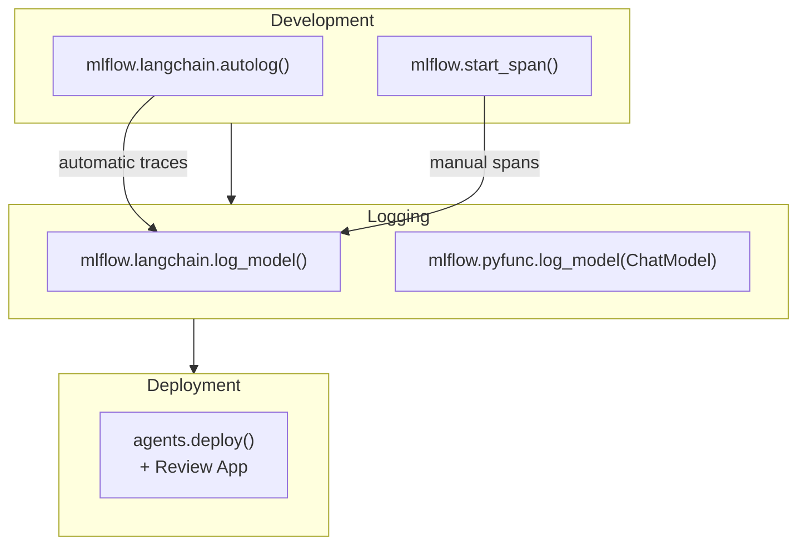

# MLflow para GenAI

O MLflow estende seus recursos de acompanhamento e implantação para GenAI com três adições
principais: **Tracing** para depurar cadeias de chamadas de LLM, **`pyfunc.ChatModel`** como
interface padrão para agents personalizados e **`agents.deploy()`** para implantação no Model
Serving com uma Review App integrada.

## Diagrama geral

> [!note] Atualização da plataforma (out. 2026)
> **`ChatModel` e `ChatAgent` são interfaces de autoria legacy.** O MLflow recomenda `ResponsesAgent` em vez de `ChatModel` desde o MLflow 3.0, e o Databricks recomenda migrar agents para o schema `ResponsesAgent` ([guia do ChatModel do MLflow](https://mlflow.org/docs/latest/genai/flavors/chat-model-intro/), [schema legacy de agents](https://learn.microsoft.com/en-us/azure/databricks/generative-ai/agent-framework/agent-legacy-schema)). Agents implantados no Model Serving com `agents.deploy()` são classificados como legacy na documentação desde 2026-10-05; novos agents usam o Agent Bricks CLI e o Agent Runtime. O exemplo de `ChatModel` abaixo foi mantido porque mostra claramente o padrão *“modelo pyfunc com pré e pós-processamento”* cobrado no exame; consulte [Sistemas agentic com MLflow, Agent Framework e Genie](../01-application-development/05-agentic-systems-mlflow-and-genie.md) para ver o equivalente com `ResponsesAgent`.



## MLflow Tracing

O **MLflow Tracing** captura as entradas, saídas e latência de cada chamada ao LLM e etapa de
recuperação como uma árvore hierárquica de **spans**. Os traces são exibidos na aba Trace da
interface do MLflow.

### Tracing automático com autolog

```python
import mlflow

# Enable automatic tracing for all LangChain calls

mlflow.langchain.autolog()

# Now any chain.invoke() call is automatically traced

response = rag_chain.invoke({"question": "What is Delta Lake?"})

# Traces appear in the active MLflow experiment's Trace tab

```

`autolog()` captura:

- Template do prompt renderizado com os valores das variáveis
- Endpoint de LLM chamado e parâmetros utilizados
- Texto da resposta do LLM e contagens de tokens
- Entradas do retriever e número de documentos retornados
- Latência total de relógio de parede por etapa

### Tracing manual com spans

Para código personalizado não coberto pelo autolog, use gerenciadores de contexto para criar spans manualmente:

```python
import mlflow
from databricks.vector_search.client import VectorSearchClient

vs_client = VectorSearchClient()
index = vs_client.get_index(
    endpoint_name="my_vs_endpoint",
    index_name="catalog.schema.docs_index",
)


def retrieve_and_answer(question: str) -> str:
    with mlflow.start_span("rag-pipeline") as root_span:
        root_span.set_inputs({"question": question})

        # Child span for retrieval
        with mlflow.start_span("retrieval") as retrieval_span:
            results = index.similarity_search(
                query_text=question,
                columns=["content"],
                num_results=5,
            )
            rows = results.get("result", {}).get("data_array", [])
            retrieval_span.set_inputs({"query": question})
            retrieval_span.set_outputs({"num_results": len(rows)})

        context = "\n".join(row[0] for row in rows)

        # Child span for generation
        with mlflow.start_span("generation") as gen_span:
            import mlflow.deployments
            client = mlflow.deployments.get_deploy_client("databricks")
            response = client.predict(
                endpoint="databricks-meta-llama-3-1-70b-instruct",
                inputs={
                    "messages": [
                        {"role": "system", "content": f"Context:\n{context}"},
                        {"role": "user",   "content": question},
                    ],
                    "temperature": 0,
                },
            )
            answer = response["choices"][0]["message"]["content"]
            gen_span.set_inputs({"context_length": len(context)})
            gen_span.set_outputs({"answer": answer})

        root_span.set_outputs({"answer": answer})
        return answer
```

**Exemplo de hierarquia de spans**:

```text
rag-pipeline  (200ms)
├── retrieval  (45ms)
└── generation (155ms)
```

### Principais métodos de span

| Método | Finalidade |
| ------ | ------- |
| `span.set_inputs(dict)` | Registra o que o span recebeu |
| `span.set_outputs(dict)` | Registra o que o span produziu |
| `span.set_attribute(key, value)` | Registra metadados arbitrários |
| `span.set_status("ERROR")` | Marca o span como com falha |

## Interface `mlflow.pyfunc.ChatModel`

`ChatModel` é uma classe-base (agora legacy) para chains personalizadas de GenAI. Ela impõe a
interface de chat completions compatível com OpenAI e é um exemplo claro de um modelo pyfunc com
pré e pós-processamento em torno da chamada ao LLM. Para agents novos, use uma subclasse de `ResponsesAgent`.

```python
import mlflow
from mlflow.pyfunc import ChatModel
from mlflow.types.llm import ChatCompletionRequest, ChatCompletionResponse, ChatMessage


class MyRAGChain(ChatModel):

    def load_context(self, context):
        """Called once at serving startup. Load heavy dependencies here."""
        import mlflow.deployments
        from databricks.vector_search.client import VectorSearchClient

        self.llm_client = mlflow.deployments.get_deploy_client("databricks")
        vs = VectorSearchClient()
        self.index = vs.get_index(
            endpoint_name="my_vs_endpoint",
            index_name="catalog.schema.docs_index",
        )

    def predict(
        self,
        context,
        messages: ChatCompletionRequest,
        params=None,
    ) -> ChatCompletionResponse:
        """Called for each inference request."""
        # Extract last user message
        user_message = messages[-1]["content"]

        # Retrieve
        results = self.index.similarity_search(
            query_text=user_message,
            columns=["content"],
            num_results=5,
        )
        rows = results.get("result", {}).get("data_array", [])
        context_text = "\n".join(row[0] for row in rows)

        # Generate
        response = self.llm_client.predict(
            endpoint="databricks-meta-llama-3-1-70b-instruct",
            inputs={
                "messages": [
                    {
                        "role": "system",
                        "content": (
                            "Answer using ONLY the context below.\n\n"
                            f"Context:\n{context_text}"
                        ),
                    },
                    {"role": "user", "content": user_message},
                ],
                "temperature": 0,
            },
        )
        answer = response["choices"][0]["message"]["content"]

        return {
            "choices": [
                {"message": {"role": "assistant", "content": answer}}
            ]
        }
```

### Registrar um ChatModel

```python
with mlflow.start_run():
    model_info = mlflow.pyfunc.log_model(
        artifact_path="rag_agent",
        python_model=MyRAGChain(),
        input_example={
            "messages": [{"role": "user", "content": "What is Delta Lake?"}]
        },
        pip_requirements=[
            "databricks-vectorsearch",
            "mlflow",
        ],
    )
    print(model_info.model_uri)
```

**`load_context` vs. `predict`**:

- `load_context` — é executado uma vez quando o contêiner de serving inicia; use-o para inicializações
  caras (carregar modelos, conectar-se ao índice vetorial)
- `predict` — chamado por solicitação; mantenha-o rápido e evite inicializar clientes aqui

## `mlflow.langchain.log_model()` com resources

Ao registrar uma chain do LangChain, declare todos os recursos externos do Databricks para que
`agents.deploy()` possa provisionar automaticamente as permissões IAM corretas.

```python
import mlflow
from mlflow.models.resources import (
    DatabricksVectorSearchIndex,
    DatabricksServingEndpoint,
)

with mlflow.start_run():
    model_info = mlflow.langchain.log_model(
        lc_model=rag_chain,
        artifact_path="chain",
        input_example={"question": "What is RAG?"},
        resources=[
            DatabricksVectorSearchIndex(
                index_name="catalog.schema.my_index"
            ),
            DatabricksServingEndpoint(
                endpoint_name="databricks-meta-llama-3-1-70b-instruct"
            ),
        ],
        pip_requirements=[
            "langchain==0.2.0",
            "langchain-community==0.2.0",
            "databricks-vectorsearch",
        ],
    )
```

### Tipos de recursos

| Classe de recurso | Use quando |
| -------------- | -------- |
| `DatabricksVectorSearchIndex` | A chain consulta um índice do Vector Search |
| `DatabricksServingEndpoint` | A chain chama um endpoint do Model Serving |
| `DatabricksSQLWarehouse` | A chain executa consultas SQL |
| `DatabricksUnityCatalogFunction` | A chain chama uma função do UC como ferramenta |

## `agents.deploy()` para Review App

`agents.deploy()` implanta no Model Serving um modelo registrado no Unity Catalog e cria uma
**Review App** — uma interface web para coletar feedback humano.

```python
from databricks import agents

deployment = agents.deploy(
    model_name="catalog.schema.my_rag_agent",
    model_version=1,
    environment_vars={
        "DATABRICKS_HOST": "https://<workspace>.azuredatabricks.net",
        "DATABRICKS_TOKEN": "{{secrets/my-scope/databricks-token}}",
    },
)

print(deployment.query_endpoint)   # REST endpoint for production queries
print(deployment.review_app_url)   # URL for human reviewers
```

### Fluxo de trabalho da Review App

```text
1. agents.deploy() → creates serving endpoint + review app
2. Share review_app_url with domain experts / QA team
3. Reviewers submit queries, rate answers (thumbs up/down, comments)
4. MLflow 3: feedback is attached to each request's trace as an assessment
5. Pull labelled traces for analysis or to build an evaluation dataset
```

```python
import mlflow

# Traces (with reviewer feedback) from the agent's MLflow experiment
traces_df = mlflow.search_traces(experiment_ids=["<experiment-id>"])
traces_df[["trace_id", "request", "response", "assessments"]].head()
```

> [!note]
> Nas implantações com MLflow 2.x, o feedback da Review App era armazenado na tabela de inferência `<model>_payload_assessment_logs`. O Databricks descontinuou esses logs de solicitações e avaliações, bem como o modelo de feedback, em favor do tracing do MLflow 3 e de `mlflow.log_feedback()` ([Implantar um agent, Model Serving](https://docs.databricks.com/aws/en/agents/custom-agents/model-serving/deploy-agent)). Consulte [Scorers, judges, feedback de especialistas e monitoramento de agents do MLflow](../05-evaluation-and-monitoring/03-mlflow-scorers-judges-and-feedback.md).

**Dica para o exame**: `agents.deploy()` é diferente de `mlflow.models.deploy()`. O módulo
`agents` é específico do Mosaic AI Agent Framework e inclui a integração com a Review App.

## Acompanhamento de experimentos de LLM com MLflow

Boas práticas para acompanhar experimentos de GenAI:

```python
with mlflow.start_run(run_name="rag-v3-llama-70b"):
    # Log configuration
    mlflow.log_param("llm_endpoint", "databricks-meta-llama-3-1-70b-instruct")
    mlflow.log_param("temperature", 0.0)
    mlflow.log_param("num_retrieved_chunks", 5)
    mlflow.log_param("chunk_size", 512)
    mlflow.log_param("embedding_model", "databricks-gte-large-en")

    # Log eval metrics after mlflow.evaluate()
    mlflow.log_metric("faithfulness_mean", 0.92)
    mlflow.log_metric("answer_relevance_mean", 0.87)
    mlflow.log_metric("avg_latency_ms", 340)

    # Log prompt template as artifact
    with open("/tmp/system_prompt.txt", "w") as f:
        f.write(SYSTEM_PROMPT)
    mlflow.log_artifact("/tmp/system_prompt.txt", artifact_path="prompts")

    # Log the chain
    mlflow.langchain.log_model(lc_model=rag_chain, artifact_path="chain")
```

## Questões de prática

> [!success]- Question 1
> **P:** Um desenvolvedor quer inspecionar a decomposição da latência de cada etapa de uma chain
> RAG do LangChain (tempo de recuperação vs. tempo de geração do LLM) sem escrever instrumentação
> personalizada. Qual recurso do MLflow faz isso com o mínimo de código?
>
> A) `mlflow.log_metric("latency", time.time() - start)`
> B) `mlflow.langchain.autolog()`
> C) `mlflow.pyfunc.ChatModel` com chamadas manuais a `set_outputs()`
> D) `mlflow.evaluate()` com `model_type="question-answering"`
>
> **Resposta correta: B**
>
> `mlflow.langchain.autolog()` instrumenta automaticamente componentes do LangChain para emitir
> spans com latência e dados de entrada/saída. Não é necessário código personalizado. `log_metric`
> requer código manual para medir o tempo. `ChatModel` com `set_outputs()` é uma abordagem manual
> de tracing. `mlflow.evaluate()` mede a qualidade da saída, não a latência por etapa.

> [!success]- Question 2
> **P:** Em `mlflow.pyfunc.ChatModel`, qual método é chamado uma vez na inicialização do contêiner
> e é o local recomendado para inicializar o cliente do Vector Search?
>
> A) `__init__`
> B) `predict`
> C) `load_context`
> D) `setup`
>
> **Resposta correta: C**
>
> `load_context` é chamado uma vez quando o contêiner de serving inicia, antes de qualquer chamada a
> `predict`. Ele recebe um `PythonModelContext` com acesso aos artefatos registrados. Inicializar
> clientes pesados nesse método evita recriá-los a cada solicitação. `__init__` é executado quando
> o modelo é instanciado (antes da serialização), portanto não pode acessar secrets de serving.
> `predict` é executado por solicitação. `setup` não é um método de `ChatModel`.

> [!success]- Question 3
> **P:** Qual saída de `agents.deploy()` fornece a URL para que especialistas no domínio enviem
> consultas e avaliem as respostas do agent?
>
> A) `deployment.query_endpoint`
> B) `deployment.review_app_url`
> C) `deployment.model_uri`
> D) `deployment.serving_endpoint_name`
>
> **Resposta correta: B**
>
> `deployment.review_app_url` é a URL da interface de feedback humano criada por
> `agents.deploy()`. `deployment.query_endpoint` é o endpoint REST para consultas programáticas
> em produção. `model_uri` é o caminho do artefato MLflow do modelo registrado.
> `serving_endpoint_name` identifica o endpoint subjacente do Model Serving.

## Casos de uso

- **Depuração da latência RAG com tracing**: usar `mlflow.langchain.autolog()` para identificar que 80 % da latência de ponta a ponta vem da etapa de geração do LLM (não da recuperação), orientando a equipe a trocar por um modelo mais rápido ou reduzir o tamanho do contexto.
- **Garantia de qualidade com intervenção humana**: implantar um agent RAG com `agents.deploy()` e compartilhar a URL da Review App com especialistas do domínio, que avaliam 500 respostas ao longo de duas semanas — produzindo um conjunto de dados rotulado para ajustar a rubrica de avaliação.

## Problemas e erros comuns

### `agents.deploy()` falha por falta de permissões de recursos

**Cenário:** a implantação de um modelo LangChain registrado com `agents.deploy()` falha porque o
endpoint de serving não consegue acessar o índice do Vector Search ou o endpoint de LLM, embora o
notebook funcione normalmente de forma interativa.
**Correção:** declare todos os recursos externos do Databricks no parâmetro `resources` ao
registrar o modelo (`DatabricksVectorSearchIndex`, `DatabricksServingEndpoint`). `agents.deploy()`
usa essa lista para provisionar automaticamente permissões IAM para o service principal do endpoint de serving.

### Traces do MLflow não aparecem na interface do experimento

**Cenário:** `mlflow.langchain.autolog()` está habilitado, mas nenhum trace aparece na aba Trace do
experimento MLflow após executar `chain.invoke()`.
**Correção:** certifique-se de que um experimento MLflow ativo esteja definido
(`mlflow.set_experiment("/path/to/experiment")`) antes de chamar `autolog()`. Em um notebook do
Databricks, o experimento é definido automaticamente; em IDEs externas ou scripts de CI, isso deve
ser feito explicitamente. Verifique também se as versões dos pacotes `mlflow` e `langchain` são compatíveis.

## Principais conclusões

- **MLflow Tracing**: captura entradas, saídas e latência de cada chamada ao LLM e etapa de recuperação em uma árvore hierárquica de spans — exibida na interface Trace do MLflow
- **`mlflow.langchain.autolog()`**: habilita traces automáticos para todas as chains do LangChain com uma única linha — não exige instrumentação manual
- **`mlflow.start_span(name, span_type)`**: cria spans manualmente para componentes personalizados não cobertos pelo autolog
- **`mlflow.pyfunc.ChatModel`** (legacy): interface pyfunc que aceita mensagens de chat no formato OpenAI em `predict()` — substituída por `ResponsesAgent` para agents novos
- **`agents.deploy()`**: implanta um modelo registrado no Model Serving E habilita automaticamente a Review App para coletar feedback humano
- **Review App**: interface colaborativa de anotação humana — captura avaliações positivas/negativas e feedback em texto livre por predição
- **Tracing para depuração**: use a árvore de spans para identificar qual etapa (recuperação, chamada ao LLM, execução de ferramenta) causa latência ou saída incorreta

---

**[← Anterior: Mosaic AI e Foundation Models](./01-mosaic-ai-and-foundation-models.md) | [↑ Voltar para Montagem e implantação de aplicações](./README.md) | [Próximo: Aplicações de IA compostas](./03-compound-ai-apps.md) →**
