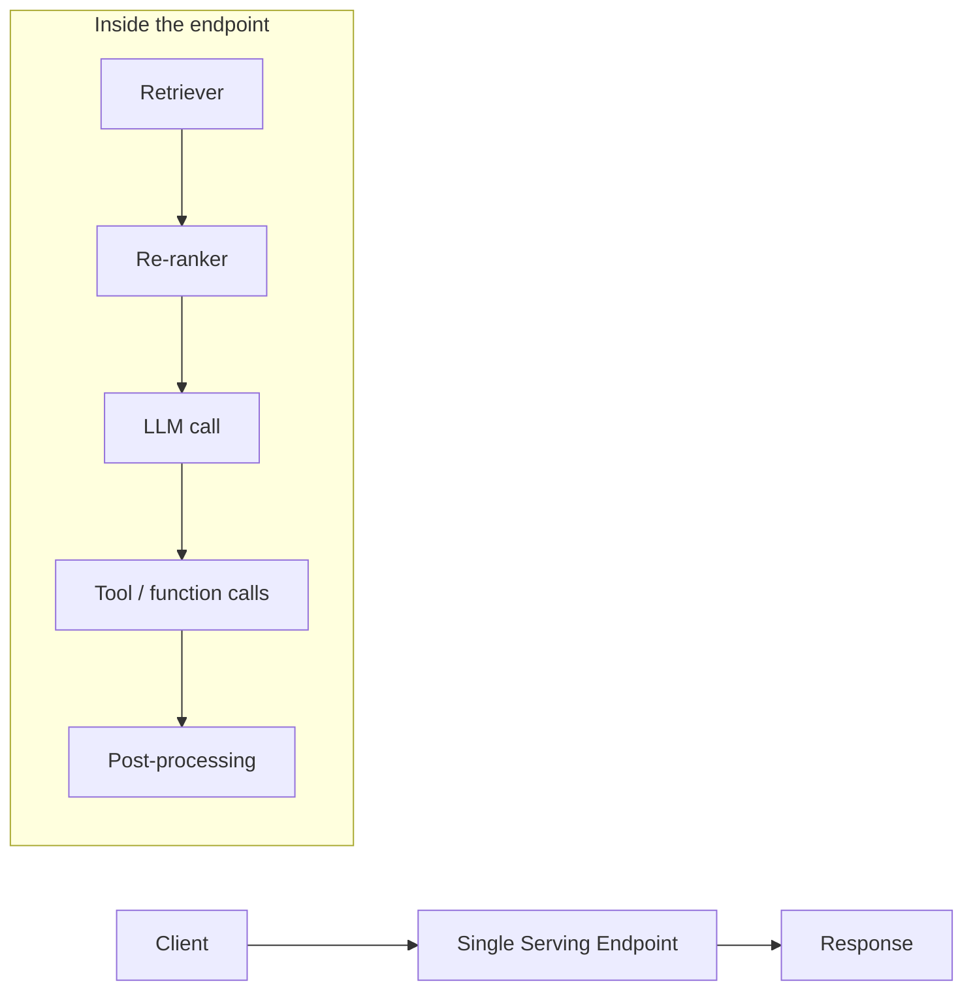

# Aplicações de IA compostas

## Visão geral

Uma **aplicação de IA composta** é um único endpoint servido que orquestra vários componentes — um retriever, um re-ranker opcional, um LLM, chamadas opcionais a ferramentas/funções e pós-processamento — em um serviço lógico. No Databricks, o caminho canônico é **MLflow + Mosaic AI Agent Framework + Model Serving**: você registra a aplicação composta como um modelo do MLflow, registra-a no Unity Catalog e a serve por trás de um único endpoint do Model Serving, que os consumidores chamam como qualquer outro endpoint de LLM.

> [!abstract]
>
> - **Aplicação de IA composta** = retriever + (re-ranker) + LLM + (ferramentas) + pós-processamento, por trás de um único endpoint
> - Registrada como modelo do MLflow por meio de uma subclasse de `mlflow.pyfunc.ResponsesAgent` (recomendado atualmente) ou `ChatAgent`
> - Registrada no **Unity Catalog** (catalog.schema.model_name), com controle de versões e **implantada por `databricks.agents.deploy(uc_model, version)`**, que provisiona um endpoint do Model Serving
> - **Inference Tables** capturam cada solicitação/resposta — a mesma trilha de auditoria de um endpoint de LLM único
> - O Agent Framework acrescenta streaming, tool calling e tracing ao MLflow PyFunc padrão

> [!tip] O que o exame cobra
>
> - Que o artefato servido seja **um endpoint**, e não N microsserviços — o empacotamento importa
> - Os MLflow flavors para aplicações compostas (`ChatAgent` / `ResponsesAgent` para aplicações no formato de chat; Agent Framework para agents que usam ferramentas)
> - Que o Agent Framework oferece **streaming + tracing + Inference Tables** prontos para uso
> - Como recuperação + LLM + chamadas a ferramentas são combinados em uma única chamada de `predict`

---

## O padrão de aplicação composta



Tudo dentro de `EP_internal` é executado em uma réplica do Model Serving por solicitação. O escalonamento automático, a escolha de GPU/CPU e a divisão de tráfego se aplicam à aplicação composta inteira, não a etapas individuais.

## Registrar uma aplicação composta com MLflow + Agent Framework

```python
# agent.py — models-from-code file
import mlflow
from mlflow.pyfunc import ResponsesAgent
from mlflow.types.responses import ResponsesAgentRequest, ResponsesAgentResponse


class CustomerSupportRAG(ResponsesAgent):
    def predict(self, request: ResponsesAgentRequest) -> ResponsesAgentResponse:
        question = request.input[-1].content          # latest user turn
        docs = retriever.invoke(question)             # Vector Search retriever (pre-processing)
        context = "\n".join(d.page_content for d in docs)
        answer = llm.invoke(f"Context: {context}\n\nQuestion: {question}").content
        return ResponsesAgentResponse(                # post-processing into the Responses schema
            output=[self.create_text_output_item(text=answer, id="msg_1")]
        )


mlflow.models.set_model(CustomerSupportRAG())
```

```python
# driver notebook — log, register in UC, deploy
import mlflow
from databricks import agents
from mlflow.models.resources import DatabricksServingEndpoint, DatabricksVectorSearchIndex

mlflow.set_registry_uri("databricks-uc")
with mlflow.start_run():
    info = mlflow.pyfunc.log_model(
        name="agent",
        python_model="agent.py",
        resources=[
            DatabricksServingEndpoint(endpoint_name="databricks-claude-sonnet-4-5"),
            DatabricksVectorSearchIndex(index_name="main.genai.docs_index"),
        ],
        registered_model_name="main.genai.customer_support_rag",
    )

# Creates (or updates) a Model Serving endpoint with inference tables, tracing, and the Review App
agents.deploy("main.genai.customer_support_rag", info.registered_model_version)
```

> [!note]
> `databricks.agents.deploy()` é o caminho de etapa única para o Model Serving cobrado no exame: ele cria um endpoint de serving, provisiona credenciais para os recursos declarados, habilita inference tables, ativa o MLflow Tracing em tempo real e configura a Review App ([Implantar um agent, Model Serving](https://docs.databricks.com/aws/en/agents/custom-agents/model-serving/deploy-agent)).

> [!note] Atualização da plataforma (out. de 2026)
> Desde **2026-10-05**, a documentação classifica como *legacy* os agents implantados no **Model Serving**. Novos agents code-first são estruturados e implantados com o **Agent Bricks CLI** (Beta) — `agentbricks init`, `agentbricks dev`, `agentbricks deploy` — que os serve com `DurableAgentServer` no **Agent Runtime** (Databricks Apps) ([Agent Bricks CLI](https://docs.databricks.com/aws/en/agents/custom-agents/agent-bricks-cli), [notas de versão de outubro de 2026](https://docs.databricks.com/aws/en/release-notes/product/2026/october)). O padrão de “um endpoint governado, várias etapas” permanece igual; apenas a camada de hospedagem muda.

## Chamar a aplicação composta servida

Quando `agents.deploy(...)` terminar o provisionamento, o endpoint poderá ser chamado como qualquer endpoint de LLM único (`ResponsesAgent` recebe uma lista `input` de mensagens):

```bash
curl https://<workspace>/serving-endpoints/customer-support-rag/invocations \
  -H "Authorization: Bearer $DATABRICKS_TOKEN" \
  -d '{"input":[{"role":"user","content":"How do I reset my password?"}]}'
```

## Casos de uso

- **RAG sobre tabelas do UC** — o retriever obtém os fragmentos top-k de um índice do Mosaic AI Vector Search e o LLM fundamenta a resposta
- **Agent que usa ferramentas** — o LLM decide qual ferramenta chamar (consulta, calculadora, consulta SQL) e o framework executa a chamada
- **Orquestração de vários modelos** — um classificador pequeno direciona as solicitações entre modelos baratos e caros por trás de um único endpoint
- **Pipelines com re-ranking** — recuperação ampla e barata (busca vetorial) + re-ranker cross-encoder pequeno + geração pelo LLM

## Problemas e erros comuns

- **Latência de cold start** — `scale_to_zero_enabled = true` reduz custos, mas a primeira solicitação pode levar mais de 30 s. Para serving sensível à latência, mantenha uma réplica ativa
- **Streaming não habilitado** — sem o wrapper do Agent Framework, aplicações compostas PyFunc personalizadas não fazem streaming por padrão; o cliente pode expirar durante gerações longas
- **Chamadas de ferramentas sem tracing** — verifique se o Agent Framework envolve a execução das ferramentas para que as chamadas apareçam nas Inference Tables e nos traces do MLflow
- **Acoplamento rígido a um provedor de LLM específico** — mantenha a chamada ao LLM abstraída (roteie pelas Foundation Model APIs ou pelo AI Gateway / Unity Gateway) para poder trocar modelos sem registrar novamente o agent

## Dicas para o exame

> [!tip]
>
> - “Um endpoint, várias etapas” é o padrão canônico. Se uma questão propuser três endpoints separados encadeados pela rede, quase sempre estará incorreta.
> - **`ResponsesAgent` (subclasse) + `databricks.agents.deploy()`** é o caminho cobrado no exame para aplicações compostas e que usam ferramentas. O Databricks considera `ChatAgent` e `ChatModel` interfaces de autoria *legacy* e recomenda migrar para `ResponsesAgent`; o MLflow recomenda `ResponsesAgent` em vez de `ChatModel` desde o MLflow 3.0.
> - Inference Tables + MLflow Tracing são o registro de auditoria. Eles abrangem a aplicação composta **inteira**, não apenas a chamada ao LLM.
> - O registro no Unity Catalog é obrigatório em produção — o Model Serving precisa de um modelo registrado no UC.

## Principais conclusões

- Aplicações de IA compostas = retriever + re-ranker + LLM + ferramentas + pós-processamento, servidos por um único endpoint
- Registre com o Mosaic AI Agent Framework usando `mlflow.pyfunc.ResponsesAgent` (legado: `ChatAgent`); registre no UC; sirva pelo Model Serving (novos agents: Agent Bricks CLI → Agent Runtime)
- Streaming, tracing e Inference Tables são fornecidos pelo framework
- O escalonamento automático e a divisão de tráfego se aplicam à aplicação composta inteira

## Tópicos relacionados

- [Mosaic AI e Foundation Models](./01-mosaic-ai-and-foundation-models.md)
- [MLflow para GenAI](./02-mlflow-for-genai.md)
- [Servidores MCP](./04-mcp-servers.md)
- [Sistemas agentic com MLflow, Agent Framework e Genie](../01-application-development/05-agentic-systems-mlflow-and-genie.md)
- [Monitoramento online (domínio de avaliação e monitoramento)](../05-evaluation-and-monitoring/02-online-monitoring.md)
- [AI Gateway: acompanhamento de uso e controle de custos](../05-evaluation-and-monitoring/04-ai-gateway-usage-and-cost-control.md)

## Documentação oficial

- [Implantar um agent (Model Serving, legacy)](https://docs.databricks.com/aws/en/agents/custom-agents/model-serving/deploy-agent)
- [Implantar agents no Databricks (Agent Bricks CLI → Agent Runtime)](https://docs.databricks.com/aws/en/agents/deploy/)
- [MLflow `ChatAgent` / `ResponsesAgent`](https://mlflow.org/docs/latest/python_api/mlflow.pyfunc.html)
- [Mosaic AI Model Serving](https://docs.databricks.com/en/machine-learning/model-serving/index.html)
- [Inference Tables](https://docs.databricks.com/en/machine-learning/model-serving/inference-tables.html)

---

**[← Anterior: MLflow para GenAI](./02-mlflow-for-genai.md) | [↑ Voltar para Montagem e implantação de aplicações](./README.md) | [Próximo: Servidores MCP — gerenciados, externos e personalizados](./04-mcp-servers.md) →**
