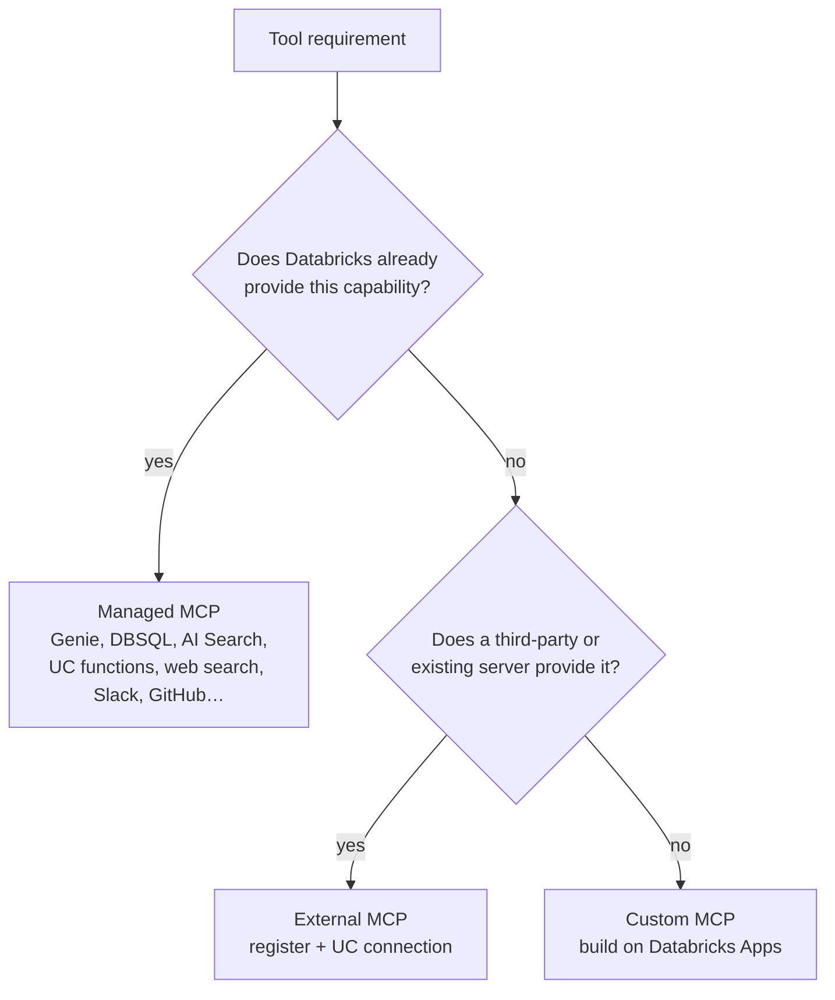

# Servidores MCP — gerenciados, externos e personalizados

## Visão geral

O **Model Context Protocol (MCP)** é um padrão aberto que permite a um agent descobrir e chamar
ferramentas — consultar dados, pesquisar documentos, chamar serviços externos — por meio de uma
única interface. O item do guia do exame é *"Integrate managed, external, and custom MCP servers
based on a given application requirements."* No Databricks, há três tipos de servidor:
**gerenciado** (fornecido e hospedado pelo Databricks), **externo** (servidor de terceiros ou
auto-hospedado que você registra) e **personalizado** (servidor criado e hospedado no Databricks
Apps). O exame cobra a escolha do tipo adequado com o mínimo de manutenção e a governança dele.

> [!abstract]
>
> - **Servidores MCP gerenciados** — ferramentas fornecidas pelo Databricks para Genie, Databricks SQL, Vector Search (AI Search), funções do Unity Catalog, pesquisa na Web e apps conectados (Slack, GitHub, Microsoft 365, …); não exigem hospedagem nem registro
> - **Servidores MCP externos** — registre uma vez um servidor de terceiros ou auto-hospedado; suas credenciais ficam em uma **conexão HTTP** do Unity Catalog e o acesso é concedido com `EXECUTE`
> - **Servidores MCP personalizados** — suas próprias ferramentas, servidas por um **Databricks App** em `https://<app-host>/mcp`
> - **Governança** — MCPs são objetos protegíveis do Unity Catalog invocados pelo gateway, com seleção de ferramentas, limites de taxa, políticas e acompanhamento de uso

> [!tip] O que o exame avalia
>
> - Escolher **gerenciado** quando o Databricks já oferece o recurso (menor manutenção), **externo** para um servidor de terceiros existente e **personalizado** somente para uma lógica que ninguém oferece
> - Entender que chaves de API para servidores externos **nunca são codificadas diretamente** — elas são armazenadas como secrets/credenciais de conexão e referenciadas na configuração (a questão de exemplo oficial tem como resposta *D e E*)
> - Saber que o acesso é governado por permissões do Unity Catalog e que chamadas a ferramentas podem ser executadas **em nome do usuário**
> - Saber como um agent se conecta: pela URL do servidor, por meio dos clientes `databricks-mcp` / `databricks-langchain` / `databricks-openai`

---

> [!note] Atualização da plataforma (out. 2026)
> **Os serviços MCP integrados agora são executados pelo Unity Gateway.** MCPs fornecidos pelo Databricks ficam no schema `system.ai` e são chamados em `https://<workspace-host>/ai-gateway/mcp-services/<mcp-name>`, por exemplo, `system.ai.genie_one_mcp` (disponibilidade geral), `system.ai.dbsql`, `system.ai.web_search` e `system.ai.sandbox` (os três últimos exigem o Unity Gateway Beta) ([MCPs fornecidos pelo Databricks](https://docs.databricks.com/aws/en/agents/mcp-tools/built-in-mcp-services)).
> **Alteração no endpoint do Genie:** o antigo endpoint Beta `https://<host>/api/2.0/mcp/genie` (sem ID de space) foi descontinuado e **será encerrado em 2026-10-31** — migre para `system.ai.genie_one_mcp`. Para consultar um único Genie Agent selecionado, use `https://<host>/api/2.0/mcp/genie/{genie_space_id}` ([Genie One MCP](https://docs.databricks.com/aws/en/agents/mcp-tools/genie-mcp), [Genie Agent MCP](https://docs.databricks.com/aws/en/agents/mcp-tools/genie-agent)).
> **Os endpoints legacy do workspace** (`/api/2.0/mcp/ai-search/{catalog}/{schema}/{index}`, `/api/2.0/mcp/sql`, `/api/2.0/mcp/functions/{catalog}/{schema}/{function}`) continuam funcionando, mas **ignoram o Unity Gateway** — sem tracing do gateway, grants no nível do MCP, políticas ou guardrails.
> **Novo guardrail:** desde 2026-10-21 (Beta), chamadas e resultados de ferramentas MCP podem ser analisados para detectar tentativas de jailbreak e prompt injection ([notas de versão de outubro de 2026](https://docs.databricks.com/aws/en/release-notes/product/2026/october)).

## Escolher o tipo de servidor



| Requisito | Tipo de servidor | Motivo |
| :--- | :--- | :--- |
| Perguntas em linguagem natural sobre tabelas governadas | **Gerenciado** — Genie One MCP ou Genie Agent MCP | Fundamentado em semântica selecionada; permissões do UC aplicadas |
| Executar uma instrução SQL específica | **Gerenciado** — Databricks SQL MCP | Usa as permissões do UC e do warehouse do solicitante |
| Pesquisar um índice não estruturado | **Gerenciado** — AI Search (Vector Search) | Não é necessário criar um servidor |
| Chamar uma função de negócio governada | **Gerenciado** — funções do Unity Catalog | Reutiliza funções do UC como ferramentas |
| Pesquisar na Web pública | **Gerenciado** — `system.ai.web_search` | Retorna uma resposta sintetizada com citações |
| API de um fornecedor SaaS que já oferece servidor MCP | **Externo** | Registre uma vez; credenciais armazenadas em uma conexão do UC |
| Sua própria API REST interna | **Personalizado** — template MCP Server (OpenAPI) no Databricks Apps | Expõe endpoints existentes como ferramentas MCP |
| Nova lógica proprietária | **Personalizado** — template MCP Server (Starter) no Databricks Apps | Escreva ferramentas Python; o Apps as hospeda |

> [!warning] Common Mistake
> Criar um **servidor wrapper personalizado** em torno de um recurso que o Databricks já oferece como MCP gerenciado, ou de uma API de terceiros que já tem um servidor MCP, acrescenta código e manutenção sem benefício. A questão de exemplo oficial rejeita essa opção: use o servidor **gerenciado** para o primeiro caso e registre o servidor **externo** para o segundo.

## Servidores MCP gerenciados

MCPs fornecidos pelo Databricks não precisam de hospedagem nem registro ([MCPs fornecidos pelo Databricks](https://docs.databricks.com/aws/en/agents/mcp-tools/built-in-mcp-services)).

| MCP | Finalidade |
| :--- | :--- |
| `system.ai.genie_one_mcp` | Analytics em linguagem natural no workspace, fundamentada na Genie Ontology (GA) |
| Genie Agent MCP (`/api/2.0/mcp/genie/{space_id}`) | Perguntas limitadas a um Genie Agent selecionado; somente leitura; sem histórico de conversas |
| `system.ai.dbsql` | Executa SQL específico em um SQL warehouse com as permissões do solicitante |
| `system.ai.web_search` | Pesquisa na Web pública com citações |
| `system.ai.sandbox` | Executa Python, SQL ou shell em um ambiente isolado (sem saída de rede) |
| `system.ai.slack`, `system.ai.github`, `system.ai.atlassian`, `system.ai.google_drive`, `system.ai.gmail`, `system.ai.google_calendar`, `system.ai.microsoft_365` | Serviços de terceiros conectados; usuários entram por OAuth gerenciado |
| AI Search, funções do Unity Catalog | Endpoints legacy do workspace; agents Python usam ferramentas retriever do AI Bridge e `UCFunctionToolkit` |

## Servidores MCP externos

Registre um servidor de terceiros ou auto-hospedado para que toda a equipe possa usá-lo pelo gateway ([servidores MCP externos](https://docs.databricks.com/aws/en/ai-gateway/register-mcp-service)).

1. Abra **Unity Gateway → MCPs → + MCP → Connect an existing MCP server**
2. Escolha um catálogo e um schema e dê um nome ao MCP (requer `CREATE SERVICE` no schema)
3. Selecione ou **crie uma conexão HTTP** — URL do servidor e credenciais (bearer token, OAuth ou OAuth gerenciado para provedores compatíveis). As credenciais ficam na conexão, não no código do agent
4. Carregue e **selecione as ferramentas** a serem expostas (lista manual ou prefixos, como `get_*`)
5. Crie o serviço MCP; os agents o acessam como `<catalog>.<schema>.<service>` ou em `https://<host>/ai-gateway/mcp-services/<catalog>.<schema>.<service>`

Requisitos: o servidor deve oferecer suporte a **Streamable HTTP** e o workspace deve conseguir acessá-lo pela rede. Você também pode instalar servidores MCP pelo **Databricks Marketplace**.

> [!note]
> A resposta de exemplo do exame descreve a chave de API do servidor externo como *armazenada no Databricks Secrets e referenciada na configuração do servidor MCP*. No produto atual, a credencial fica na **conexão HTTP** do Unity Catalog criada durante o registro. O princípio cobrado é o mesmo: **secrets são armazenados em um repositório governado e referenciados, nunca inseridos no código ou em prompts.**

## Servidores MCP personalizados no Databricks Apps

Crie um servidor quando nenhum servidor gerenciado ou externo for adequado ([servidores MCP personalizados](https://docs.databricks.com/aws/en/agents/mcp-tools/custom-mcp)):

| Caminho | Use quando |
| :--- | :--- |
| **Template MCP Server (Starter)** | Quiser escrever suas próprias ferramentas Python |
| **Template MCP Server (OpenAPI)** | Quiser expor uma API HTTP existente (especificação OpenAPI 3.x em um volume + conexão HTTP) |
| **Implantar um servidor existente** | Já tiver código de servidor MCP |

Dê ao app um nome com o prefixo `mcp-` para que o AI Playground o reconheça. A URL do servidor é a URL do app acrescida de `/mcp`. A adição de uma ferramenta ao template Starter é assim:

```python
@mcp_server.tool
def uppercase(text: str) -> str:
    """Convert a string to uppercase."""
    return text.upper()
```

Os solicitantes precisam de `CAN USE` no app.

## Conectar um agent a um servidor MCP

```python
from databricks.sdk import WorkspaceClient
from databricks_mcp import DatabricksMCPClient

workspace_client = WorkspaceClient()
mcp_client = DatabricksMCPClient(
    server_url="https://<workspace-host>/ai-gateway/mcp-services/system.ai.genie_one_mcp",
    workspace_client=workspace_client,
)

for tool in mcp_client.list_tools():
    print(tool.name, tool.description, tool.inputSchema)

# Call a tool by name with arguments that match its inputSchema
result = mcp_client.call_tool(tool_name, arguments)
```

Para agents LangGraph, `databricks_langchain` oferece `DatabricksMCPServer` e `DatabricksMultiServerMCPClient` para transformar um ou mais servidores MCP em ferramentas LangChain; para o cliente OpenAI, `databricks_openai.McpServerToolkit` faz o mesmo ([Usar ferramentas MCP em um agent Python](https://docs.databricks.com/aws/en/agents/custom-agents/use-mcp-tools)). Agents criados com o Agent Bricks CLI adicionam um MCP gerenciado com `agentbricks tools add mcp system.ai.<name>` e não precisam de código de conexão.

## Governar o acesso ao MCP

| Controle | Como |
| :--- | :--- |
| **Quem pode chamar** | `EXECUTE` no serviço MCP e `USE CATALOG` / `USE SCHEMA`; usuários finais **não** precisam de `USE CONNECTION` |
| **Quais ferramentas** | Seleção de ferramentas durante o registro (`include_tool_selectors`); ferramentas não selecionadas ficam ocultas e as chamadas são rejeitadas |
| **Identidade de quem** | OAuth on-behalf-of-user (recomendado para Genie) para que as permissões do UC sejam aplicadas por usuário; service principal para automação |
| **Qual conteúdo** | Políticas de serviço (Beta) avaliam uma chamada antes da execução e o resultado depois — permitem, bloqueiam ou exigem aprovação; guardrails integrados de *Sensitive Data Detection* e jailbreak |
| **Qual volume** | Limites de taxa por serviço, usuário, grupo ou service principal (solicitações por minuto para MCP) |
| **O que aconteceu** | Acompanhamento de uso em `system.ai_gateway.usage` e no painel de uso do gateway |

Fontes: [Governar um MCP](https://docs.databricks.com/aws/en/ai-gateway/govern-mcp-service), [Limites de taxa](https://docs.databricks.com/aws/en/ai-gateway/rate-limits), [Acompanhamento de uso](https://docs.databricks.com/aws/en/ai-gateway/usage-tracking).

## Casos de uso

- **Assistente de pesquisa (questão de exemplo oficial)** — MCP gerenciado de Web/dados para a fonte na internet, além de MCP externo para uma API de pesquisa de terceiros com chave, cuja credencial fica em um repositório governado
- **Copilot de analytics** — `system.ai.genie_one_mcp` responde a perguntas de negócios com permissões do UC aplicadas por usuário
- **API interna de CRM** — o template OpenAPI no Databricks Apps expõe endpoints REST existentes como ferramentas MCP
- **Integração de tickets** — `system.ai.atlassian` permite que um agent leia e crie issues do Jira depois que cada usuário entra

## Problemas e erros comuns

### Chamadas ao Genie MCP começam a falhar após 2026-10-31

**Cenário:** um agent configurado com `https://<host>/api/2.0/mcp/genie` para de funcionar.
**Correção:** esse endpoint Beta será encerrado em 2026-10-31. Mude para `system.ai.genie_one_mcp` (pela URL do gateway e pelo escopo OAuth `ai-gateway`) ou para o endpoint específico do space `.../api/2.0/mcp/genie/{genie_space_id}`.

### “Ferramenta não permitida pela configuração do serviço MCP”

**Cenário:** o agent chama uma ferramenta anunciada pelo servidor upstream, mas a chamada é rejeitada.
**Correção:** a ferramenta não foi selecionada durante o registro do serviço MCP. Atualize a seleção de ferramentas (`include_tool_selectors`).

### Chamadas ausentes do uso do gateway e dos traces

**Cenário:** o tráfego MCP não aparece em `system.ai_gateway.usage`.
**Correção:** o agent usa um endpoint legacy do workspace (`/api/2.0/mcp/...`), que ignora o Unity Gateway. Use o MCP `system.ai` ou uma URL de serviço MCP registrado.

## Dicas para o exame

> [!tip] Dicas para o exame
>
> - **Menor manutenção:** primeiro gerenciado, depois externo e, por último, personalizado.
> - **Nunca inclua chaves de API diretamente** no código do agent ou no frontend — armazene-as em um secret store/conexão e faça referência a elas.
> - **Servidores MCP personalizados são executados no Databricks Apps** (URL termina em `/mcp`); solicitantes precisam de `CAN USE` no app.
> - **MCPs externos/registrados:** solicitantes precisam de `EXECUTE` no serviço MCP, não de `USE CONNECTION`.
> - Genie via MCP: Genie One para perguntas sobre todo o workspace; Genie Agent MCP (`/mcp/genie/{space_id}`) para um único agent selecionado.

## Principais conclusões

- MCP padroniza a forma como agents descobrem e chamam ferramentas; o Databricks oferece servidores gerenciados, externos e personalizados
- Servidores gerenciados abrangem Genie, SQL, busca, funções do UC, pesquisa na Web, execução de código em sandbox e apps SaaS populares, sem hospedagem
- Servidores externos são registrados uma vez pelo Unity Gateway, com credenciais em uma conexão HTTP do UC
- Servidores personalizados são criados a partir de templates e hospedados no Databricks Apps
- Governe com grants do UC, seleção de ferramentas, identidade OBO, políticas de serviço, limites de taxa e acompanhamento de uso

## Tópicos relacionados

- [Sistemas agentic com MLflow, Agent Framework e Genie](../01-application-development/05-agentic-systems-mlflow-and-genie.md)
- [Aplicações de IA compostas](./03-compound-ai-apps.md)
- [Controle de acesso e inferência em lote](./05-access-control-and-batch-inference.md)
- [AI Gateway: acompanhamento de uso e controle de custos](../05-evaluation-and-monitoring/04-ai-gateway-usage-and-cost-control.md)

## Documentação oficial

- [MCPs no Databricks](https://docs.databricks.com/aws/en/agents/mcp-tools/)
- [MCPs fornecidos pelo Databricks](https://docs.databricks.com/aws/en/agents/mcp-tools/built-in-mcp-services)
- [Servidores MCP externos](https://docs.databricks.com/aws/en/ai-gateway/register-mcp-service)
- [Servidores MCP personalizados](https://docs.databricks.com/aws/en/agents/mcp-tools/custom-mcp)
- [Usar ferramentas MCP em um agent Python](https://docs.databricks.com/aws/en/agents/custom-agents/use-mcp-tools)
- [Governar um MCP](https://docs.databricks.com/aws/en/ai-gateway/govern-mcp-service)

---

**[← Anterior: Aplicações de IA compostas](./03-compound-ai-apps.md) | [↑ Voltar para Montagem e implantação de aplicações](./README.md) | [Próximo: Controle de acesso e inferência em lote](./05-access-control-and-batch-inference.md) →**
