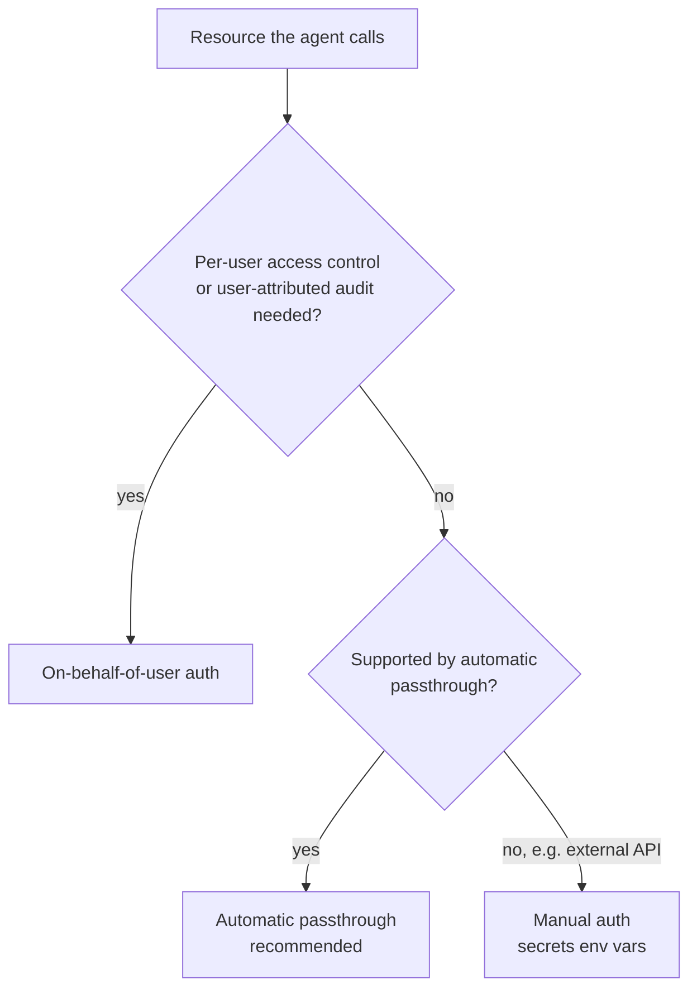

# Controle de acesso e inferência em lote

## Visão geral

Dois itens de Montagem e implantação de aplicações tratam de *como uma aplicação implantada acessa
outros recursos*: *"Control access to resources from model serving endpoints"* e *"Identify batch
inference workloads and apply ai_query() appropriately."* O primeiro trata de credenciais — qual
identidade o endpoint usa ao chamar um índice do Vector Search, um LLM, o Genie ou uma API externa.
O segundo trata do formato da carga de trabalho — quando evitar um endpoint ativo e executar o modelo
em uma tabela com SQL.

> [!abstract]
>
> - **Passthrough de autenticação automática** — declare os recursos do Databricks usados pelo agent ao registrá-lo; a implantação provisiona credenciais de curta duração com privilégio mínimo
> - **Autenticação on-behalf-of-user (OBO)** — o agent atua com as permissões do *usuário final*, limitadas aos escopos de API declarados
> - **Autenticação manual** — variáveis de ambiente baseadas em secrets (`{{secrets/scope/key}}`) para APIs externas e tudo que a autenticação automática não cobre
> - **Permissões de endpoint** — `CAN QUERY` para consumidores, `CAN MANAGE` para proprietários; nunca envie tokens ao navegador
> - **`ai_query()`** — AI Function de uso geral para aplicar um modelo a muitas linhas por SQL ou pipeline; prefira AI Functions específicas para a tarefa, quando disponíveis

> [!tip] O que o exame avalia
>
> - Escolher entre passthrough, OBO e autenticação manual conforme o requisito (acesso em nível de linha por usuário → OBO; recursos compartilhados → passthrough; chave de API de terceiros → secrets)
> - Saber que a lista `resources` em `log_model()` habilita credenciais automáticas durante a implantação
> - Reconhecer cargas de trabalho **em lote** (tabela grande, nenhum usuário aguardando, execução agendada) e escrever a chamada `ai_query()`
> - Opções de `ai_query()`: `returnType`, `failOnError`, `modelParameters`, `responseFormat`

---

> [!note] Atualização da plataforma (out. 2026)
> Agents implantados no **Model Serving** (via `databricks.agents.deploy()`) agora são classificados como *legacy* na documentação; novos agents são implantados com o **Agent Bricks CLI** no **Agent Runtime** do Databricks Apps ([Implantar agents no Databricks](https://docs.databricks.com/aws/en/agents/deploy/)). Os conceitos de controle de acesso continuam válidos, mas com novos nomes: no Databricks Apps, **autorização do app** (antiga autenticação por *service principal*) e **autorização do usuário** (antiga autenticação *on-behalf-of-user*) ([Autenticação para agents no Apps](https://docs.databricks.com/aws/en/agents/custom-agents/agent-authentication)). Os mecanismos de Model Serving abaixo são os cobrados no guia do exame de março de 2026.

## Controlar o acesso a recursos a partir de endpoints do Model Serving

Um agent implantado normalmente precisa chamar um índice do Vector Search, um endpoint de LLM,
funções do Unity Catalog, Genie, um SQL warehouse ou uma API externa. O Databricks documenta três
métodos; você pode combiná-los por recurso ([Autenticação para agents (Model Serving)](https://docs.databricks.com/aws/en/agents/custom-agents/model-serving/agent-authentication-model-serving)).

| Método | Executado como | Ciclo de vida da credencial | Configuração |
| :--- | :--- | :--- | :--- |
| **Passthrough de autenticação automática** | Service principal criado para a versão do agent, com acesso de privilégio mínimo aos recursos declarados | Curta duração, rotação automática | Baixa — declare recursos no momento do registro |
| **On-behalf-of-user (OBO)** | Usuário final que envia a solicitação | Credenciais do usuário restritas aos escopos de API declarados | Média — declare escopos e crie o cliente dentro de `predict` |
| **Autenticação manual** | Qualquer credencial fornecida por você | Longa duração; você gerencia a rotação | Alta — secrets e variáveis de ambiente |



### Passthrough de autenticação automática

Declare cada recurso do Databricks em `resources` ao registrar o modelo. Durante a implantação, o
Databricks (1) verifica se o **criador do endpoint** pode acessar cada recurso declarado, (2) cria
um service principal para a versão do modelo e concede a ele acesso de leitura a esses recursos e
(3) emite credenciais de curta duração para o endpoint. O comportamento é semelhante a *run as owner*.

```python
import mlflow
from mlflow.models.resources import (
    DatabricksServingEndpoint,
    DatabricksVectorSearchIndex,
    DatabricksFunction,
    DatabricksGenieSpace,
    DatabricksSQLWarehouse,
    DatabricksTable,
)

with mlflow.start_run():
    mlflow.pyfunc.log_model(
        name="agent",
        python_model="agent.py",
        resources=[
            DatabricksServingEndpoint(endpoint_name="databricks-claude-sonnet-4-5"),
            DatabricksVectorSearchIndex(index_name="main.rag.docs_index"),
            DatabricksFunction(function_name="main.tools.lookup_order"),
            DatabricksGenieSpace(genie_space_id="<space-id>"),
        ],
    )
```

Se um recurso não estiver na lista, o endpoint implantado receberá um erro de permissão ao chamá-lo — a falha de implantação mais comum em agents.

### Autenticação on-behalf-of-user (OBO)

Use OBO quando os usuários puderem ver somente os dados aos quais têm direito (filtros de linha,
máscaras de coluna, Genie com permissões por usuário) ou quando as auditorias precisarem mostrar o
usuário real. Declare os escopos de API REST que o agent pode usar em nome do usuário e crie o
cliente no escopo do usuário **dentro de** `predict` (as credenciais do usuário só existem durante
o processamento de uma solicitação).

```python
from mlflow.models.auth_policy import AuthPolicy, SystemAuthPolicy, UserAuthPolicy
from mlflow.models.resources import DatabricksServingEndpoint

system_policy = SystemAuthPolicy(
    resources=[DatabricksServingEndpoint(endpoint_name="databricks-claude-sonnet-4-5")]
)
user_policy = UserAuthPolicy(api_scopes=["model-serving", "ai-search"])

mlflow.pyfunc.log_model(
    name="agent",
    python_model="agent.py",
    auth_policy=AuthPolicy(system_auth_policy=system_policy, user_auth_policy=user_policy),
)
```

```python
# inside the agent's predict()
from databricks.sdk import WorkspaceClient
from databricks_ai_bridge import ModelServingUserCredentials

user_client = WorkspaceClient(credentials_strategy=ModelServingUserCredentials())
```

Os escopos restringem o token às APIs de que o agent precisa — privilégio mínimo para as credenciais do usuário.

### Autenticação manual com secrets

Para serviços externos (uma chave da OpenAI, um token de API SaaS), armazene a credencial como
**secret do Databricks** e faça referência a ela em `environment_vars` do endpoint com
`{{secrets/<scope>/<key>}}`. O criador do endpoint precisa de `READ` no secret; o valor em texto
simples nunca aparece no código nem na configuração do endpoint ([Configurar o acesso a recursos a
partir de endpoints de model serving](https://docs.databricks.com/aws/en/machine-learning/model-serving/store-env-variable-model-serving)).

```bash
databricks secrets create-scope my_secret_scope
databricks secrets put-secret my_secret_scope openai_api_key
```

```json
{
  "served_entities": [
    {
      "entity_name": "main.agents.support_agent",
      "entity_version": "3",
      "workload_size": "Small",
      "scale_to_zero_enabled": true,
      "environment_vars": {
        "OPENAI_API_KEY": "{{secrets/my_secret_scope/openai_api_key}}"
      }
    }
  ]
}
```

Sem a sintaxe `{{secrets/...}}`, o valor é tratado como variável de ambiente em **texto simples**.

### Quem pode chamar o endpoint

| Permissão em um endpoint de serving | Concede |
| :--- | :--- |
| `CAN VIEW` | Visualizar o endpoint e sua configuração |
| `CAN QUERY` | Enviar solicitações (conceda a aplicações e usuários) |
| `CAN MANAGE` | Editar configurações, permissões e definições do gateway |

Restrinja a criação de endpoints e `CAN MANAGE` aos administradores para impedir que guardrails e
limites de taxa sejam contornados; conceda aos demais usuários acesso de consulta a endpoints
aprovados ([Configurar governança em endpoints de model serving](https://docs.databricks.com/aws/en/ai-gateway/configure-ai-gateway-endpoints)).

> [!important]
> Frontends **nunca** mantêm tokens de longa duração. O navegador chama o **backend do app** (por
> exemplo, um Databricks App), e o backend chama o endpoint com as credenciais do app ou do usuário
> autenticado. Essa é a resposta à questão de exemplo oficial sobre um Databricks App que acessa PDFs internos.

## Inferência em lote com `ai_query()`

### É uma carga de trabalho em lote?

| Sinal | Em lote (`ai_query`, AI Functions) | Em tempo real (endpoint de serving / agent) |
| :--- | :--- | :--- |
| Quem está aguardando? | Ninguém — os resultados são gravados em uma tabela | Um usuário ou uma aplicação, por solicitação |
| Volume | Milhares a milhões de linhas | Uma solicitação por vez |
| Gatilho | Agendamento, pipeline ou SQL ad hoc | Ação do usuário ou chamada de API |
| Tarefas típicas | Classificar uma fila de tickets, sumarizar transcrições de chamadas, extrair campos de contratos, enriquecer um catálogo de produtos, gerar embeddings de um corpus | Chat, copilots, agents interativos |

### Função específica da tarefa ou `ai_query()`?

O Databricks recomenda as **AI Functions específicas da tarefa** (`ai_classify`, `ai_extract`,
`ai_summarize`, `ai_translate`, `ai_analyze_sentiment`, `ai_parse_document`, `ai_mask`, …) quando
uma delas for adequada, e `ai_query()` quando você precisar de um prompt personalizado ou modelo
específico ([AI Functions no Databricks](https://docs.databricks.com/aws/en/large-language-models/ai-functions)).

### Sintaxe de `ai_query()`

```sql
ai_query(endpoint, request [, returnType] [, failOnError] [, modelParameters] [, responseFormat])
```

| Argumento | Finalidade |
| :--- | :--- |
| `endpoint` | Nome do endpoint de foundation model, external model ou model serving personalizado |
| `request` | O prompt (modelos de chat/completion) ou entrada (modelos personalizados) — normalmente construído a partir de colunas |
| `returnType` | Tipo de retorno esperado; opcional no Databricks Runtime 15.2+, quando é inferido |
| `failOnError` | O padrão é `true`. Com `false`, retorna um STRUCT com o resultado analisado e uma mensagem de erro, para que uma linha com falha não interrompa o job (DBR 15.3+) |
| `modelParameters` | Parâmetros constantes, como `max_tokens` e `temperature` |
| `responseFormat` | Saída estruturada `text`, `json_object` ou `json_schema` para modelos de chat |

```sql
CREATE OR REPLACE TABLE main.support.ticket_summaries AS
SELECT
  ticket_id,
  ai_query(
    'databricks-meta-llama-3-1-8b-instruct',
    CONCAT('Summarise this support ticket in one sentence: ', body),
    modelParameters => named_struct('max_tokens', 100, 'temperature', 0.0),
    failOnError => false
  ) AS summary
FROM main.support.tickets
WHERE created_date >= current_date() - INTERVAL 1 DAY;
```

Observações práticas da documentação:

- AI Functions são executadas em **Databricks SQL (não em warehouses Classic SQL)**, notebooks, pipelines do Lakeflow e jobs; é necessário o Databricks Runtime **15.4 LTS ou superior**
- O acompanhamento de uso do gateway também captura solicitações `ai_query` a model services fornecidos pelo Databricks, portanto o custo em lote aparece junto ao custo online ([Acompanhamento de uso](https://docs.databricks.com/aws/en/ai-gateway/usage-tracking))
- Escolha um **modelo pequeno** e defina `max_tokens` para grandes filas; o custo aumenta conforme linhas × tokens

## Casos de uso

- **Assistente de RH por usuário** — autenticação OBO para que as consultas de cada funcionário respeitem os filtros de linha das tabelas de RH
- **Bot de conhecimento compartilhado** — passthrough automático a um índice do Vector Search e a um endpoint de LLM; todos os usuários veem o mesmo corpus
- **Enriquecimento por terceiros** — autenticação manual com `{{secrets/...}}` para chamar uma API de fornecedor pelo agent
- **Triagem noturna de tickets** — um job agendado usa `ai_classify` para roteamento e `ai_query` com um prompt personalizado para gerar resumos e grava os resultados no Delta

## Problemas e erros comuns

### Agent implantado recebe erro 403 no Vector Search

**Cenário:** o agent funciona no notebook, mas falha após a implantação com erro de permissão.
**Correção:** o índice não foi declarado em `resources` no momento do registro, portanto nenhuma credencial foi provisionada. Registre novamente com `DatabricksVectorSearchIndex(...)` e reimplante. Confirme também se o criador do endpoint pode acessar o índice.

### Cliente OBO criado na inicialização

**Cenário:** chamadas no escopo do usuário falham ou usam a identidade errada.
**Correção:** crie o cliente `ModelServingUserCredentials` dentro de `predict` — as credenciais do usuário só existem durante uma solicitação.

### Uma linha malformada interrompe o lote

**Cenário:** um job noturno `ai_query` falha por causa de uma única linha.
**Correção:** defina `failOnError => false` e trate a coluna de erro posteriormente.

## Dicas para o exame

> [!tip] Dicas para o exame
>
> - **Recursos compartilhados → passthrough automático** (declare `resources`). **Dados por usuário → OBO** (declare escopos). **Chave de API externa → secrets** (`{{secrets/scope/key}}`).
> - **Nunca** coloque PATs ou chaves de API em um navegador, prompt ou célula de notebook.
> - Ninguém aguardando + muitas linhas = **lote** → `ai_query()` ou AI Function específica da tarefa.
> - `failOnError => false` retorna resultado + erro por linha; `responseFormat` impõe saída JSON.

## Principais conclusões

- Agents do Model Serving se autenticam em recursos por passthrough automático, OBO ou secrets manuais — combine os métodos por recurso
- Declarar `resources` no momento do registro permite o uso de credenciais passthrough
- OBO aplica as permissões do Unity Catalog do usuário final e limita tokens aos escopos declarados
- Permissões de endpoint (`CAN QUERY`, `CAN MANAGE`) controlam quem pode chamar a aplicação; frontends chamam por meio de um backend
- Cargas de trabalho em lote usam `ai_query()` ou AI Functions específicas da tarefa, em vez de um endpoint em tempo real

## Tópicos relacionados

- [Aplicações de IA compostas](./03-compound-ai-apps.md)
- [Servidores MCP](./04-mcp-servers.md)
- [Memória, CI/CD, prompts e interfaces de usuário](./06-memory-cicd-prompts-and-interfaces.md)
- [Visão geral da governança](../06-governance/01-governance-overview.md)

## Documentação oficial

- [Autenticação para agents (Model Serving)](https://docs.databricks.com/aws/en/agents/custom-agents/model-serving/agent-authentication-model-serving)
- [Configurar o acesso a recursos a partir de endpoints de model serving](https://docs.databricks.com/aws/en/machine-learning/model-serving/store-env-variable-model-serving)
- [Implantar um agent (Model Serving, legacy)](https://docs.databricks.com/aws/en/agents/custom-agents/model-serving/deploy-agent)
- [Função `ai_query`](https://docs.databricks.com/aws/en/sql/language-manual/functions/ai_query)
- [AI Functions no Databricks](https://docs.databricks.com/aws/en/large-language-models/ai-functions)

---

**[← Anterior: Servidores MCP — gerenciados, externos e personalizados](./04-mcp-servers.md) | [↑ Voltar para Montagem e implantação de aplicações](./README.md) | [Próximo: Memória, CI/CD, prompts e interfaces de usuário](./06-memory-cicd-prompts-and-interfaces.md) →**
