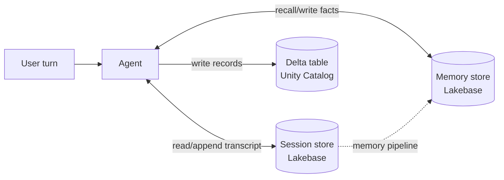
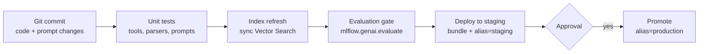

# Memória, CI/CD, prompts e interfaces de usuário

## Visão geral

Quatro itens de Montagem e implantação de aplicações transformam um agent funcional em uma
aplicação de produção: *"Configurar um armazenamento de dados persistente para armazenar e
recuperar memória intermediária ou informações estruturadas"*, *"Aplicar práticas recomendadas de
CI/CD, como atualizar um índice do Vector Search, promover prompts entre ambientes e testar
componentes individuais de um agent"*, *"Aplicar controle de versão de prompts e gerenciar o ciclo
de vida deles"* e *"Desenvolver uma interface interativa apropriada para um cenário de uso de agents
(Apps, Slack, Teams etc.)"*.

> [!abstract]
>
> - **Memória** — o estado de *sessão* de curto prazo (conversa, checkpoints do framework) e a *memória* de longo prazo (fatos e preferências entre conversas) pertencem a um armazenamento durável, como o **Lakebase** (Postgres gerenciado); fatos estruturados gravados pelo agent pertencem a **tabelas Delta**
> - **CI/CD** — versione código, prompts e modelos; teste ferramentas e retrievers isoladamente; avalie o agent inteiro como gate; atualize o índice do Vector Search como etapa do pipeline; implante com bundles
> - **Ciclo de vida de prompts** — o **MLflow Prompt Registry** armazena prompts no Unity Catalog com **versões** imutáveis e **aliases** mutáveis (`staging`, `production`) para promoção e reversão
> - **Interfaces de usuário** — **Databricks Apps** para uma interface Web governada, o app Genie para **Microsoft Teams** e backends de bot para ferramentas de chat — sempre chamando o agent no lado do servidor

> [!tip] O que o exame avalia
>
> - Onde manter o estado da conversa para que ele sobreviva a reinicializações e escale entre réplicas (não na memória do processo)
> - O padrão de promoção de prompts da questão de exemplo oficial: **versões de prompts do MLflow + aliases** — não merges de branches nem sobrescritas de JSON ou Delta
> - O que significa “testar componentes individuais” de um agent (ferramentas, retriever, prompt, avaliação de ponta a ponta)
> - Escolher a interface adequada ao cenário e manter credenciais fora do navegador

---

> [!note] Atualização da plataforma (out. 2026)
> **Memória:** o Databricks agora oferece stores totalmente gerenciados de **sessões de agent** e **memória de agent**, ambos baseados no Lakebase, além de **pipelines de memória de agent** (Beta, 2026-10-12), que extraem fatos duráveis das sessões e os armazenam na memória ([Memória e sessões de agents](https://docs.databricks.com/aws/en/agents/custom-agents/stateful-agents)). O padrão anterior de memória Lakebase autogerenciada e os stores de memória gerenciados anteriores estão listados como *legacy* ([Ofertas legacy para agents](https://docs.databricks.com/aws/en/agents/legacy/)).
> **Implantação e interface:** projetos criados com o **Agent Bricks CLI** (Beta) incluem uma interface de chat e são implantados no Agent Runtime do Databricks Apps; `agentbricks sessions bind` e `agentbricks memory bind` conectam os stores ([Agent Bricks CLI](https://docs.databricks.com/aws/en/agents/custom-agents/agent-bricks-cli)).
> **Bundles:** Databricks Asset Bundles foram renomeados **Declarative Automation Bundles** em 2026-03-16 ([notas de versão de março de 2026](https://docs.databricks.com/aws/en/release-notes/product/2026/march)).

## Armazenamentos de dados persistentes para memória e informações estruturadas

Uma réplica do agent pode reiniciar ou escalar a qualquer momento, portanto o **estado deve ficar fora do processo**.

| Estado | Exemplo | Armazenamento |
| :--- | :--- | :--- |
| **Estado da sessão (curto prazo)** | Transcrição da conversa, chamadas a ferramentas e resultados, checkpoint do LangGraph | Store de sessão baseado no Lakebase (ou checkpointer Postgres no Lakebase) |
| **Memória de longo prazo** | “Este usuário prefere respostas em japonês”, “O Projeto X usa o workspace da UE” | Store de memória com busca semântica (baseado no Lakebase) |
| **Informações estruturadas produzidas pelo agent** | Campos extraídos, decisões, registros de casos | Tabela Delta no Unity Catalog (`MERGE` em uma chave) |
| **Consultas de baixa latência lidas pelo agent** | Perfil do cliente por ID durante um chat | Tabela Lakebase ou tabela online/de features indexada por ID |



Regras de design:

- Identifique sessões por um **ID de sessão ou thread** e memórias por **assunto** (usuário, conta, projeto)
- Passe o ID da sessão por `custom_inputs` (ou pela API de invocação) para que cada turno recarregue o mesmo estado
- Não inclua secrets nem PII bruta na memória; aplique a mesma governança usada para tabelas
- Sessões e memória são independentes: excluir uma sessão não exclui as memórias extraídas dela

## CI/CD para aplicações de GenAI



### Testar componentes individuais

| Componente | Teste |
| :--- | :--- |
| **Ferramentas** (funções do UC, ferramentas Python) | Testes unitários com entradas fixas e saídas esperadas; tratamento de erros |
| **Retriever** | Métricas de recuperação em um conjunto de consultas rotulado (recall@k, MRR, `RetrievalSufficiency`) |
| **Prompt + parser** | Testes de formato: a saída pode ser analisada e validada pelo schema? |
| **Roteamento / seleção de ferramentas** | Judges `ToolCallCorrectness` e `ToolCallEfficiency` em solicitações representativas |
| **Agent inteiro** | `mlflow.genai.evaluate()` em um conjunto de dados de avaliação versionado, comparado à versão atual em produção |

### Atualizar um índice do Vector Search no pipeline

- **Índice Delta Sync no modo triggered** — depois de atualizar a tabela de chunks, chame `index.sync()` como tarefa do job e aguarde a sincronização antes de executar testes de recuperação
- **Modo continuous** — não há etapa explícita, mas os testes devem considerar o atraso de propagação
- **Alteração do modelo de embedding** — crie um novo índice e faça a troca (blue-green), pois os vetores de modelos diferentes não são comparáveis (consulte [Vector Search em produção](../01-application-development/04-vector-search-runtime.md))

### Promover modelos e prompts com aliases

- Registre versões do agent no Unity Catalog e aponte ambientes para **aliases** (`models:/main.agents.support_agent@champion`) em vez de números de versão
- Promova prompts da mesma forma com aliases de prompt (próxima seção)
- Implante jobs, endpoints e apps com **Declarative Automation Bundles** para definir dev, staging e produção como código

## Controle de versões e ciclo de vida de prompts

O **MLflow Prompt Registry** (Beta) armazena prompts como objetos do Unity Catalog ([Prompt Registry](https://docs.databricks.com/aws/en/mlflow3/genai/prompt-version-mgmt/prompt-registry/)):

| Conceito | Significado |
| :--- | :--- |
| **Prompt** | Entidade nomeada no Unity Catalog (`catalog.schema.prompt_name`) |
| **Versão** | Snapshot imutável com número incrementado automaticamente e mensagem de commit |
| **Alias** | Ponteiro mutável para uma versão (`staging`, `production`) — mova-o para promover ou reverter |
| **Tags** | Metadados de chave-valor específicos da versão |

Permissões: `CREATE FUNCTION`, `EXECUTE` e `MANAGE` no schema do Unity Catalog que armazena os prompts.

```python
import mlflow

# Register (creates version 1, or the next version if the prompt exists)
prompt = mlflow.genai.register_prompt(
    name="main.prompts.customer_support",
    template="You are a helpful assistant. Answer this question: {{question}}",
    commit_message="Initial customer support prompt",
)

# Promote: point the production alias at a validated version
mlflow.genai.set_prompt_alias(
    name="main.prompts.customer_support",
    alias="production",
    version=prompt.version,
)

# Load by alias in the application — no code change when the alias moves
prod_prompt = mlflow.genai.load_prompt("prompts:/main.prompts.customer_support@production")
text = prod_prompt.format(question="How do I reset my password?")
```

| Etapa do ciclo de vida | Função |
| :--- | :--- |
| Criar / adicionar uma versão | `register_prompt()` |
| Recuperar uma versão ou alias | `load_prompt()` |
| Encontrar prompts | `search_prompts()` |
| Promover / reverter | `set_prompt_alias()` |
| Remover um alias (as versões permanecem) | `delete_prompt_alias()` |
| Remover um prompt ou versão | `delete_prompt()` |

Templates usam variáveis entre chaves duplas (`{{question}}`). Para reverter, mova o alias para uma versão anterior — o histórico de versões nunca é perdido.

## Interfaces de usuário para agents

| Cenário | Interface | Observações |
| :--- | :--- | :--- |
| Aplicação Web interna com SSO corporativo e permissões por usuário | **Databricks Apps** (Streamlit, Dash, Gradio, Flask, Node.js/React) | O backend do app chama o agent com autorização do app ou do usuário; nenhum token no navegador |
| Agent code-first que precisa rapidamente de uma interface de chat | Template de agent / interface de chat do Agent Bricks CLI no Databricks Apps | Incluída no projeto estruturado |
| Analistas que já trabalham no Microsoft Teams | **App Databricks Genie no Microsoft Teams** (Public Preview) | Consulte o Genie em mensagem direta ou canal; proprietários do canal podem fixar um Genie Agent específico ([documentação](https://docs.databricks.com/aws/en/integrations/msft-teams)) |
| Equipe de suporte que usa Slack | Backend de bot do Slack que chama o endpoint do agent ou a Genie Conversation API no lado do servidor | Mantenha a credencial do Databricks no backend; associe usuários do Slack a identidades para aplicar permissões |
| Desenvolvedores que testam um agent | `agentbricks dev` local, AI Playground, MLflow Review App | Ambientes de teste, não interfaces de produção |
| Consumidores programáticos | REST / API de invocação, clientes compatíveis com OpenAI, `ai_query()` do SQL | Service principal com `CAN QUERY` |

A decisão geralmente depende de **onde os usuários já trabalham** e de **qual identidade deve ser aplicada**. Em todas as opções, o frontend se comunica com um backend, que mantém as credenciais.

## Casos de uso

- **Bot de suporte que resiste a reinicializações** — o estado da conversa fica em um store de sessão baseado no Lakebase, para que uma réplica escalada possa continuar qualquer conversa
- **Lançamento controlado de prompt** — uma alteração de prompt é registrada como versão 7, avaliada em staging com o alias `staging`, aprovada e promovida ao mover `production` para 7; a reversão move-o de volta para 6
- **Atualização noturna do índice** — um job atualiza a tabela de chunks, aciona `index.sync()`, executa testes de recuperação e só então atualiza o alias do agent
- **Equipe financeira no Teams** — o app Genie é fixado em um Genie Agent financeiro no canal da equipe

## Problemas e erros comuns

### Contexto da conversa perdido entre turnos

**Cenário:** o agent esquece turnos anteriores depois de escalar para várias réplicas.
**Correção:** o estado está armazenado na memória do processo. Persista sessões em um store externo indexado pelo ID da sessão e passe o ID em cada solicitação.

### Alterações de prompt exigem nova implantação

**Cenário:** cada ajuste de prompt exige reconstruir e reimplantar o agent.
**Correção:** carregue prompts do Prompt Registry por **alias** em tempo de execução; a promoção passa a ser apenas a movimentação de um alias.

### Testes passam, mas respostas de produção estão desatualizadas

**Cenário:** o CI avalia um índice cuja sincronização ainda não terminou.
**Correção:** torne a sincronização do índice uma etapa explícita do pipeline e aguarde a conclusão antes de executar testes de recuperação e avaliação.

## Dicas para o exame

> [!tip] Dicas para o exame
>
> - **Promoção de prompts com histórico e reversão → versões de prompts do MLflow + aliases** (resposta de exemplo oficial).
> - Memória de conversa → **store externo durável** (Lakebase / store de sessão), nunca memória do processo.
> - “Testar componentes individuais” = ferramentas, retriever, prompt/parser, roteamento — depois, avalie o agent inteiro.
> - Alterações no índice são uma **etapa do pipeline** (`sync()` para índices Delta Sync triggered); um novo modelo de embedding exige um novo índice.
> - Interface: **Databricks Apps** para interfaces Web governadas; o **Teams** tem um app Genie; qualquer interface chama o agent no **lado do servidor**.

## Principais conclusões

- Mantenha o estado da sessão e a memória de longo prazo em stores duráveis (baseados no Lakebase); grave saídas estruturadas em tabelas Delta
- CI/CD para agents versiona código, prompts e modelos; testa componentes individualmente e condiciona lançamentos à avaliação
- O Prompt Registry oferece versões imutáveis e aliases móveis para promover e reverter prompts
- Escolha a interface onde os usuários já trabalham e mantenha sempre as credenciais no backend

## Tópicos relacionados

- [MLflow para GenAI](./02-mlflow-for-genai.md)
- [Controle de acesso e inferência em lote](./05-access-control-and-batch-inference.md)
- [Engenharia de prompts](../01-application-development/01-prompt-engineering.md)
- [Databricks Vector Search](../04-data-preparation/03-databricks-vector-search.md)

## Documentação oficial

- [Memória e sessões de agents](https://docs.databricks.com/aws/en/agents/custom-agents/stateful-agents)
- [Prompt Registry](https://docs.databricks.com/aws/en/mlflow3/genai/prompt-version-mgmt/prompt-registry/)
- [Agent Bricks CLI (Beta)](https://docs.databricks.com/aws/en/agents/custom-agents/agent-bricks-cli)
- [Autenticação para agents no Databricks Apps](https://docs.databricks.com/aws/en/agents/custom-agents/agent-authentication)
- [App Databricks Genie no Microsoft Teams](https://docs.databricks.com/aws/en/integrations/msft-teams)

---

**[← Anterior: Controle de acesso e inferência em lote](./05-access-control-and-batch-inference.md) | [↑ Voltar para Montagem e implantação de aplicações](./README.md)**
