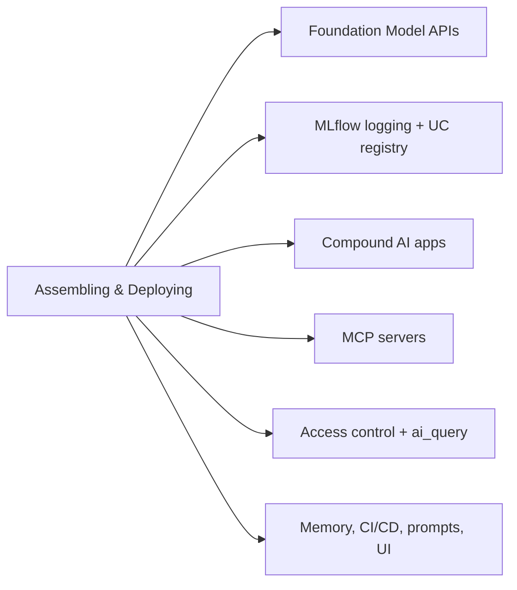

# Montagem e implantação de aplicações (22 % do exame)

Seção 4 do guia do exame: como empacotar, proteger, implantar e operar aplicações de GenAI no Databricks. Abrange Foundation Model APIs, registro no MLflow e no Unity Catalog, o padrão de aplicações compostas, servidores MCP, controle de acesso a partir de endpoints de serving, inferência em lote com `ai_query()`, memória persistente, CI/CD, ciclo de vida de prompts e interfaces de usuário. (O monitoramento do AI Gateway foi movido para [Avaliação e monitoramento](../05-evaluation-and-monitoring/README.md), onde o guia do exame o posiciona.)

> [!note] Atualização da plataforma (out. de 2026)
> O exame aborda agents implantados no **Model Serving** com `agents.deploy()`. Desde 2026-10-05, a documentação classifica esse caminho como *legacy* e recomenda o **Agent Bricks CLI** (Beta), que implanta no **Agent Runtime** do Databricks Apps. Aprenda o caminho cobrado no exame e saiba que o novo também existe ([Implantar agents no Databricks](https://docs.databricks.com/aws/en/agents/deploy/)).

## Visão geral dos tópicos

## Conteúdo da seção

| Arquivo | Tópico | Prioridade |
| :--- | :--- | :--- |
| [01-mosaic-ai-and-foundation-models.md](./01-mosaic-ai-and-foundation-models.md) | Foundation Model APIs, pagamento por token vs. throughput provisionado, modelos externos, serving de modelos personalizados | Alta |
| [02-mlflow-for-genai.md](./02-mlflow-for-genai.md) | MLflow Tracing, pyfunc com pré/pós-processamento, `log_model` com recursos, `agents.deploy()`, Review App | Alta |
| [03-compound-ai-apps.md](./03-compound-ai-apps.md) | Um endpoint para retriever + LLM + ferramentas; `ResponsesAgent`; registro no UC; implantação | Alta |
| [04-mcp-servers.md](./04-mcp-servers.md) | Servidores MCP gerenciados, externos e personalizados; alterações de endpoints; governança *(guia de 2026)* | Alta |
| [05-access-control-and-batch-inference.md](./05-access-control-and-batch-inference.md) | Passthrough automático, OBO, secrets; permissões de endpoints; inferência em lote com `ai_query()` *(guia de 2026)* | Alta |
| [06-memory-cicd-prompts-and-interfaces.md](./06-memory-cicd-prompts-and-interfaces.md) | Stores de memória persistente, CI/CD, Prompt Registry, interfaces para Apps / Teams / Slack *(guia de 2026)* | Alta |

## Cobertura do guia do exame

| Item do guia do exame (Seção 4) | Onde é abordado |
| :--- | :--- |
| Codificar uma chain usando um modelo pyfunc com pré e pós-processamento | [02](./02-mlflow-for-genai.md), [03](./03-compound-ai-apps.md) |
| Controlar o acesso a recursos a partir de endpoints de model serving | [05](./05-access-control-and-batch-inference.md#controlar-o-acesso-a-recursos-a-partir-de-endpoints-do-model-serving) |
| Codificar uma chain simples conforme os requisitos | [Chains e agents](../01-application-development/02-chains-agents.md) |
| Escolher os elementos básicos para criar uma aplicação RAG: model flavor, modelo de embedding, retriever, dependências, exemplos de entrada, assinatura do modelo | [02](./02-mlflow-for-genai.md), [03](./03-compound-ai-apps.md) |
| Registrar o modelo no Unity Catalog usando MLflow | [02](./02-mlflow-for-genai.md), [03](./03-compound-ai-apps.md) |
| Criar e consultar um índice do Vector Search | [Databricks Vector Search](../04-data-preparation/03-databricks-vector-search.md) |
| Identificar como servir uma aplicação de LLM que usa Foundation Model APIs | [01](./01-mosaic-ai-and-foundation-models.md) |
| Explicar os principais conceitos e componentes do Mosaic AI Vector Search | [Databricks Vector Search](../04-data-preparation/03-databricks-vector-search.md), [Vector Search em produção](../01-application-development/04-vector-search-runtime.md) |
| Identificar cargas de trabalho de inferência em lote e aplicar `ai_query()` adequadamente | [05](./05-access-control-and-batch-inference.md#inferência-em-lote-com-ai_query) |
| Configurar o Vector Search para uma solução específica considerando o número de embeddings, a frequência de atualização, a latência e os requisitos de custo | [Vector Search em produção](../01-application-development/04-vector-search-runtime.md#diretrizes-de-dimensionamento) |
| Configurar um armazenamento de dados persistente para armazenar e recuperar memória intermediária ou informações estruturadas | [06](./06-memory-cicd-prompts-and-interfaces.md#armazenamentos-de-dados-persistentes-para-memória-e-informações-estruturadas) |
| Aplicar práticas recomendadas de CI/CD, como atualizar um índice do Vector Search, promover prompts entre ambientes e testar componentes individuais de um agent | [06](./06-memory-cicd-prompts-and-interfaces.md#cicd-para-aplicações-de-genai) |
| Integrar servidores MCP gerenciados, externos e personalizados com base nos requisitos de uma aplicação | [04](./04-mcp-servers.md) |
| Aplicar controle de versão de prompts e gerenciar o ciclo de vida deles | [06](./06-memory-cicd-prompts-and-interfaces.md#controle-de-versões-e-ciclo-de-vida-de-prompts) |
| Desenvolver uma interface interativa apropriada para um cenário de uso de agents (Apps, Slack, Teams etc.) | [06](./06-memory-cicd-prompts-and-interfaces.md#interfaces-de-usuário-para-agents) |

## Conceitos-chave

| Conceito | Por que é importante |
| :--- | :--- |
| **Foundation Model APIs (FMAPI)** | LLMs e modelos de embedding hospedados pelo Databricks — sem infraestrutura para gerenciar |
| **Pagamento por token vs. throughput provisionado** | Pagamento por solicitação vs. capacidade reservada com latência previsível |
| **`ResponsesAgent` + `agents.deploy()`** | Caminho de empacotamento e implantação de agents cobrado no exame (`ChatAgent` / `ChatModel` são legados) |
| **`resources` em `log_model()`** | Declarar dependências permite que a implantação provisione credenciais |
| **Servidores MCP** | Primeiro os gerenciados, depois os externos e, por último, os personalizados (no Databricks Apps) |
| **`ai_query()`** | Aplica um modelo a uma tabela inteira quando ninguém está aguardando uma resposta |
| **Aliases do Prompt Registry** | Promova e reverta prompts sem reimplantar |

## Recursos relacionados

- [Fundamentos do MLflow (compartilhado)](../../../../../shared/fundamentals/mlflow-basics.md)
- [Documentação do Model Serving](https://docs.databricks.com/en/machine-learning/model-serving/index.html)
- [Documentação das Foundation Model APIs](https://docs.databricks.com/en/machine-learning/foundation-models/index.html)
- [MCPs no Databricks](https://docs.databricks.com/aws/en/agents/mcp-tools/)
- [Agent Bricks CLI (Beta)](https://docs.databricks.com/aws/en/agents/custom-agents/agent-bricks-cli)

---

**[← Anterior: Desenvolvimento de aplicações](../01-application-development/README.md) | [↑ Voltar para GenAI Engineer Associate](../README.md) | [Próximo: Design de aplicações](../03-design-applications/README.md) →**
