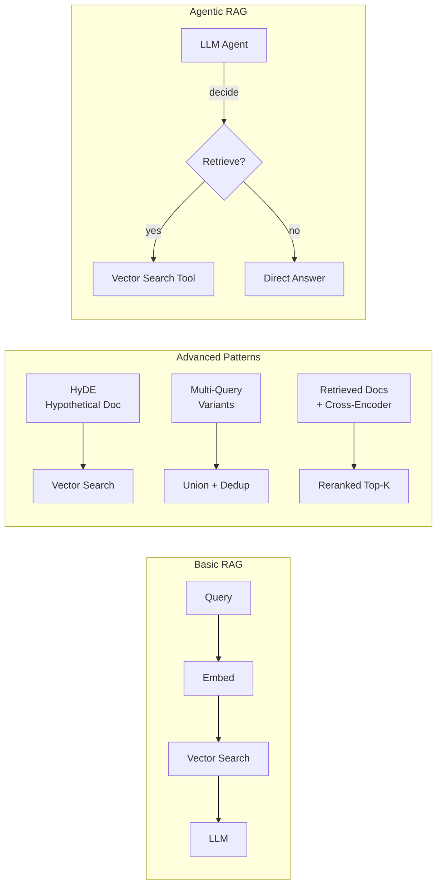
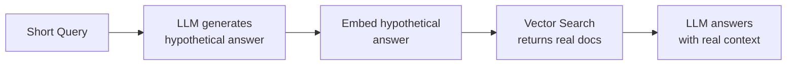

# Padrões de design de RAG

Padrões avançados de recuperação vão além do pipeline RAG básico para lidar com desafios de precisão, recall
e tomada de decisão dinâmica. Este arquivo aborda quando escolher RAG em vez de fine-tuning
e os principais padrões de arquitetura que melhoram a qualidade de sistemas RAG.

## Visão geral

> [!note] Atualização da plataforma (out. 2026)
> O exemplo de RAG agentic abaixo herda de `mlflow.pyfunc.ChatModel`, interface de autoria que o Databricks agora considera *legada*; desde o MLflow 3.0, o MLflow recomenda usar `ResponsesAgent` ([guia do MLflow ChatModel](https://mlflow.org/docs/latest/genai/flavors/chat-model-intro/)). Os próprios padrões de recuperação não mudaram. Para conhecer a interface atual e alternativas gerenciadas, consulte [Sistemas agentic com MLflow, Agent Framework e Genie](../../../../../certifications/genai-engineer-associate/01-application-development/05-agentic-systems-mlflow-and-genie.md) e [Agent Bricks](03-agent-bricks.md).



## Estrutura para decidir entre RAG e fine-tuning

Escolher entre RAG e fine-tuning é um tema frequente no exame. Eles resolvem problemas diferentes.

| Critério | Use RAG | Use fine-tuning |
| :--- | :--- | :--- |
| **Atualidade do conhecimento** | Dados atualizados com frequência (semanal/diária) | Conhecimento estável, que raramente muda |
| **Tamanho dos dados** | Grande demais para caber na janela de contexto | Conjunto de dados pequeno e selecionado |
| **Privacidade** | Dados sensíveis demais para incluir no treinamento | Dados podem ser usados no treinamento |
| **Latência** | Latência de recuperação aceitável | Latência rigorosa; recuperação lenta demais |
| **Objetivo** | Adicionar conhecimento factual | Mudar tom, estilo ou formato de saída |
| **Custo** | Evitar custos de treinamento em GPU | Custo único de treinamento aceitável |
| **Auditabilidade** | São necessárias citações rastreáveis das fontes | Saída de modelo caixa-preta é aceitável |

### Regra principal para o exame

O RAG adiciona conhecimento **no momento da inferência**, recuperando documentos — os pesos do modelo nunca\mudam. O fine-tuning **modifica os pesos do modelo** — o conhecimento é incorporado, mas fica desatualizado
e é caro de atualizar.

## Padrões avançados de RAG

### HyDE — embeddings de documentos hipotéticos

**Problema**: a pergunta curta do usuário (“O que é o Databricks AutoML?”) talvez não gere embeddings
semelhantes aos de parágrafos longos de documentação que a respondem.

**Solução**: primeiro peça ao LLM para gerar um documento hipotético que responda à pergunta. Gere o embedding dessa
resposta hipotética — semanticamente, ela corresponderá melhor à documentação real do que a
pergunta curta original.



```python
import mlflow.deployments

deploy_client = mlflow.deployments.get_deploy_client("databricks")

def hyde_retrieve(query: str, index, num_results: int = 5) -> list[dict]:
    """HyDE: generate hypothetical answer, embed it, use as retrieval query."""

    # Step 1: Generate a hypothetical answer
    hyde_prompt = (
        f"Write a short, factual paragraph that directly answers this question. "
        f"Do not say 'I don't know' — write the best possible answer you can.\n\n"
        f"Question: {query}"
    )
    hypo_response = deploy_client.predict(
        endpoint="databricks-meta-llama-3-1-70b-instruct",
        inputs={"messages": [{"role": "user", "content": hyde_prompt}]}
    )
    hypothetical_answer = hypo_response["choices"][0]["message"]["content"]

    # Step 2: Use the hypothetical answer as the retrieval query
    results = index.similarity_search(
        query_text=hypothetical_answer,
        columns=["content", "source", "chunk_id"],
        num_results=num_results
    )
    return results.get("result", {}).get("data_array", [])
```

**Quando usar HyDE**: quando as consultas são curtas ou ambíguas e a documentação é extensa.
Melhora o recall de perguntas factuais curtas diante de documentos longos.

### RAG com múltiplas consultas (multi-query)

**Problema**: a formulação de uma única consulta pode não encontrar documentos relevantes que usam
outra terminologia.

**Solução**: gere de 3 a 5 formulações alternativas da mesma pergunta, faça a recuperação para cada uma
e remova resultados duplicados antes de enviá-los ao LLM.

```python
from databricks.vector_search.client import VectorSearchClient

def multi_query_retrieve(query: str, index, num_results: int = 5) -> list[str]:
    """Generate multiple query variants and union the results."""

    # Generate query variants
    variant_prompt = (
        f"Generate 3 different ways to ask the following question. "
        f"Return only the questions, one per line, no numbering.\n\n"
        f"Question: {query}"
    )
    variant_response = deploy_client.predict(
        endpoint="databricks-meta-llama-3-1-70b-instruct",
        inputs={"messages": [{"role": "user", "content": variant_prompt}]}
    )
    variants_text = variant_response["choices"][0]["message"]["content"]
    query_variants = [query] + [
        v.strip() for v in variants_text.strip().split("\n") if v.strip()
    ]

    # Retrieve for each variant and deduplicate by chunk_id
    seen_ids = set()
    all_chunks = []
    for variant in query_variants:
        results = index.similarity_search(
            query_text=variant,
            columns=["content", "source", "chunk_id"],
            num_results=num_results
        )
        for row in results.get("result", {}).get("data_array", []):
            chunk_id = row[2]  # chunk_id column
            if chunk_id not in seen_ids:
                seen_ids.add(chunk_id)
                all_chunks.append(row[0])  # content column

    return all_chunks[:num_results * 2]  # cap total context
```

### Reclassificação (re-ranking)

**Problema**: a pontuação de similaridade vetorial é uma aproximação imperfeita da relevância. Os cinco primeiros resultados
podem incluir chunks irrelevantes cujos embeddings são parecidos por acaso.

**Solução**: use um modelo cross-encoder para pontuar a relevância real de cada chunk recuperado em relação à consulta
e, em seguida, reordená-los. Cross-encoders analisam juntos a consulta e o documento — são muito
mais precisos que a similaridade de cosseno de um bi-encoder, mas lentos demais para executar em todo o índice.

```python
# Two-stage retrieval: fast ANN first, accurate reranking second

from databricks.vector_search.client import VectorSearchClient

def retrieve_and_rerank(
    query: str,
    index,
    initial_k: int = 20,
    final_k: int = 5
) -> list[str]:
    """Retrieve broad set with ANN, then rerank with cross-encoder."""

    # Stage 1: fast approximate nearest-neighbor retrieval
    results = index.similarity_search(
        query_text=query,
        columns=["content", "chunk_id"],
        num_results=initial_k
    )
    candidates = [
        row[0]
        for row in results.get("result", {}).get("data_array", [])
    ]

    # Stage 2: rerank using Cohere reranker endpoint
    rerank_response = deploy_client.predict(
        endpoint="cohere-rerank-v3",
        inputs={
            "query": query,
            "documents": candidates,
            "top_n": final_k
        }
    )
    reranked = sorted(
        rerank_response["results"],
        key=lambda x: x["relevance_score"],
        reverse=True
    )
    return [candidates[r["index"]] for r in reranked]
```

**Ponto principal para o exame**: o re-ranking opera sobre o conjunto **recuperado** (por exemplo, os 20 primeiros), não
sobre o índice inteiro. É uma etapa posterior à recuperação.

### Chunking pai-filho

**Problema**: chunks pequenos recuperam resultados com precisão, mas não oferecem contexto suficiente para o LLM
gerar uma boa resposta. Chunks grandes fornecem contexto, mas reduzem a precisão da recuperação.

**Solução**: indexe **chunks filhos** pequenos para uma busca vetorial precisa, mas retorne o
**chunk pai** (a seção completa) ao LLM para oferecer um contexto mais rico.

```python
# Indexing: store both parent_id and child content

def create_parent_child_chunks(document: str, parent_size: int = 1024,
                                child_size: int = 256) -> list[dict]:
    """Split document into parents, then children referencing their parent."""
    from langchain.text_splitter import RecursiveCharacterTextSplitter

    parent_splitter = RecursiveCharacterTextSplitter(chunk_size=parent_size)
    child_splitter = RecursiveCharacterTextSplitter(chunk_size=child_size)

    parents = parent_splitter.create_documents([document])
    chunks = []
    for p_idx, parent in enumerate(parents):
        children = child_splitter.create_documents([parent.page_content])
        for c_idx, child in enumerate(children):
            chunks.append({
                "chunk_id": f"p{p_idx}_c{c_idx}",
                "parent_id": f"p{p_idx}",
                "content": child.page_content,    # indexed for search
                "parent_content": parent.page_content  # returned to LLM
            })
    return chunks
```

No momento da recuperação, pesquise em `content` (o chunk filho pequeno), mas passe `parent_content` ao LLM.

### Compressão contextual

**Problema**: os chunks recuperados contêm frases irrelevantes para a consulta, ocupando espaço na
janela de contexto e podendo distrair o LLM.

**Solução**: após a recuperação, use um LLM para extrair de cada chunk somente as frases
relevantes para a consulta antes de passá-las à etapa final de geração.

```python
def compress_chunk(chunk: str, query: str) -> str:
    """Extract only relevant sentences from a chunk."""
    compress_prompt = (
        f"From the passage below, extract only the sentences that are directly "
        f"relevant to answering the question. If nothing is relevant, respond with "
        f"'NOT RELEVANT'.\n\n"
        f"Question: {query}\n\nPassage:\n{chunk}"
    )
    response = deploy_client.predict(
        endpoint="databricks-meta-llama-3-1-70b-instruct",
        inputs={"messages": [{"role": "user", "content": compress_prompt}]}
    )
    result = response["choices"][0]["message"]["content"]
    return "" if result.strip() == "NOT RELEVANT" else result
```

## RAG agêntico (agentic RAG)

O RAG padrão **sempre** recupera informações antes de responder. O RAG agentic permite que o LLM
decida **se** vai recuperar informações, chamar outras ferramentas ou responder usando a memória.

### Padrão de chamada de ferramentas com Mosaic AI Agent Framework

```python
import mlflow
from mlflow.pyfunc import ChatModel
from mlflow.types.llm import ChatCompletionRequest, ChatCompletionResponse
from databricks.vector_search.client import VectorSearchClient

class AgenticRAGModel(ChatModel):
    """
    Agentic RAG using mlflow.pyfunc.ChatModel base class.
    The LLM decides when to call the retrieval tool.
    """

    def load_context(self, context):
        self.deploy_client = mlflow.deployments.get_deploy_client("databricks")
        self.vsc = VectorSearchClient()
        self.index = self.vsc.get_index(
            endpoint_name="my_endpoint",
            index_name="catalog.schema.docs_index"
        )

    def _retrieve(self, query: str) -> str:
        """Vector search tool callable by the agent."""
        results = self.index.similarity_search(
            query_text=query,
            columns=["content"],
            num_results=4
        )
        chunks = [
            row[0]
            for row in results.get("result", {}).get("data_array", [])
        ]
        return "\n\n".join(chunks)

    def predict(
        self, context, messages: ChatCompletionRequest, params=None
    ) -> ChatCompletionResponse:
        tools = [
            {
                "type": "function",
                "function": {
                    "name": "retrieve_docs",
                    "description": (
                        "Search the knowledge base for relevant documentation. "
                        "Use this when the question requires specific factual information."
                    ),
                    "parameters": {
                        "type": "object",
                        "properties": {
                            "query": {
                                "type": "string",
                                "description": "The search query"
                            }
                        },
                        "required": ["query"]
                    }
                }
            }
        ]

        # First LLM call — agent decides whether to use the tool
        response = self.deploy_client.predict(
            endpoint="databricks-meta-llama-3-1-70b-instruct",
            inputs={
                "messages": [m.to_dict() for m in messages.messages],
                "tools": tools
            }
        )

        choice = response["choices"][0]
        # If the model called a tool, execute it and call again
        if choice.get("finish_reason") == "tool_calls":
            import json
            tool_call = choice["message"]["tool_calls"][0]
            args = json.loads(tool_call["function"]["arguments"])
            context_text = self._retrieve(args["query"])

            followup_messages = [m.to_dict() for m in messages.messages] + [
                choice["message"],
                {
                    "role": "tool",
                    "tool_call_id": tool_call["id"],
                    "content": context_text
                }
            ]
            final_response = self.deploy_client.predict(
                endpoint="databricks-meta-llama-3-1-70b-instruct",
                inputs={"messages": followup_messages}
            )
            return final_response
        return response
```

### Registro de um modelo agêntico com MLflow

```python
with mlflow.start_run():
    model_info = mlflow.pyfunc.log_model(
        artifact_path="agentic_rag",
        python_model=AgenticRAGModel(),
        pip_requirements=[
            "databricks-vectorsearch",
            "mlflow>=2.13"
        ]
    )
```

## Métricas de avaliação de RAG (visão rápida)

A avaliação detalhada é abordada no tópico 03. As quatro métricas principais a conhecer são:

| Métrica | Pergunta respondida | Boa pontuação |
| :--- | :--- | :--- |
| **Fidelidade** | A resposta está fundamentada no contexto recuperado? | > 0.8 |
| **Relevância da resposta** | A resposta trata da pergunta? | > 0.8 |
| **Precisão do contexto** | Os chunks recuperados são realmente relevantes? | > 0.7 |
| **Recall do contexto** | A recuperação encontrou todas as informações necessárias? | > 0.7 |

## Armadilhas comuns

| Armadilha | Causa | Correção |
| :--- | :--- | :--- |
| Estouro da janela de contexto | Muitos chunks ou chunks grandes demais enviados ao LLM | Reduza `num_results`; use compressão contextual |
| Recuperação irrelevante | Consulta e documentos usam terminologias diferentes | Use HyDE; adicione busca híbrida; melhore o chunking |
| Propagação de alucinações | O LLM acrescenta fatos que não estáo no contexto recuperado | Reduza a temperatura; adicione guardrails de fidelidade |
| Latência do re-ranking | Cross-encoder lento demais para produção | Armazene consultas frequentes em cache; reduza o conjunto inicial recuperado |
| Conhecimento desatualizado | O índice vetorial não é atualizado quando os documentos mudam | Use Delta Sync CONTINUOUS ou sincronização TRIGGERED agendada |

## Questões de prática

**Questão 1**: você está criando um sistema RAG no qual os usuários fazem perguntas muito curtas (5–10 palavras),
mas a base de conhecimento contém parágrafos técnicos longos. O recall da recuperação é baixo.
Qual técnica trata mais diretamente essa incompatibilidade?

A) Aumentar `num_results` de 5 para 20
B) Usar HyDE — gerar uma resposta hipotética e criar o embedding dela para usá-la como consulta de recuperação
C) Trocar similaridade de cosseno por distância euclidiana
D) Adicionar filtros de metadados para reduzir o espaço de busca

> [!success]- Resposta
> **Resposta correta: B**
>
> O problema central é uma **incompatibilidade de espaço de embeddings** entre consultas curtas e
> parágrafos longos de documentos. HyDE preenche essa lacuna ao gerar uma resposta hipotética que
> que se assemelha ao estilo e ao tamanho dos documentos reais — produzindo embeddings que ficam
> mais próximos dos vetores dos documentos reais.
>
> Aumentar `num_results` (A) aumenta o recall, mas também aumenta o ruído e o uso da
> janela de contexto. A distância euclidiana (C) não resolve a incompatibilidade de embeddings.
> Filtros de metadados (D) reduzem o escopo, mas não corrigem problemas de distância semântica entre embeddings.

**Questão 2**: um modelo RAG agentic que usa `mlflow.pyfunc.ChatModel` chama uma ferramenta
de busca vetorial. Qual é a próxima etapa correta no loop de chamada de ferramentas?

A) Retornar o resultado da ferramenta diretamente ao usuário sem uma segunda chamada ao LLM
B) Gerar novamente o embedding do resultado da ferramenta e executar uma segunda busca vetorial
C) Anexar o resultado da ferramenta como uma mensagem com papel `tool` e chamar o LLM novamente
D) Armazenar o resultado da ferramenta no tracking do MLflow e encerrar a interação da conversa

> [!success]- Resposta
> **Resposta correta: C**
>
> O loop padrão de chamada de ferramentas nas APIs de LLM é:
>
> 1. O LLM responde com `finish_reason: "tool_calls"`
> 2. A aplicação executa a ferramenta e obtém o resultado
> 3. O resultado é anexado como mensagem com `role: "tool"` e o `tool_call_id` correspondente
> 4. O histórico completo de mensagens (incluindo o resultado da ferramenta) é enviado de volta ao LLM para uma resposta final
>
> O LLM precisa receber a saída da ferramenta para gerar uma resposta final fundamentada.

**Questão 3**: sua equipe quer melhorar o recall da recuperação sem sacrificar a qualidade da resposta
final. Qual combinação de técnicas alcança esse objetivo?

A) RAG multi-query para ampliar a recuperação + re-ranking para selecionar o subconjunto mais relevante
B) HyDE para ampliar a recuperação + chunks maiores para aumentar o contexto
C) Filtragem de metadados para restringir a recuperação + temperatura mais alta para respostas mais criativas
D) Chunking pai-filho para recuperação + fine-tuning do LLM com os documentos recuperados

> [!success]- Resposta
> **Resposta correta: A**
>
> **RAG multi-query** melhora o recall ao recuperar candidatos com várias formulações de consulta. O
> **re-ranking** então aplica um cross-encoder para selecionar os chunks mais relevantes
> do conjunto mais amplo de candidatos, mantendo a qualidade e aumentando a cobertura.
>
> HyDE + chunks maiores (B) podem ajudar em consultas individuais, mas aumentam o ruído do contexto.
> A filtragem por metadados (C) restringe o recall em vez de melhorá-lo. Fazer fine-tuning com os
> documentos recuperados (D) não é um padrão comum e não resolve a questão do recall.

## Casos de uso

- **Assistente de busca corporativa**: chatbot personalizado baseado em documentação específica do domínio, usando índices de busca vetorial e HyDE para lidar com consultas curtas de funcionários sobre documentos longos de políticas.
- **Base de conhecimento com várias fontes**: combinação de documentação de produtos, chamados de suporte e FAQs em um único pipeline RAG, usando recuperação multi-query para abranger diferenças de terminologia entre fontes e, depois, re-ranking para destacar os chunks mais relevantes.

## Problemas e erros comuns

### Baixo recall de recuperação em consultas curtas

**Cenário:** usuários fazem perguntas curtas como “o que é AutoML?”, mas os cinco primeiros chunks recuperados são irrelevantes porque o embedding da consulta curta não fica próximo ao de parágrafos longos de documentação.
**Correção:** implemente HyDE: primeiro gere uma resposta hipotética e, em seguida, crie o embedding da resposta hipotética como consulta de recuperação. Isso preenche a lacuna entre os espaços de embeddings de consultas curtas e documentos extensos.

### Estouro da janela de contexto causa respostas truncadas

**Cenário:** enviar muitos chunks recuperados ao LLM preenche a janela de contexto e resulta em respostas incompletas ou cortadas.
**Correção:** reduza `num_results`, aplique compressão contextual para extrair somente as frases relevantes de cada chunk ou use chunking pai-filho, para enviar ao LLM menos chunks, porém mais ricos em contexto.

## Principais conclusões

- **RAG versus fine-tuning**: o RAG recupera conhecimento no momento da inferência (pesos inalterados, informações sempre atualizadas); o fine-tuning incorpora conhecimento aos pesos (caro de atualizar, fica desatualizado)
- **HyDE**: gera uma resposta hipotética e cria o embedding dela para preencher a lacuna entre embeddings de consultas curtas e chunks longos de documentos
- **Multi-query RAG**: gera várias versões da consulta, recupera resultados para cada uma e remove duplicatas — melhora o recall ao custo de maior latência
- **Re-ranking**: um cross-encoder recalcula as pontuações do conjunto de candidatos recuperados para selecionar os chunks finais semanticamente mais relevantes
- **RAG agentic**: o LLM decide se chama a ferramenta de recuperação; o resultado da ferramenta é anexado como mensagem com papel `tool` antes da segunda chamada ao LLM
- **RAG é adequado para**: dados atualizados com frequência, grandes bases de conhecimento, restrições de privacidade, requisitos de auditabilidade
- **Fine-tuning é adequado para**: mudanças de tom/estilo, domínios de conhecimento estáveis, requisitos rigorosos de latência

---

**[↑ Voltar para Design de aplicações](README.md) | [Próximo: Design de soluções e planejamento de ferramentas](02-solution-design-and-tool-planning.md) →**
