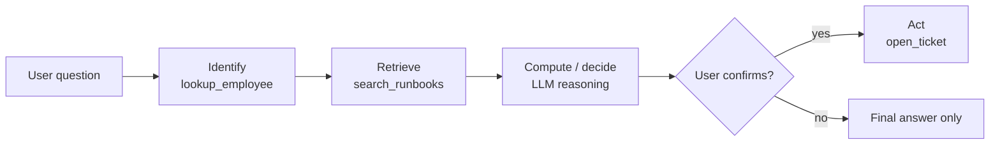

# Design de soluções e planejamento de ferramentas

## Visão geral

Antes de escrever qualquer prompt, o domínio Design de aplicações espera que você transforme uma solicitação de negócio em uma especificação precisa do pipeline: quais são as entradas, quais devem ser as saídas, qual *tarefa* do modelo as produz, quais componentes de cadeia conectam as duas e — no caso de agentes — quais ferramentas existem e em que ordem são executadas. Este arquivo aborda os cinco itens da Seção 1 do guia do exame que não são sobre Agent Bricks; o Agent Bricks tem um arquivo próprio.

> [!abstract]
>
> - **Objetivo de negócio → especificação de I/O** — identifique o usuário, os campos de entrada, o formato de saída, as fontes de conhecimento e as restrições de qualidade, latência e custo antes de escolher qualquer tecnologia
> - **Seleção da tarefa do modelo** — associe o requisito a uma categoria de tarefa de NLP (sumarização, classificação, extração, geração, tradução ou embeddings) e avalie os modelos *dentro* dessa categoria
> - **Componentes da cadeia** — template de prompt, retriever, re-ranker, LLM, parser de saída, guardrail, memória e ferramentas — cada componente transforma um formato de entrada no formato seguinte
> - **Planejamento de ferramentas** — defina o contrato de cada ferramenta (nome, descrição e parâmetros tipados) e ordene-as conforme a dependência dos dados: identificar → recuperar → calcular → agir

> [!tip] O que o exame avalia
>
> - Escolher a **categoria de tarefa** correspondente a um requisito de negócio (a questão oficial de exemplo sobre a ideia central de um memorando é respondida com *Sumarização*, não text2text nem classificação)
> - Escolher o **conjunto mínimo de componentes da cadeia** que transforma determinada entrada no formato de saída desejado
> - Decidir quando uma **cadeia fixa** é suficiente e quando o problema exige **raciocínio em várias etapas** com ferramentas
> - Ordenar as ferramentas para que cada etapa tenha os dados necessários e deixar ações irreversíveis para o final

---

## Do objetivo de negócio à especificação do pipeline

O item do guia do exame diz: *"Traduzir os objetivos do caso de uso de negócio em uma descrição das entradas e saídas desejadas para o pipeline de IA."* Uma boa especificação responde a seis perguntas antes de qualquer decisão de design.

| Pergunta | Exemplo de resposta (assistente interno de suporte de TI) |
| :--- | :--- |
| **Quem é o usuário e onde faz a pergunta?** | Funcionários, em um Databricks App ou no Microsoft Teams |
| **Quais são as entradas?** | Pergunta em texto livre + ID do funcionário (da sessão autenticada) + ID opcional do chamado |
| **Qual é o formato da saída?** | Resposta curta (≤ 120 palavras), links para fontes citadas e um campo JSON `action` (`none` / `open_ticket`) |
| **Onde estão os dados de conhecimento?** | Runbooks de TI (PDF em um volume do UC), histórico de chamados (tabela Delta) e inventário de ativos (tabela Delta) |
| **Quais são as restrições?** | Latência P95 < 5 s; nenhuma PII nas respostas; limite mensal de custo |
| **Como o sucesso é medido?** | Correção em relação a um conjunto de avaliação rotulado por especialistas no assunto (SMEs), fundamentação e taxa de resolução sem escalonamento |

A especificação orienta imediatamente o design:

- **Conhecimento não estruturado** (runbooks) → chunk + embedding + índice vetorial → retriever
- **Fatos estruturados por entidade** (status do chamado, responsável pelo ativo) → ferramenta de consulta ou tabela indexada por ID, *não* um armazenamento vetorial
- **Um campo de saída estruturado** (`action`) → prompt com saída estruturada e parser de saída ou validação de esquema
- **Um efeito colateral** (`open_ticket`) → uma ferramenta com etapa explícita de confirmação

> [!note]
> A questão oficial de exemplo sobre datas de entrega demonstra o mesmo princípio: fatos por transação, como a data prevista de entrega, pertencem a uma **tabela indexada por `transaction_id`** (a resposta do PDF é uma tabela de feature store), não a um armazenamento vetorial de documentos de políticas nem aos pesos de um modelo ajustado.

### Contratos de entrada e saída

Registre o contrato como tipos — ele se tornará a assinatura do modelo que você registrará no MLflow posteriormente (consulte [MLflow para GenAI](../../../../../certifications/genai-engineer-associate/02-assembling-and-deploying-apps/02-mlflow-for-genai.md)).

```python
from pydantic import BaseModel, Field
from typing import Literal

class HelpDeskRequest(BaseModel):
    question: str
    employee_id: str
    ticket_id: str | None = None

class HelpDeskResponse(BaseModel):
    answer: str = Field(max_length=900)
    sources: list[str]
    action: Literal["none", "open_ticket"]
```

## Seleção da tarefa do modelo

Item do guia do exame: *"Selecionar tarefas de modelo para atender a determinado requisito de negócio."* Catálogos de LLMs (hubs de modelos, model cards e AI Functions do Databricks) são organizados por **tarefa**; portanto, o primeiro passo é nomear corretamente a tarefa.

| Requisito de negócio | Categoria da tarefa | Recurso do Databricks (se houver) |
| :--- | :--- | :--- |
| Resumir um memorando de um parágrafo em uma frase com sua ideia central | **Sumarização** | `ai_summarize` |
| Encaminhar e-mails de suporte para uma entre 8 filas | **Classificação de texto** | `ai_classify` |
| Extrair número, valor total e vencimento de faturas em documentos | **Extração de informações / entidades** | `ai_extract`, Information Extraction do Agent Bricks |
| Detectar sentimento positivo / negativo em avaliações | **Análise de sentimento** (uma tarefa de classificação) | `ai_analyze_sentiment` |
| Traduzir descrições de produtos para japonês | **Tradução** | `ai_translate` |
| Responder a perguntas com base em documentos internos | **Perguntas e respostas / chat com recuperação (RAG)** | Vector Search + modelo de chat, Knowledge Assistant |
| Encontrar o chamado anterior mais semelhante | **Embedding + busca por similaridade** | `ai_similarity`, Vector Search |
| Reescrever texto para corrigir a gramática ou mudar o registro | **Geração de texto para texto** | `ai_fix_grammar`, `ai_query` |
| Ocultar nomes e e-mails antes do armazenamento | **Mascaramento / detecção de PII** | `ai_mask` |

Nomes das funções verificados em [AI Functions no Databricks](https://docs.databricks.com/aws/en/large-language-models/ai-functions). Use a função específica da tarefa quando ela for adequada; recorra a `ai_query()` com um modelo de chat geral quando precisar de um prompt personalizado.

> [!warning] Erro comum
> "Text-to-text generation" pode produzir um resumo, mas, quando o requisito é *condensar o texto à sua ideia central*, o exame espera a categoria de tarefa mais específica — **sumarização**. Escolha a tarefa mais específica que corresponda ao requisito e, em seguida, compare os modelos dentro dela.

## Seleção dos componentes da cadeia

Item do guia do exame: *"Selecionar componentes de cadeia para determinada entrada e saída do modelo."* Cada componente converte um formato no seguinte. Comece pela saída exigida e trabalhe de três para frente.

| Componente | Converte | Inclua quando… |
| :--- | :--- | :--- |
| **Template de prompt** | Variáveis brutas → mensagens formatadas | Sempre — toda cadeia tem um |
| **Retriever** | Pergunta → chunks relevantes | As respostas dependem de documentos com os quais o modelo não foi treinado |
| **Re-ranker** | Candidatos top-k → melhores chunks | O recall é bom, mas o melhor chunk não aparece primeiro na classificação |
| **LLM (modelo de chat)** | Mensagens → texto / chamadas de ferramentas | Sempre |
| **Parser de saída / esquema** | Texto do modelo → `str`, JSON, objeto Pydantic | O código subsequente precisa de um valor tipado |
| **Guardrail** | Entrada ou saída → permitida / bloqueada | Entrada não confiável ou saída regulamentada |
| **Memória / armazenamento de sessão** | Histórico da conversa → contexto | Conversas com várias interações |
| **Ferramentas** | Chamada de ferramenta pelo modelo → resultado externo | O modelo precisa consultar dados atuais ou executar uma ação |

### Exemplo de mapeamento

| Entrada → saída desejadas | Cadeia mínima |
| :--- | :--- |
| Pergunta → resposta em texto simples com base em PDFs de políticas | prompt → retriever → LLM → `StrOutputParser` |
| E-mail de suporte → rótulo de fila (uma entre 8) | prompt (few-shot) → LLM → parser de enumeração (ou `ai_classify`) |
| PDF de contrato → JSON com partes e datas | parser (`ai_parse_document`) → prompt com esquema JSON → LLM → parser JSON |
| Interação de chat → resposta que considera interações anteriores | memória → prompt → retriever → LLM |
| Pergunta → resposta que talvez precise consultar o status atual de um pedido | prompt → LLM com ferramentas (`get_order_status`, `search_docs`) → resposta final |

## Elaboração de prompts para respostas formatadas

Item do guia do exame: *"Criar um prompt que gere uma resposta em um formato específico."* O catálogo completo de técnicas está em [Engenharia de prompts](../../../../../certifications/genai-engineer-associate/01-application-development/01-prompt-engineering.md); durante o design, decida **com que rigor** o formato deve ser imposto.

| Nível de imposição | Técnica | Quando usar |
| :--- | :--- | :--- |
| Flexível | Instruções explícitas de formato + um ou dois exemplos few-shot | Saída lida por pessoas; pequenas variações são aceitáveis |
| Médio | Modo JSON (`response_format={"type": "json_object"}`) + parser com nova tentativa | Saída lida por máquinas; esquema pequeno |
| Rigoroso | Saída estruturada com JSON Schema (`json_schema`) + validação Pydantic | A saída alimenta outro sistema; todos os campos são obrigatórios |

`ai_query()` aceita o argumento `responseFormat` com os mesmos três níveis — `text`, `json_object`, `json_schema` — para cargas em lote (referência de [`ai_query`](https://docs.databricks.com/aws/en/sql/language-manual/functions/ai_query)).

## Definição e ordenação de ferramentas para raciocínio em várias etapas

Item do guia do exame: *"Definir e ordenar ferramentas que coletam conhecimento ou executam ações em raciocínio de várias etapas."*

### 1. Defina cada ferramenta como um contrato

O modelo escolhe as ferramentas com base no **nome, na descrição e no esquema dos parâmetros** — essas três informações compõem toda a interface da ferramenta.

```python
from langchain_core.tools import tool

@tool
def lookup_employee(employee_id: str) -> dict:
    """Return department, laptop asset tag, and manager for an employee ID.
    Use this before any tool that needs an asset tag."""
    ...

@tool
def search_runbooks(query: str) -> str:
    """Search IT runbooks for troubleshooting steps. Use for how-to questions."""
    ...

@tool
def open_ticket(employee_id: str, asset_tag: str, summary: str) -> str:
    """Open a help-desk ticket. Only call after the user confirms."""
    ...
```

Boas definições de ferramentas:

- Faça com que cada ferramenta execute **uma única tarefa** — `lookup_employee` e `open_ticket` são ferramentas distintas, não uma única ferramenta `helpdesk(action=...)`
- Especifique na descrição **quando usar** a ferramenta e o que deve acontecer antes
- Use **parâmetros tipados e mínimos** — o modelo os preenche com base na conversa
- Separe ferramentas de **leitura** (coletam conhecimento) de ferramentas de **gravação** (executam ações)

### 2. Ordene as ferramentas conforme a dependência dos dados



| Regra de ordenação | Motivo |
| :--- | :--- |
| **Identificar antes de recuperar** | Resolver os IDs primeiro torna as consultas seguintes precisas (e filtráveis) |
| **Ler antes de gravar** | Colete todos os fatos antes de qualquer efeito colateral |
| **Barato e determinístico antes de caro e generativo** | Uma consulta a uma tabela pode responder algo que uma chamada de LLM tentaria adivinhar |
| **Ações irreversíveis por último, após confirmação** | Impede que o agente aja com base em uma conclusão intermediária incorreta |
| **Paralelize consultas independentes** | Duas consultas sem relação podem ser executadas simultaneamente (`RunnableParallel`) |

### 3. Escolha o padrão de controle

| Padrão | Quem decide a ordem | Quando usar |
| :--- | :--- | :--- |
| **Cadeia fixa** | Você, no momento do design | As etapas são sempre iguais (RAG clássico) |
| **Roteador** | Uma chamada de LLM escolhe uma ramificação | Existem poucos tipos de solicitação bem conhecidos |
| **Planejar e executar** | O LLM escreve um plano e depois executa as etapas | Tarefas de várias etapas com um plano previsível |
| **Loop ReAct** | O LLM decide após cada observação | Tarefas abertas; limite com `max_iterations` |
| **Supervisor (multiagente)** | Um supervisor delega a agentes especializados | Vários domínios, cada um com suas próprias ferramentas — consulte [Agent Bricks](03-agent-bricks.md) |

## Casos de uso

- **Triagem de requisitos** — um gerente de produto pede “uma IA que cuide de faturas”; a especificação de I/O revela duas tarefas (extração para JSON e, depois, classificação para encaminhar aprovações), sem necessidade de chat
- **Evitar armazenamento vetorial para fatos estruturados** — o status dos pedidos e as datas de entrega vêm de uma ferramenta que consulta uma tabela indexada; perguntas sobre políticas são encaminhadas ao retriever
- **Agentes que executam ações com segurança** — ferramentas de leitura coletam contexto, o agente propõe uma ação e uma etapa de confirmação controla a única ferramenta de gravação
- **Design atento a custos** — classificação e sumarização são executadas como jobs em lote de `ai_classify` / `ai_summarize`, em vez de um endpoint de chat

## Problemas e erros comuns

### O agente chama a ferramenta de gravação cedo demais

**Cenário:** um agente abre chamados duplicados porque chama `open_ticket` antes de verificar se o usuário já tem um chamado aberto.
**Correção:** adicione uma ferramenta de leitura (`list_open_tickets`), indique a ordem nas descrições das duas ferramentas (“chame `list_open_tickets` primeiro”) e exija confirmação explícita do usuário antes de executar a ferramenta de gravação.

### Categoria de tarefa incorreta

**Cenário:** uma equipe avalia modelos gerais de geração de texto para um problema de encaminhamento e obtém rótulos inconsistentes em texto livre.
**Correção:** reformule o problema como **classificação** com um conjunto fechado de rótulos — use prompting few-shot com parser de enumeração ou `ai_classify` com a lista de rótulos.

### Ferramenta sobrecarregada

**Cenário:** uma única ferramenta `database(action, table, filters)` resulta em argumentos malformados e tabelas incorretas.
**Correção:** divida-a em ferramentas específicas, bem descritas e com parâmetros tipados; o modelo seleciona ferramentas com muito mais confiabilidade do que compõe argumentos em formato livre.

## Dicas para o exame

> [!tip] Dicas para o exame
>
> - Leia primeiro o requisito de **saída** — ele indica a categoria da tarefa e se você precisa de um parser de saída.
> - **Fatos estruturados por entidade → tabela indexada ou ferramenta**; **conhecimento não estruturado → retriever**. Fine-tuning raramente é a resposta para fatos que mudam.
> - Parágrafo → ideia central em uma frase = **Sumarização**. Conjunto fechado de rótulos = **Classificação**. Campos extraídos de documentos = **Extração**.
> - Ordem das ferramentas: **identificar → recuperar → calcular → agir**, deixando ações irreversíveis para o final e sujeitas a aprovação.

## Principais conclusões

- Escreva a especificação de I/O (usuário, entradas, formato de saída, fontes de conhecimento, restrições e métrica de sucesso) antes de escolher os componentes
- Associe cada requisito à categoria de tarefa mais específica e depois compare os modelos dentro dessa categoria
- Cada componente da cadeia converte um formato em outro — adicione somente os componentes exigidos pela saída
- Ferramentas são contratos: nome + descrição + parâmetros tipados; mantenha-as específicas e separe leituras de gravações
- Ordene as ferramentas conforme a dependência dos dados e deixe as ações irreversíveis para o final, após confirmação

## Tópicos relacionados

- [Padrões de design de RAG](01-rag-design-patterns.md)
- [Agent Bricks](03-agent-bricks.md)
- [Engenharia de prompts](../../../../../certifications/genai-engineer-associate/01-application-development/01-prompt-engineering.md)
- [Cadeias e agentes de LLM](../../../../../certifications/genai-engineer-associate/01-application-development/02-chains-agents.md)

## Documentação oficial

- [AI Functions no Databricks](https://docs.databricks.com/aws/en/large-language-models/ai-functions)
- [Função `ai_query`](https://docs.databricks.com/aws/en/sql/language-manual/functions/ai_query)
- [Desenvolver agentes no Databricks](https://docs.databricks.com/aws/en/agents/)
- [Guia do exame Databricks Certified Generative AI Engineer Associate (PDF)](https://www.databricks.com/sites/default/files/2026-10/databricks-certified-gen-ai-associate-exam-guide-august-2026.pdf)

---

**[← Anterior: RAG Design Patterns](01-rag-design-patterns.md) | [↑ Voltar para Design de aplicações](README.md) | [Próximo: Agent Bricks — Knowledge Assistant, Multi-Agent Supervisor, Information Extraction](03-agent-bricks.md) →**
