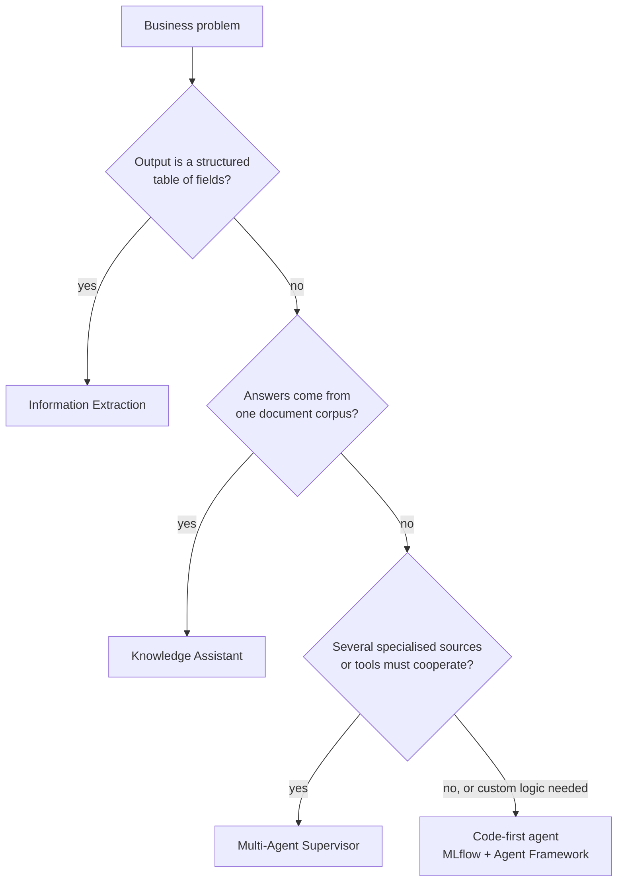
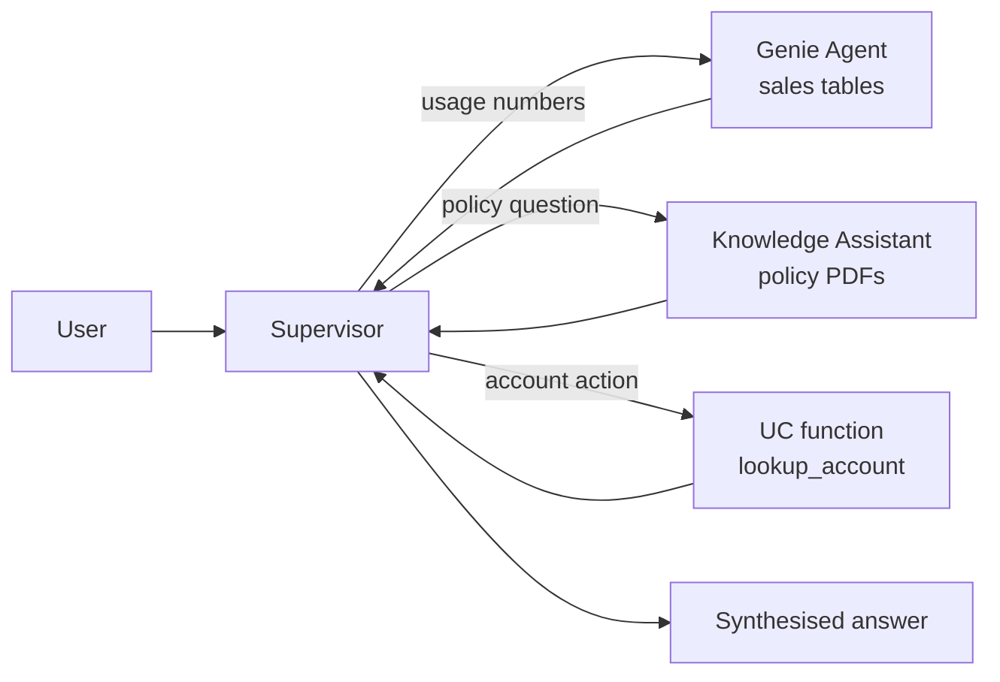

# Agent Bricks — Knowledge Assistant, Multi-Agent Supervisor, Information Extraction

## Visão geral

O guia do exame de 2026 acrescenta ao domínio Design de aplicações o item: *"Determinar como e quando usar Agent Bricks (Knowledge Assistant, Multiagent Supervisor, Information Extraction) para resolver problemas."* Esses são os criadores declarativos de agentes low-code do Databricks. Você fornece dados e instruções, a ferramenta cria e hospeda o agente, e especialistas no assunto o aprimoram com feedback em linguagem natural. O exame avalia **qual brick é adequado para cada problema** e quando um agente implementado em código é a melhor opção.

> [!abstract]
>
> - **Knowledge Assistant** — chatbot de perguntas e respostas sobre *documentos*, com citações, aprimorado por perguntas e diretrizes de SMEs
> - **Multi-Agent Supervisor** (nome atual na documentação: **Supervisor Agent**) — coordena até 50 subagentes e ferramentas (Genie Agents, endpoints do Knowledge Assistant, funções do UC, servidores MCP e agentes personalizados) em diferentes domínios
> - **Information Extraction** — transforma documentos não estruturados em uma tabela estruturada que segue um esquema definido por você (na versão atual, usa `ai_extract`)
> - Os três exigem **Unity Catalog, computação serverless e uma política de uso serverless com orçamento diferente de zero**

> [!tip] O que o exame avalia
>
> - Associar cada cenário ao brick correto: perguntas e respostas sobre documentos → Knowledge Assistant; muitas fontes especializadas → Supervisor; documentos → campos estruturados → Information Extraction
> - Que os bricks são **aprimorados com feedback de SMEs** (perguntas, diretrizes e rótulos), e não pelo retreinamento manual de um modelo
> - Que um Supervisor **respeita as permissões de cada usuário final** em cada subagente
> - Quando optar por um agente baseado em código (lógica ou ferramentas personalizadas, controle total do loop)

---

> [!note] Atualização da plataforma (out. 2026)
> Em **2026-10-12**, o Databricks classificou **Knowledge Assistant** e **Supervisor Agent** como *legados*. Para novos agentes low-code, a documentação agora indica **Genie Agents** (nome adotado em 8 de julho de 2026 para Genie Spaces); para novos agentes escritos em código, indica a **Agent Bricks CLI** (Beta). A **Supervisor API** programática (Beta) foi descontinuada e chegou ao **fim da vida útil em 2026-09-30**. O brick **Information Extraction** foi reconstruído com `ai_extract` e não está na lista de recursos legados; somente sua versão antiga está. O guia do exame (publicado em 18 de março de 2026) ainda cita os três bricks; portanto, estude-os conforme descrito abaixo. Fontes: [notas de versão de outubro de 2026](https://docs.databricks.com/aws/en/release-notes/product/2026/october), [ofertas legadas de agentes](https://docs.databricks.com/aws/en/agents/legacy/), [Supervisor API (descontinuada)](https://docs.databricks.com/aws/en/agents/agent-bricks/supervisor-api).

## Onde os bricks se encaixam

| Brick | Entrada | Saída | Problema típico |
| :--- | :--- | :--- | :--- |
| **Knowledge Assistant** | Arquivos em um volume do UC, uma tabela do UC com coluna de arquivos ou um índice do Vector Search | Respostas de chat com citações, servidas por um endpoint de agente | Perguntas e respostas sobre políticas de RH, assistente de documentação de produtos, base de conhecimento de suporte |
| **Multi-Agent Supervisor** | Subagentes e ferramentas selecionados por você (Genie Agents, endpoints de agentes, funções do UC, servidores MCP, tabelas, volumes e índices) | Um endpoint que delega tarefas e sintetiza uma resposta | “Responder a perguntas sobre políticas *e* contas *e* análises de uso em um único chat” |
| **Information Extraction** | Documentos ou texto em um volume ou tabela do UC | Uma tabela estruturada que segue seu esquema JSON | Contratos → partes e termos; faturas → itens de linha; notas clínicas → detalhes principais |

## Knowledge Assistant

O Knowledge Assistant cria um chatbot de perguntas e respostas sobre documentos que responde *com citações*. O Databricks descreve sua abordagem como um **“Instructed Retriever”**, que vai além do RAG básico ([documentação do Knowledge Assistant](https://docs.databricks.com/aws/en/agents/agent-bricks/knowledge-assistant)).

### Fontes de conhecimento

| Tipo de fonte | Requisitos (conforme a documentação atual) |
| :--- | :--- |
| **Arquivos em um volume do UC** | `txt`, `pdf`, `md`, `ppt`/`pptx`, `doc`/`docx`; arquivos acima de 100 MB e PDFs/arquivos do Office com mais de 500 páginas são ignorados |
| **Arquivos em uma tabela do UC** | Tabela de streaming ou tabela com Change Data Feed; uma coluna `content` (BINARY ou STRING) e uma struct `metadata` (`file_path`, `file_name`, …). Tabelas ingeridas pelos conectores do SharePoint ou Google Drive correspondem automaticamente |
| **índice existente do Vector Search** | Deve usar `databricks-gte-large-en`, `databricks-bge-large-en` ou `databricks-qwen3-embedding-0-6b` |

### Ciclo de criação e aprimoramento

1. **Configure** — nome, descrição, fonte(s) de conhecimento e uma *descrição do conteúdo de cada fonte* para que o agente saiba quando usá-la
2. **Teste** — converse na página de configuração ou no AI Playground
3. **Aprimore** — adicione perguntas na guia *Examples* e compartilhe o agente com SMEs, que podem anexar **diretrizes** em linguagem natural às respostas; elas entram em vigor assim que são salvas
4. **Utilize** — o brick disponibiliza um **endpoint de agente**; chame-o pelo Playground, pela API ou por um Databricks App; conceda **Can Query** aos consumidores

### Quando escolher esse brick

- O conhecimento está em um **corpus de documentos** e os usuários fazem **perguntas em linguagem natural** sobre ele
- Você quer **citações** e **pouco código**
- Especialistas no domínio, e não engenheiros, ajustarão a qualidade

Quando *não* escolher esse brick: as respostas precisam de dados estruturados em tempo real (use Genie ou uma ferramenta), você precisa de lógica de recuperação ou ferramentas personalizadas, ou a saída deve ser uma tabela estruturada (use Information Extraction).

> [!note]
> O Databricks Free Edition **não** oferece suporte ao Knowledge Assistant ([limitações do Free Edition](https://docs.databricks.com/aws/en/getting-started/free-edition-limitations)). Em vez disso, pratique nele os outros bricks e a abordagem baseada em código.

## Multi-Agent Supervisor (Supervisor Agent)

O guia do exame o chama de **Multiagent Supervisor**; a documentação do produto usa **Supervisor Agent**. Ele cria um sistema supervisor que delega tarefas a subagentes e ferramentas especializadas e, em seguida, sintetiza o resultado ([documentação do Supervisor Agent](https://docs.databricks.com/aws/en/agents/agent-bricks/multi-agent-supervisor)).

### Subagentes e ferramentas compatíveis

| Subagente / ferramenta | Acesso necessário ao usuário final |
| :--- | :--- |
| **Genie Agent** (antigo Genie Space) — dados estruturados consultados em linguagem natural | Acesso ao Genie Agent e aos objetos do UC subjacentes |
| **Endpoint do Knowledge Assistant** — perguntas e respostas sobre documentos | `CAN QUERY` no endpoint do agente |
| **Endpoint do Model Serving** / **agente personalizado** | `CAN QUERY` no endpoint (agentes personalizados em Apps: `CAN USE` no app) |
| **Função do Unity Catalog** | `EXECUTE` na função |
| **Tabela / volume / índice do Vector Search do UC** | `SELECT` / `READ VOLUME` e também `USE CATALOG` e `USE SCHEMA` |
| **Servidor MCP** (registrado ou personalizado) | `EXECUTE` no serviço MCP registrado ou `CAN USE` no app que o hospeda |
| **Dashboard publicado**, **busca na Web** | `CAN VIEW` no dashboard; a busca na Web solicita a aprovação do usuário para cada chamada |

Comportamentos principais:

- **Até 50** agentes e ferramentas por supervisor
- **Controle de acesso por usuário** — se um usuário final não tiver acesso a um subagente, o supervisor desvia a conversa dele; se não tiver acesso a nenhum subagente, encerra a conversa
- **As descrições orientam a delegação** — escreva uma descrição detalhada para cada subagente; o supervisor usa essas descrições para encaminhar as solicitações
- A **execução de código** é integrada: uma sessão serverless em sandbox, sem saída de rede e com acesso somente de leitura às tabelas e aos volumes adicionados
- **Aprimoramento por SMEs** — adicione perguntas de exemplo, compartilhe a página de configuração com especialistas (eles precisam de `CAN MANAGE` e acesso aos subagentes) e permita que adicionem diretrizes
- Os subagentes de índice do Vector Search aceitam **somente índices Delta Sync**

### Quando escolher esse brick

- Um único ponto de entrada conversacional precisa responder a perguntas que abrangem **dados estruturados** (Genie) e **documentos não estruturados** (Knowledge Assistant), ou chamar várias ferramentas
- Cada domínio já tem, ou deve ter, seu **próprio agente especializado**
- Você quer que o encaminhamento e a síntese sejam feitos para você e ajustados por SMEs

## Information Extraction

Information Extraction transforma documentos e textos não estruturados em informações estruturadas usando um esquema definido ([documentação do Information Extraction](https://docs.databricks.com/aws/en/agents/agent-bricks/info-extraction)).

- **Entrada**: arquivos em um volume do UC, arquivos carregados ou uma coluna de texto (`STRING` / `VARIANT`) em uma tabela do UC
- **Esquema**: o brick propõe um esquema de extração com base nos seus dados; você refina os campos
- **Interfaces**: interface do Agent Bricks, **SQL** (`ai_extract`) e API REST
- **Escala**: projetado para transformar grandes volumes de documentos em lote em uma tabela Delta para análises ou agentes subsequentes

A versão anterior (agora *legada*) aceitava um conjunto de dados **sem rótulos** (o brick inferia um exemplo de saída JSON) ou **rotulado** (uma coluna JSON com ground truth usada na avaliação) e usava avaliação baseada em MLflow para comparar custo e qualidade ([página da versão legada](https://docs.databricks.com/aws/en/agents/agent-bricks/key-info-extraction)). Questões elaboradas com base no guia de março de 2026 podem descrever qualquer uma das versões; a ideia central é a mesma: **documentos entram, linhas no formato do esquema saem**.

### Quando escolher esse brick

- O resultado desejado é uma **tabela**, não uma conversa
- É preciso extrair os mesmos campos de milhares de contratos, faturas ou notas
- Você quer integrar `ai_extract` ao pipeline no nível do SQL

## Bricks versus agentes baseados em código

| Necessidade | Escolha |
| :--- | :--- |
| Caminho mais rápido para um chatbot de documentos com citações | Knowledge Assistant (legado; novas implementações → Genie Agents) |
| Coordenar agentes e ferramentas existentes com ajustes de SMEs | Multi-Agent Supervisor (legado; novas implementações → Genie Agents ou Agent Bricks CLI) |
| Campos estruturados extraídos de documentos em escala | Information Extraction / `ai_extract` |
| Loop, ferramentas ou memória personalizados, com controle total | Agente baseado em código com MLflow + Agent Framework — consulte [Sistemas agentic com MLflow e Genie](../../../../../certifications/genai-engineer-associate/01-application-development/05-agentic-systems-mlflow-and-genie.md) |

## Casos de uso

- **Assistente de políticas de RH** — Knowledge Assistant sobre um volume de PDFs de políticas; SMEs de RH adicionam diretrizes como “sempre cite o número da seção da política”
- **Chat de visão 360 do cliente** — o Supervisor encaminha perguntas sobre faturamento a um Genie Agent que consulta tabelas de cobrança, perguntas sobre políticas ao Knowledge Assistant e alterações de conta a uma função do UC
- **Análise de contratos** — Information Extraction extrai partes, datas de vigência e termos de renovação de 40.000 contratos para uma tabela Delta usada em um dashboard
- **Migração para código** — um protótipo do Knowledge Assistant comprova seu valor; a equipe o recria como agente baseado em código quando precisa de ferramentas e memória personalizadas

## Problemas e erros comuns

### O Supervisor fornece respostas pouco úteis a alguns usuários

**Cenário:** analistas recebem respostas completas, mas representantes de vendas recebem respostas vagas do mesmo supervisor.
**Correção:** o supervisor aplica as permissões de cada usuário em todos os subagentes. Conceda ao grupo de vendas acesso ao Genie Agent (e às tabelas subjacentes) e `CAN QUERY` no endpoint do Knowledge Assistant.

### O Knowledge Assistant ignora alguns documentos

**Cenário:** apresentações grandes nunca aparecem nas citações.
**Correção:** arquivos acima de 100 MB e PDFs/arquivos do Office com mais de 500 páginas (cada slide conta como uma página) são ignorados durante a ingestão. Divida os arquivos ou faça a análise prévia em uma tabela do UC.

### Brick inadequado para o formato de saída

**Cenário:** uma equipe cria um Knowledge Assistant para “obter a data de renovação de cada contrato” e depois coleta as respostas do chat em uma tabela.
**Correção:** a saída é uma tabela de campos — use Information Extraction (`ai_extract`).

## Dicas para o exame

> [!tip] Dicas para o exame
>
> - **Perguntas e respostas sobre documentos com citações → Knowledge Assistant.** **Vários agentes/ferramentas especializados por trás de um chat → Multi-Agent Supervisor.** **Documentos → tabela estruturada → Information Extraction.**
> - Um Supervisor costuma combinar um **Genie Agent (dados estruturados)** com um **Knowledge Assistant (dados não estruturados)**.
> - Os bricks são aprimorados com **perguntas de SMEs e diretrizes em linguagem natural**, não pelo ajuste fino de um modelo por você.
> - As permissões são propagadas: o **usuário final** precisa de acesso a cada subagente e aos dados dele.
> - Nota sobre o produto: KA e Supervisor são legados desde 2026-10-12, e a Supervisor API chegou ao fim da vida útil em 2026-09-30. No exame, responda com o brick adequado ao cenário.

## Principais conclusões

- Agent Bricks oferece agentes declarativos: Knowledge Assistant, Multi-Agent Supervisor (Supervisor Agent) e Information Extraction
- Escolha conforme o formato da saída e a quantidade de fontes: um corpus de documentos → KA; muitas fontes que cooperam → Supervisor; linhas no formato de um esquema → IE
- Todos os bricks exigem Unity Catalog, computação serverless e uma política de uso serverless com orçamento diferente de zero
- SMEs aprimoram a qualidade com exemplos e diretrizes; consumidores precisam de `CAN QUERY` no endpoint
- Agentes baseados em código continuam sendo a escolha quando você precisa de lógica, ferramentas ou memória personalizadas

## Tópicos relacionados

- [Design de soluções e planejamento de ferramentas](02-solution-design-and-tool-planning.md)
- [Sistemas agentic com MLflow e Genie](../../../../../certifications/genai-engineer-associate/01-application-development/05-agentic-systems-mlflow-and-genie.md)
- [Servidores MCP](../../../../../certifications/genai-engineer-associate/02-assembling-and-deploying-apps/04-mcp-servers.md)
- [Scorers, juízes e feedback de SMEs do MLflow](../../../../../certifications/genai-engineer-associate/05-evaluation-and-monitoring/03-mlflow-scorers-judges-and-feedback.md)

## Documentação oficial

- [Desenvolver agentes no Databricks (Agent Bricks)](https://docs.databricks.com/aws/en/agents/)
- [Knowledge Assistant (legado)](https://docs.databricks.com/aws/en/agents/agent-bricks/knowledge-assistant)
- [Supervisor Agent (legado)](https://docs.databricks.com/aws/en/agents/agent-bricks/multi-agent-supervisor)
- [Information Extraction](https://docs.databricks.com/aws/en/agents/agent-bricks/info-extraction)
- [Ofertas legadas de agentes](https://docs.databricks.com/aws/en/agents/legacy/)
- [Agent Bricks CLI (Beta)](https://docs.databricks.com/aws/en/agents/custom-agents/agent-bricks-cli)

---

**[← Anterior: Design de soluções e planejamento de ferramentas](02-solution-design-and-tool-planning.md) | [↑ Voltar para Design de aplicações](README.md)**
