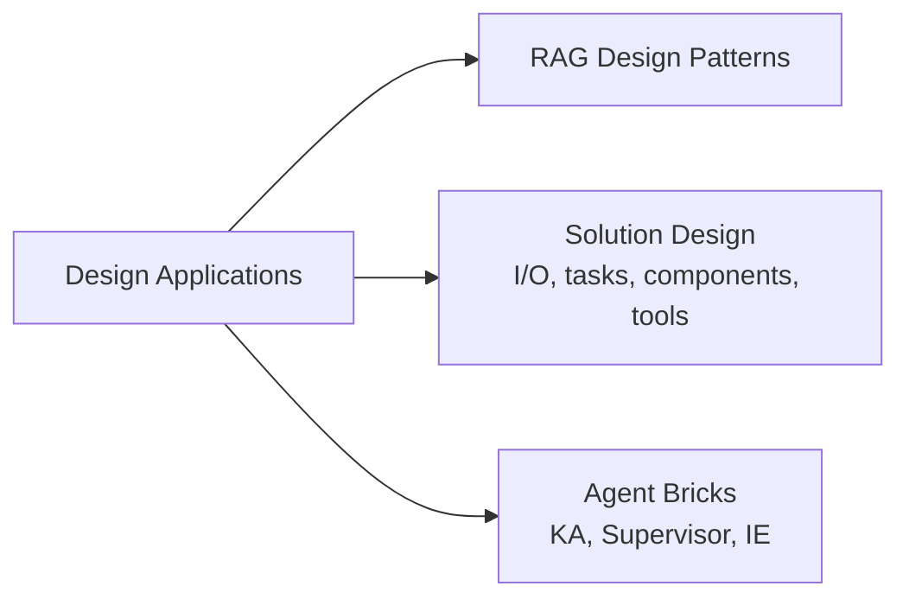

# Design de aplicações (14 % do exame)

Seção 1 do guia do exame: transformar um requisito de negócio em um design de GenAI — entradas e saídas do pipeline, tarefa do modelo, componentes da cadeia, ferramentas e sua ordem, arquitetura de recuperação e quando um agente declarativo do **Agent Bricks** é a ferramenta certa.

## Visão geral dos tópicos

## Conteúdo da seção

| Arquivo | Tópico | Prioridade |
| :--- | :--- | :--- |
| [01-rag-design-patterns.md](01-rag-design-patterns.md) | RAG versus fine-tuning, HyDE, multi-query, re-ranking, chunking pai-filho, RAG agentic | Alta |
| [02-solution-design-and-tool-planning.md](02-solution-design-and-tool-planning.md) | Objetivo de negócio → especificação de I/O, seleção da tarefa do modelo, componentes da cadeia, prompts com saída formatada, definição e ordenação de ferramentas *(guia de 2026)* | Alta |
| [03-agent-bricks.md](03-agent-bricks.md) | Knowledge Assistant, Multi-Agent Supervisor, Information Extraction — como e quando usar cada um *(guia de 2026)* | Alta |

## Cobertura do guia do exame

| Item do guia do exame (Seção 1) | Onde é abordado |
| :--- | :--- |
| Criar um prompt que gere uma resposta em um formato específico | [02](02-solution-design-and-tool-planning.md#elaboração-de-prompts-para-respostas-formatadas), [Engenharia de prompts](../../../../../certifications/genai-engineer-associate/01-application-development/01-prompt-engineering.md) |
| Selecionar tarefas de modelo para atender a determinado requisito de negócio | [02](02-solution-design-and-tool-planning.md#seleção-da-tarefa-do-modelo) |
| Selecionar componentes de cadeia para a entrada e saída desejadas do modelo | [02](02-solution-design-and-tool-planning.md#seleção-dos-componentes-da-cadeia) |
| Traduzir os objetivos do caso de uso de negócio em uma descrição das entradas e saídas desejadas para o pipeline de IA | [02](02-solution-design-and-tool-planning.md#do-objetivo-de-negócio-à-especificação-do-pipeline) |
| Definir e ordenar ferramentas que coletam conhecimento ou executam ações em raciocínio de várias etapas | [02](02-solution-design-and-tool-planning.md#definição-e-ordenação-de-ferramentas-para-raciocínio-em-várias-etapas), [Padrões de design de RAG](01-rag-design-patterns.md) |
| Determinar como e quando usar Agent Bricks (Knowledge Assistant, Multiagent Supervisor, Information Extraction) para resolver problemas | [03](03-agent-bricks.md) |

## Conceitos-chave

| Conceito | Por que é importante |
| :--- | :--- |
| **RAG = consulta com livro aberto; fine-tuning = estudar** | O RAG injeta contexto atualizado no momento da consulta; o fine-tuning incorpora conhecimento nos pesos. RAG é melhor para fatos que mudam; fine-tuning, para estilo/formato/persona |
| **Especificação de I/O primeiro** | Usuário, entradas, formato de saída, fontes de conhecimento, restrições e métrica de sucesso orientam todas as escolhas seguintes |
| **Categoria de tarefa mais específica** | Resumo, classificação, extração, tradução — escolha a tarefa mais específica e compare modelos dentro dela |
| **Ordenação das ferramentas** | Identificar → recuperar → calcular → agir, deixando ações irreversíveis para o final e sujeitas a aprovação |
| **Agent Bricks** | Perguntas e respostas sobre documentos → Knowledge Assistant; vários agentes que cooperam → Supervisor; documentos → linhas estruturadas → Information Extraction |
| **Orçamento da janela de contexto** | Prompt do sistema + fragmentos recuperados + histórico + resposta compartilham o mesmo orçamento |

## Recursos relacionados

- [Fundamentos de RAG / Vector Search (compartilhado)](../../../../../shared/fundamentals/rag-vector-search-basics.md)
- [Desenvolvimento de aplicações (padrões de execução)](../../../../../certifications/genai-engineer-associate/01-application-development/README.md)
- [Preparação de dados (chunking, embeddings, indexação)](../04-data-preparation/README.md)
- [Desenvolver agentes no Databricks (Agent Bricks)](https://docs.databricks.com/aws/en/agents/)

---

**[← Anterior: Montagem e implantação de aplicações](../../../../../certifications/genai-engineer-associate/02-assembling-and-deploying-apps/README.md) | [↑ Voltar para GenAI Engineer Associate](../../../../../certifications/genai-engineer-associate/README.md) | [Próximo: Preparação de dados](../04-data-preparation/README.md) →**
