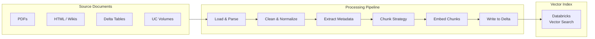

# Processamento de documentos e chunking

O processamento de documentos é a base de todo sistema RAG. A qualidade do chunking
determina diretamente a qualidade da recuperação — documentos divididos em chunks inadequados produzem recuperação ruim,
independentemente da sofisticação da estratégia de recuperação.

## Visão geral



## Comparação de estratégias de chunking

| Estratégia | Como funciona | Vantagens | Desvantagens | Mais adequada para |
| :--- | :--- | :--- | :--- | :--- |
| **Tamanho fixo** | Divide a cada N caracteres ou tokens | Simples, rápida, previsível | Pode dividir no meio de frases ou conceitos | Texto simples uniforme, logs |
| **Caracteres recursivos** | Tenta limites de parágrafo → frase → palavra | Preserva unidades naturais do texto | Um pouco mais complexa | Uso geral — padrão mais comum |
| **Semântica** | Divide quando diminui a similaridade entre embeddings das frases | Divide em limites reais de tópicos | Lenta, tamanho variável dos chunks | Documentos técnicos ou acadêmicos |
| **Sensível à estrutura** | Divide em títulos, seções e blocos de código | Preserva a estrutura do documento | Exige formato conhecido | Markdown, HTML, código, PDFs com cabeçalhos |
| **Frases** | Divide nos limites entre frases | Fácil de implementar | As frases podem ser muito curtas | Conversas / texto de FAQ |

## Compromissos do tamanho dos chunks

O tamanho dos chunks é o parâmetro de ajuste individual com maior impacto em um sistema RAG.

| Tamanho do chunk | Precisão da recuperação | Qualidade do contexto | Uso da janela de contexto |
| :--- | :--- | :--- | :--- |
| Muito pequeno (< 128 tokens) | Alto — muito específico | Baixo — contexto insuficiente | Eficiente |
| Pequeno (128–256 tokens) | Alto | Moderado | Eficiente |
| Médio (256–512 tokens) | Bom | Bom | Moderado |
| Grande (512–1024 tokens) | Moderado | Bom | Alto |
| Muito grande (> 1024 tokens) | Baixo — vários tópicos por chunk | Alto, mas ruidoso | Muito alto |

### Regra prática

Use **256–512 tokens** em tarefas de perguntas e respostas precisas. Use **512–1024 tokens** para sumarização
ou quando o LLM precisar de um contexto mais amplo por chunk. Sempre faça testes comparativos com seus documentos
e consultas específicos.

## Sobreposição de chunks

A sobreposição entre chunks adjacentes impede que um contexto importante seja dividido em um
limite e perdido quando somente um dos chunks é recuperado.

```python
from langchain.text_splitter import RecursiveCharacterTextSplitter

splitter = RecursiveCharacterTextSplitter(
    chunk_size=512,
    chunk_overlap=51,    # ~10% overlap
    length_function=len,
    separators=["\n\n", "\n", ". ", " ", ""]
)
```

### Por que a sobreposição ajuda

Sem sobreposição, uma frase que abrange dois chunks pode ser cortada ao meio. Uma consulta sobre esse
tópico talvez não corresponda bem a nenhum dos chunks. Com sobreposição de 10–20%, pelo menos um chunk conterá
a frase inteira.

**Sobreposição típica**: 10–20% do tamanho do chunk. Mais sobreposição = melhor preservação do contexto,
mas também mais redundância e maior custo de armazenamento e geração de embeddings.

## Extração de metadados

Os metadados armazenados junto a cada chunk permitem a **filtragem por metadados** no momento da recuperação,
reduzindo o espaço de busca antes do cálculo da similaridade vetorial.

### Metadados a armazenar

| Campo de metadados | Tipo | Finalidade |
| :--- | :--- | :--- |
| `source` | String | Filtrar pela fonte do documento (por exemplo, "policy_docs") |
| `page_number` | Integer | Identificar a página exata em um PDF |
| `section_title` | String | Identificar a seção do documento (por exemplo, "Chapter 3") |
| `document_date` | Date | Filtrar somente documentos recentes |
| `author` | String | Filtrar por autor ou equipe |
| `document_type` | String | Filtrar por tipo ("legal", "technical", "faq") |
| `language` | String | Filtragem de corpus multilíngue |

### Extração de metadados de documentos do LangChain

```python
from langchain_community.document_loaders import PyPDFLoader

loader = PyPDFLoader("/Volumes/main/docs/policies/policy_v2.pdf")
pages = loader.load()

# Each page Document has metadata automatically

for page in pages:
    print(page.metadata)
    # {'source': '/Volumes/main/docs/...', 'page': 0}

# Add custom metadata

for page in pages:
    page.metadata["document_type"] = "policy"
    page.metadata["department"] = "hr"
```

## Esquema da tabela Delta para chunks de documentos

Armazenar chunks em tabelas Delta permite a indexação Delta Sync, a governança do Unity Catalog
e o processamento em escala do Spark.

```python
from pyspark.sql.types import (
    StructType, StructField, StringType, IntegerType,
    ArrayType, FloatType, MapType, TimestampType
)

chunks_schema = StructType([
    StructField("chunk_id", StringType(), nullable=False),       # Primary key
    StructField("document_id", StringType(), nullable=False),    # Parent document
    StructField("content", StringType(), nullable=False),        # Chunk text
    StructField("embedding", ArrayType(FloatType()), True),      # Optional pre-computed
    StructField("metadata", MapType(StringType(), StringType()), True),
    StructField("chunk_index", IntegerType(), nullable=False),   # Position in document
    StructField("created_at", TimestampType(), nullable=False)
])

# Create Delta table with Change Data Feed for Vector Search sync

spark.sql("""
    CREATE TABLE IF NOT EXISTS catalog.schema.document_chunks (
        chunk_id     STRING NOT NULL,
        document_id  STRING NOT NULL,
        content      STRING NOT NULL,
        embedding    ARRAY<FLOAT>,
        metadata     MAP<STRING, STRING>,
        chunk_index  INT NOT NULL,
        created_at   TIMESTAMP NOT NULL
    )
    USING DELTA
    TBLPROPERTIES ('delta.enableChangeDataFeed' = 'true')
""")
```

**Importante**: a tabela Delta de origem de um índice Delta Sync **precisa ter o Change Data Feed
habilitado** (`delta.enableChangeDataFeed = true`). Sem ele, o Vector Search não consegue detectar
atualizações incrementais.

## Implementação em Python: pipeline completo de chunking

### Divisor recursivo de texto por caracteres (uso geral)

```python
from langchain.text_splitter import RecursiveCharacterTextSplitter
from pyspark.sql import SparkSession
import uuid
from datetime import datetime

def chunk_documents(documents: list, chunk_size: int = 512,
                    chunk_overlap: int = 51) -> list[dict]:
    """Split documents into chunks with metadata."""
    splitter = RecursiveCharacterTextSplitter(
        chunk_size=chunk_size,
        chunk_overlap=chunk_overlap,
        separators=["\n\n", "\n", ". ", " ", ""]
    )
    chunks = []
    for doc in documents:
        splits = splitter.split_text(doc["content"])
        for idx, split_text in enumerate(splits):
            chunks.append({
                "chunk_id": str(uuid.uuid4()),
                "document_id": doc["document_id"],
                "content": split_text,
                "chunk_index": idx,
                "metadata": doc.get("metadata", {}),
                "created_at": datetime.utcnow()
            })
    return chunks
```

### Divisor de texto por cabeçalhos Markdown (sensível à estrutura)

```python
from langchain.text_splitter import MarkdownHeaderTextSplitter

headers_to_split_on = [
    ("#", "h1"),
    ("##", "h2"),
    ("###", "h3"),
]

md_splitter = MarkdownHeaderTextSplitter(
    headers_to_split_on=headers_to_split_on,
    strip_headers=False
)

def chunk_markdown(md_content: str) -> list[dict]:
    """Split Markdown by headers, preserving section context in metadata."""
    splits = md_splitter.split_text(md_content)
    chunks = []
    for idx, split in enumerate(splits):
        chunks.append({
            "chunk_id": str(uuid.uuid4()),
            "content": split.page_content,
            "chunk_index": idx,
            "metadata": split.metadata  # {h1: "...", h2: "..."}
        })
    return chunks
```

## Carregamento de documentos de fontes do Databricks

### De volumes do Unity Catalog

```python
import os

def load_text_files_from_volume(volume_path: str) -> list[dict]:
    """Load all .txt and .md files from a UC Volume."""
    documents = []
    for filename in os.listdir(volume_path):
        if filename.endswith((".txt", ".md")):
            filepath = os.path.join(volume_path, filename)
            with open(filepath, "r", encoding="utf-8") as f:
                documents.append({
                    "document_id": filename,
                    "content": f.read(),
                    "metadata": {"source": filepath, "filename": filename}
                })
    return documents
```

### De tabelas Delta

```python
def load_from_delta(table_name: str, content_col: str = "content",
                    id_col: str = "doc_id") -> list[dict]:
    """Load documents from a Delta table into chunking pipeline."""
    df = spark.table(table_name).select(id_col, content_col)
    return [
        {
            "document_id": row[id_col],
            "content": row[content_col],
            "metadata": {"source_table": table_name}
        }
        for row in df.collect()
    ]
```

### Gravação dos chunks de volta no Delta

```python
from pyspark.sql import Row
from pyspark.sql.functions import current_timestamp

def write_chunks_to_delta(chunks: list[dict], target_table: str):
    """Write processed chunks to Delta table for Vector Search sync."""
    rows = [
        Row(
            chunk_id=c["chunk_id"],
            document_id=c["document_id"],
            content=c["content"],
            chunk_index=c["chunk_index"],
            metadata=c["metadata"]
        )
        for c in chunks
    ]
    (spark.createDataFrame(rows)
     .withColumn("created_at", current_timestamp())
     .write
     .format("delta")
     .mode("append")
     .saveAsTable(target_table))
```

## Questões de prática

**Questão 1**: você está criando um sistema RAG sobre uma grande coleção de documentos de políticas
da empresa, formatados em Markdown com títulos de seção bem definidos. Qual estratégia de chunking
gera chunks semanticamente mais coerentes?

A) Divisão em tamanho fixo a cada 512 caracteres
B) Divisão recursiva por caracteres com separadores padrão
C) Divisão orientada por cabeçalhos Markdown (`MarkdownHeaderTextSplitter`)
D) Divisão semântica com base em quedas na similaridade dos embeddings

> [!success]- Resposta
> **Resposta correta: C**
>
> Quando os documentos têm cabeçalhos Markdown bem definidos, a divisão sensível à estrutura preserva
> os limites lógicos entre seções. Cada chunk corresponde a uma seção definida por pessoas,
> mantendo a coerência semântica sem exigir um cálculo dispendioso de similaridade
> semântica.
>
> A divisão em tamanho fixo (A) ignora a estrutura e pode cortar uma seção ao meio. A divisão recursiva (B) é o
> padrão geral e é razoável, mas não aproveita a estrutura existente. A divisão semântica (D) é mais precisa nos
> limites entre tópicos, porém é cara e desnecessária quando já há uma estrutura de cabeçalhos disponível.

**Questão 2**: um índice Delta Sync do Vector Search não detecta novos documentos adicionados
à tabela Delta de origem. Qual é a causa mais provável?

A) O endpoint do modelo de embedding está indisponível
B) Change Data Feed não está habilitado na tabela Delta
C) O índice foi criado com `pipeline_type="TRIGGERED"` em vez de `"CONTINUOUS"`
D) A chave primária `chunk_id` contém valores duplicados

> [!success]- Resposta
> **Resposta correta: B**
>
> Índices Delta Sync exigem **Change Data Feed** (`delta.enableChangeDataFeed = true`)
> na tabela de origem para detectar inserções, atualizações e exclusões. Sem o CDF, o pipeline
> de sincronização não consegue determinar quais linhas mudaram desde a última sincronização.
>
> Um pipeline `TRIGGERED` (C) exige uma chamada manual de sincronização ou um agendamento, mas ainda
> funciona — apenas não automaticamente. Chaves primárias duplicadas (D) causariam erros na gravação,
> não uma falha silenciosa de sincronização. Um endpoint de embedding indisponível (A) faria o job
> de sincronização falhar com um erro, em vez de ignorar linhas silenciosamente.

**Questão 3**: você percebe que seu sistema RAG frequentemente divide uma explicação com várias frases
entre dois chunks adjacentes, e nenhum deles contém todo o contexto necessário para responder
a perguntas sobre o assunto. Qual alteração de parâmetro trata diretamente desse problema?

A) Diminuir `chunk_size` para gerar chunks mais granulares
B) Aumentar `chunk_overlap` para que chunks adjacentes compartilhem conteúdo no limite
C) Trocar a divisão recursiva por caracteres pela divisão em tamanho fixo
D) Adicionar mais campos de metadados para melhorar a precisão da filtragem

> [!success]- Resposta
> **Resposta correta: B**
>
> A **sobreposição de chunks** foi projetada especificamente para evitar a perda de contexto importante
> nos limites entre chunks. Quando a sobreposição é de 10–20% do tamanho do chunk, as frases finais
> de um chunk se repetem no início do seguinte, garantindo que o conteúdo que atravessa o limite
> apareça completo em pelo menos um chunk.
>
> Diminuir o tamanho do chunk (A) piora o problema dos limites, em vez de resolvê-lo. A divisão em
> tamanho fixo (C) não ajuda com o contexto nos limites. Metadados (D) melhoram a filtragem,
> mas não afetam os limites do chunk.

## Casos de uso

- **Pipeline de ingestão de contratos jurídicos**: análise de PDFs jurídicos com várias seções usando divisão recursiva por caracteres e detecção de cabeçalhos, preservando os limites das cláusulas para que o sistema RAG recupere disposições contratuais completas em vez de fragmentos.
- **Base de conhecimento de documentação técnica**: divisão de páginas de referência da API com a estratégia pai-filho — chunks filhos pequenos (200 tokens) para recuperação precisa e seções pai completas (1000 tokens) enviadas ao LLM para que a resposta inclua o contexto ao redor, como descrições de parâmetros e exemplos de código.

## Problemas e erros comuns

### Chunks são cortados no meio de frases

**Cenário:** o chunking de tamanho fixo divide o texto no meio de frases, fazendo com que o retriever retorne fragmentos sem contexto suficiente para o LLM gerar uma resposta coerente.
**Correção:** use `RecursiveCharacterTextSplitter` com separadores no nível de frase (`["\n\n", "\n", ". ", " "]`) e defina `chunk_overlap` como 50–100 tokens para que o conteúdo nos limites apareça completo em pelo menos um chunk.

### Metadados não são armazenados com os chunks

**Cenário:** os chunks recuperados não têm atribuição de origem, impossibilitando que o LLM cite de qual documento ou página veio a resposta.
**Correção:** associe metadados (nome do arquivo de origem, número da página, título da seção e versão do documento) a cada chunk durante a ingestão. Armazene colunas de metadados junto com o texto na tabela Delta para que fiquem disponíveis nos resultados de `similarity_search()`.

## Principais conclusões

- **A qualidade do chunking determina a qualidade da recuperação**: nenhuma estratégia de recuperação compensa documentos divididos em chunks inadequados
- **Chunking de tamanho fixo**: simples e uniforme; corre o risco de dividir frases no meio de uma ideia nos limites
- **Chunking por frase/semântico**: preserva unidades de sentido; os tamanhos dos chunks variam; é melhor para perguntas e respostas
- **Chunking pai-filho**: chunks filhos pequenos para maior precisão na recuperação; o chunk pai completo é enviado ao LLM para fornecer todo o contexto
- **Compromisso no tamanho dos chunks**: menor = recuperação mais precisa; maior = mais contexto, porém menos precisão
- **Sempre armazene metadados**: documento de origem, número da página e título da seção junto a cada chunk — isso permite filtragem e citação
- **Mesmo modelo para índice e consulta**: trocar o modelo de embedding invalida o índice inteiro; uma incompatibilidade causa incompatibilidade entre espaços vetoriais

---

**[↑ Voltar para Preparação de dados](README.md) | [Próximo: Modelos de embedding](02-embeddings-models.md) →**
