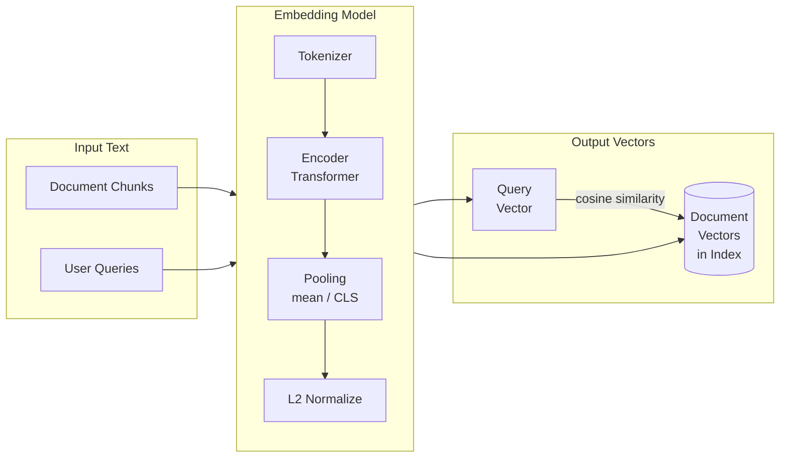

# Modelos de embedding

Modelos de embedding convertem texto em vetores numéricos densos que capturam o significado semântico.
Escolher o modelo correto e usá-lo de forma consistente na indexação e nas consultas é
fundamental para a correção de sistemas RAG.

## Visão geral



## Tipos de modelos de embedding

### Modelos somente encoder (família BERT)

Modelos somente encoder leem toda a sequência de entrada bidirecionalmente, o que os torna ideais
para produzir representações de tamanho fixo do texto.

| Característica | Valor |
| :--- | :--- |
| Arquitetura | Transformer bidirecional (BERT, RoBERTa) |
| Objetivo de treinamento | Masked Language Model (MLM) |
| Saída | Token CLS ou estados ocultos com pooling de média |
| Mais adequados para | Recuperação, classificação, similaridade semântica |
| Limitação | Tamanho máximo do contexto (normalmente 512 tokens) |

### Modelos somente decoder

Modelos somente decoder (família GPT) geram texto da esquerda para a direita e são projetados
principalmente para geração, não para embeddings. É possível usar o último token ou o pooling de média de um modelo
somente decoder para gerar embeddings, mas em geral o resultado é inferior ao de modelos criados para esse fim.

### Modelos de embedding criados para esse fim

Esses modelos são treinados especificamente para recuperação com aprendizado contrastivo (por exemplo,
multiple negatives ranking loss). Eles superam significativamente o BERT ajustado em benchmarks
de recuperação.

| Modelo | Dimensões | Pontos fortes |
| :--- | :--- | :--- |
| **Família E5** (e5-large, e5-mistral) | 1024, 4096 | Forte capacidade multilíngue e de seguir instruções |
| **Família BGE** (bge-large-en) | 1024 | Alto recall em benchmarks de recuperação em inglês |
| **Família GTE** (gte-large-en) | 1024 | Bom equilíbrio entre velocidade e qualidade |
| **Cohere Embed v3** | 1024 | Multilíngue, embeddings tipados por uso |
| **OpenAI text-embedding-ada-002** | 1536 | Amplamente usado, bom desempenho geral |
| **OpenAI text-embedding-3-large** | 3072 | Maior qualidade e contexto mais amplo |

### Modelos de embedding hospedados pelo Databricks

A Databricks Foundation Model API hospeda vários modelos de embedding como endpoints.

| Nome do endpoint | Modelo | Dimensões |
| :--- | :--- | :--- |
| `databricks-gte-large-en` | GTE-Large (inglês) | 1024 |
| `databricks-bge-large-en` | BGE-Large (inglês) | 1024 |

Esses endpoints estão disponíveis sem configuração nos workspaces do Databricks. Eles seguem
o formato de API compatível com OpenAI.

## API de modelo de fundação do Databricks para embeddings

```python
import mlflow.deployments

client = mlflow.deployments.get_deploy_client("databricks")

response = client.predict(
    endpoint="databricks-gte-large-en",
    inputs={"input": ["What is Delta Lake?", "How do I optimize Spark queries?"]}
)

# Response format (OpenAI-compatible)
# response["data"] is a list of {"object": "embedding", "embedding": [...], "index": 0}

embeddings = [item["embedding"] for item in response["data"]]
print(f"Number of embeddings: {len(embeddings)}")
print(f"Dimensions per embedding: {len(embeddings[0])}")  # 1024 for GTE-Large
```

### Embedding de um único texto

```python
def embed_text(text: str) -> list[float]:
    """Embed a single string using Databricks Foundation Model API."""
    response = client.predict(
        endpoint="databricks-gte-large-en",
        inputs={"input": [text]}
    )
    return response["data"][0]["embedding"]
```

### Embedding em lote

```python
def embed_batch(texts: list[str], batch_size: int = 32) -> list[list[float]]:
    """Embed a list of texts in batches to avoid API payload limits."""
    all_embeddings = []
    for i in range(0, len(texts), batch_size):
        batch = texts[i : i + batch_size]
        response = client.predict(
            endpoint="databricks-gte-large-en",
            inputs={"input": batch}
        )
        batch_embeddings = [item["embedding"] for item in response["data"]]
        all_embeddings.extend(batch_embeddings)
    return all_embeddings
```

## Regra fundamental: consistência dos embeddings

Esta é uma das regras mais importantes para o exame e para a prática.

**É obrigatório usar o MESMO modelo de embedding para criar o índice e gerar embeddings das consultas.**

### Por que isso importa

Cada modelo de embedding tem seu próprio espaço vetorial aprendido. Um documento incorporado com
o modelo A e uma consulta incorporada com o modelo B ocupam **espaços vetoriais incompatíveis**.
A similaridade de cosseno entre eles não tem significado — a busca retornará resultados aleatórios ou
incorretos.

```text
WRONG:
  Indexing time:  "Delta Lake documentation" -> model_A -> [0.12, -0.34, ...]
  Query time:     "What is Delta Lake?"      -> model_B -> [0.89, 0.21, ...]
  Similarity = meaningless number

CORRECT:
  Indexing time:  "Delta Lake documentation" -> model_A -> [0.12, -0.34, ...]
  Query time:     "What is Delta Lake?"      -> model_A -> [0.11, -0.31, ...]
  Similarity = high (correct semantic match)
```

### Incompatibilidade de dimensões

Modelos diferentes produzem vetores com dimensões diferentes. Tentar pesquisar com um
vetor de consulta de 1536 dimensões em um índice de 1024 dimensões gerará um erro.

| Cenário de mudança de modelo | Efeito |
| :--- | :--- |
| Mesmo modelo, mesmas dimensões | Resultados corretos |
| Modelo diferente, mesmas dimensões | Resultados incorretos sem aviso (nenhum erro) |
| Modelo diferente, dimensões diferentes | Erro em tempo de execução (incompatibilidade de dimensões) |

O caso mais perigoso é a incompatibilidade entre modelos com o mesmo número de dimensões —
nenhum erro é gerado, mas os resultados não têm significado semântico.

## Geração de embeddings em lote com Spark

Para indexar documentos em grande escala, use uma UDF pandas do Spark para paralelizar as chamadas de embedding
no cluster.

```python
from pyspark.sql.functions import col, pandas_udf
import pandas as pd
import mlflow.deployments

@pandas_udf("array<float>")
def embed_udf(text_series: pd.Series) -> pd.Series:
    """Pandas UDF to embed text using Databricks Foundation Model API."""
    deploy_client = mlflow.deployments.get_deploy_client("databricks")

    # Batch all texts in this partition
    texts = text_series.tolist()
    batch_size = 32
    all_embeddings = []

    for i in range(0, len(texts), batch_size):
        batch = texts[i : i + batch_size]
        response = deploy_client.predict(
            endpoint="databricks-gte-large-en",
            inputs={"input": batch}
        )
        batch_embeddings = [item["embedding"] for item in response["data"]]
        all_embeddings.extend(batch_embeddings)

    return pd.Series(all_embeddings)


# Apply to a Spark DataFrame

df_with_embeddings = df.withColumn("embedding", embed_udf(col("content")))

# Write to Delta for Vector Search ingestion

(df_with_embeddings
 .write
 .format("delta")
 .mode("overwrite")
 .saveAsTable("catalog.schema.document_chunks_with_embeddings"))
```

### Quando pré-calcular embeddings

| Cenário | Recomendação |
| :--- | :--- |
| índice Delta Sync com embeddings gerenciados | Deixe o Databricks calcular embeddings no momento da sincronização (não é necessário pré-calcular) |
| índice Direct Vector Access | Pré-calcule embeddings com UDF do Spark e envie pela API |
| Modelo de embedding personalizado / privado | Pré-calcule e armazene no Delta; use Direct Vector Access |
| Atualizações frequentes de documentos | Delta Sync CONTINUOUS (o Databricks gera embeddings nas atualizações) |

## Similaridade de cosseno versus produto escalar

As duas métricas medem a similaridade direcional entre dois vetores.

| Métrica | Fórmula | Intervalo | Vetores normalizados |
| :--- | :--- | :--- | :--- |
| **Similaridade de cosseno** | `dot(a,b) / (\|a\| * \|b\|)` | -1 a 1 | Equivale ao produto escalar |
| **Produto escalar** | `sum(a_i * b_i)` | Sem limite | Equivale à similaridade de cosseno |

**Ponto principal**: a maioria dos modelos de embedding criados para esse fim (incluindo GTE e BGE) normaliza os vetores
de saída com L2 para comprimento unitário. Para vetores unitários, `|a| = |b| = 1`; portanto:

```text
cosine(a, b) = dot(a, b) / (1 * 1) = dot(a, b)
```

Eles são equivalentes para vetores normalizados. O Databricks Vector Search usa similaridade de cosseno
por padrão para embeddings de texto.

A **distância euclidiana (L2)** mede a distância absoluta, não o ângulo. É adequada para
embeddings de imagens e casos em que a magnitude tem significado semântico. Para embeddings de texto,
prefira similaridade de cosseno/produto escalar.

## Questões de prática

**Questão 1**: uma equipe cria um sistema RAG. Durante a indexação, usa
`databricks-gte-large-en` para gerar embeddings de 1024 dimensões. No momento da consulta,
troca para `databricks-bge-large-en` (também com 1024 dimensões) para reduzir a latência.
Qual é o resultado?

A) Um erro imediato em tempo de execução devido a formatos de embedding incompatíveis
B) Uma precisão um pouco menor, mas resultados de recuperação geralmente corretos
C) Resultados de recuperação semanticamente incorretos, sem mensagem de erro
D) Os mesmos resultados do modelo original, pois os dois modelos têm as mesmas dimensões

> [!success]- Resposta
> **Resposta correta: C**
>
> Os dois modelos produzem vetores de 1024 dimensões; portanto, **não há incompatibilidade dimensional**.
> No entanto, GTE e BGE têm espaços vetoriais aprendidos diferentes — o mesmo texto
> produz vetores em regiões diferentes do espaço de cada modelo.
>
> A similaridade de cosseno entre um vetor de consulta BGE e vetores de documentos GTE mede o
> ângulo em um espaço combinado sem significado. A busca retornará resultados incorretos ou aleatórios
> sem nenhum aviso. Essa é a violação de consistência de embeddings mais perigosa
> porque falha silenciosamente.

**Questão 2**: você precisa gerar embeddings para 500.000 chunks de documentos armazenados em uma tabela Delta.
Qual é a abordagem recomendada no Databricks?

A) Percorrer cada linha e chamar a API de embedding individualmente a partir de um notebook
B) Usar uma UDF pandas com processamento em lotes para gerar embeddings dos chunks em paralelo no cluster Spark
C) Baixar todos os chunks para o driver, chamar a API de embedding e enviar os resultados
D) Usar o índice Delta Sync — o Databricks gerará os embeddings automaticamente durante a sincronização

> [!success]- Resposta
> **Respostas corretas: B ou D (dependendo do contexto)**
>
> **B** é correta quando é necessário pré-calcular e armazenar embeddings na tabela Delta
> (por exemplo, para um índice Direct Vector Access ou modelos de embedding personalizados). Uma UDF pandas
> distribui as chamadas de API entre os workers do cluster e processa solicitações em lotes com eficiência.
>
> **D** é correta quando se usa um índice Delta Sync — especificar
> `embedding_source_column` e `embedding_model_endpoint_name` ao criar o índice
> permite ao Databricks calcular embeddings automaticamente durante a sincronização.
>
> A opção A é extremamente lenta (500 mil chamadas de API em série). A opção C cria um gargalo no driver
> e risco de falta de memória (OOM) em grandes conjuntos de dados.

**Questão 3**: qual arquitetura de modelo de embedding é mais adequada para tarefas de recuperação
em um sistema RAG?

A) Somente decoder (estilo GPT) com pooling de média dos estados ocultos
B) Somente encoder (estilo BERT) ou modelo de embedding dedicado com treinamento contrastivo
C) Sequence-to-sequence (estilo T5) com embeddings da saída do encoder
D) Qualquer modelo — a arquitetura não afeta a qualidade da recuperação

> [!success]- Resposta
> **Resposta correta: B**
>
> **Modelos somente encoder** (BERT, RoBERTa) são bidirecionais — cada token presta atenção a
> todos os demais tokens — e produzem representações contextuais ricas. **Modelos de embedding
> dedicados** (E5, BGE, GTE) vão além, pois são treinados com objetivos contrastivos
> (por exemplo, dense passage retrieval, multiple negatives ranking loss) que otimizam explicitamente
> a similaridade entre consulta e documento em tarefas de recuperação.
>
> Modelos somente decoder (A) processam texto causalmente (da esquerda para a direita), produzindo
> representações menos adequadas para tarefas de similaridade simétrica.
> Sequence-to-sequence (C) foi projetado para tradução/sumarização, não para recuperação.
> A arquitetura afeta significativamente a qualidade da recuperação (D está incorreta).

## Casos de uso

- **Busca semântica em documentação interna**: geração de embeddings para mais de 100 mil páginas do Confluence com `databricks-gte-large-en` por chamadas de API em lote, indexação em um índice de busca vetorial Delta Sync e atendimento de consultas de similaridade por um chatbot interno de pesquisa.
- **Embedding específico de domínio para registros médicos**: ajuste fino de um modelo de embedding base com terminologia clínica para que consultas como “paciente apresentou MI” recuperem chunks que mencionam “infarto do miocárdio” — uma correspondência semântica que embeddings de uso geral não encontram.

## Problemas e erros comuns

### Incompatibilidade de dimensões dos embeddings

**Cenário:** as consultas não retornam resultados ou produzem classificações sem sentido porque o índice foi criado com um modelo de embedding (por exemplo, 768 dimensões), mas as consultas usam outro (por exemplo, 1024 dimensões).
**Correção:** use exatamente o mesmo modelo de embedding na indexação e nas consultas. Se precisar trocar de modelo, gere novamente os embeddings de todo o corpus e recrie o índice vetorial. Em índices Delta Sync, atualize `embedding_model_endpoint_name` e acione uma ressincronização completa.

### O job de geração de embeddings em lote excede o tempo limite

**Cenário:** gerar embeddings de um corpus grande (mais de 500 mil documentos) em uma única chamada de API ou em um loop muito apertado provoca erros de limitação de taxa ou timeouts no cluster.
**Correção:** gere embeddings em lote com chamadas de API paralelas, processando documentos em lotes de 100–500. Em índices Delta Sync, o Databricks gera os embeddings automaticamente. Em índices Direct Vector Access, use uma UDF do Spark que chame o endpoint de embedding em paralelo nos workers.

## Principais conclusões

- **Consistência é fundamental**: use exatamente o mesmo modelo de embedding no momento da indexação e da consulta — qualquer incompatibilidade torna os vetores incomparáveis
- **Databricks Foundation Model API**: `databricks-gte-large-en`, `databricks-bge-large-en` — serverless, sem necessidade de provisionar um cluster
- **Normalização L2**: padrão para embeddings de texto; torna o produto escalar equivalente à similaridade de cosseno
- **Compromisso no número de dimensões dos embeddings**: mais dimensões capturam nuances semânticas adicionais, mas custam mais armazenamento e computação
- **Embeddings em lote**: mais eficiente do que gerar um embedding por chunk — use chamadas de API em lote nos pipelines de indexação
- **Modelos específicos de domínio**: modelos de embedding ajustados superam modelos gerais para vocabulários especializados (jurídico, médico, código)
- **Troca de modelo**: exige gerar novamente os embeddings de todo o corpus e recriar o índice vetorial do zero

---

**[← Anterior: Processamento de documentos e chunking](01-document-processing-chunking.md) | [↑ Voltar para Preparação de dados](README.md) | [Próximo: Databricks Vector Search](03-databricks-vector-search.md) →**
