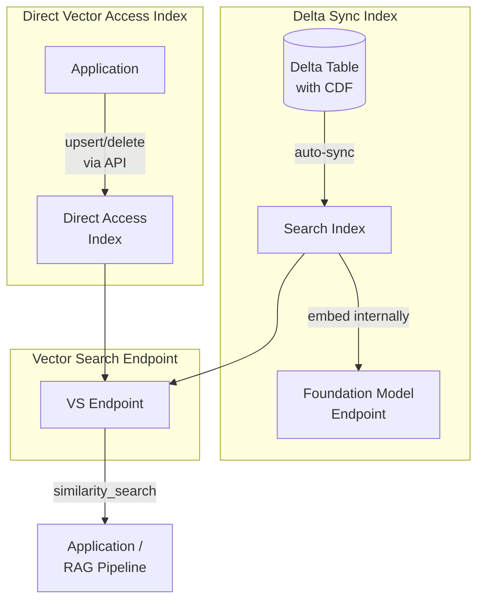

# Databricks Vector Search

O Databricks Vector Search é um banco de dados vetorial serverless totalmente gerenciado e integrado
à plataforma Lakehouse. Este arquivo aborda detalhes de implementação além dos conceitos básicos
em `rag-vector-search-basics.md` — com foco nos tipos de índice, modos de sincronização, parâmetros de busca
e integração com Unity Catalog.

## Visão geral



## Criação de endpoints

Um **endpoint** do Vector Search é o recurso computacional que hospeda um ou mais índices.
Todos os índices do mesmo endpoint compartilham sua capacidade computacional.

```python
from databricks.vector_search.client import VectorSearchClient

vsc = VectorSearchClient()

# Create a new endpoint

vsc.create_endpoint(
    name="my_endpoint",
    endpoint_type="STANDARD"
)

# Check endpoint status

endpoint = vsc.get_endpoint(name="my_endpoint")
print(endpoint["endpoint_status"]["state"])  # "ONLINE" when ready
```

**Tipos de endpoint**:

- `STANDARD` — menor latência de consulta; cerca de 320 milhões de vetores com 768 dimensões por endpoint; oferece suporte a uma meta alta de QPS; as fontes Delta Sync precisam de Change Data Feed
- `STORAGE_OPTIMIZED` — mais de 1 bilhão de vetores com 768 dimensões, indexação 10–20 vezes mais rápida, cerca de 250 ms a mais de latência de consulta, preço adequado a grandes volumes de vetores

> [!note] Atualização da plataforma (out. 2026)
> O Databricks renomeou **Vector Search** para **AI Search** em 2026-06-01; a documentação agora fala em *endpoints e índices do AI Search*, enquanto o guia do exame (março de 2026) mantém o nome original. Os exemplos usam o cliente `databricks-vectorsearch` da época do exame (`VectorSearchClient`); a documentação atual usa `%pip install databricks-ai-search` e `from databricks.ai_search.client import AISearchClient` com as mesmas operações de endpoint e índice ([Criar endpoints e índices do AI Search](https://docs.databricks.com/aws/en/ai-search/create-ai-search)). O Free Edition permite um endpoint do AI Search com uma unidade de busca e não oferece suporte a índices Direct Vector Access. Fontes: [notas de versão de junho de 2026](https://docs.databricks.com/aws/en/release-notes/product/2026/june), [Databricks AI Search](https://docs.databricks.com/aws/en/ai-search/ai-search), [limitações do Free Edition](https://docs.databricks.com/aws/en/getting-started/free-edition-limitations).

## Detalhes dos tipos de índice

### Índice Delta Sync

Um índice Delta Sync lê diretamente de uma tabela Delta e mantém o índice vetorial
sincronizado com ela. O Databricks chama internamente o endpoint do modelo de embedding.

**Requisitos**:

- A tabela de origem precisa ser uma **tabela Delta**
- A tabela de origem precisa ter **Change Data Feed habilitado**: `delta.enableChangeDataFeed = true`
- É necessário especificar um endpoint válido de modelo de embedding

**Tipos de pipeline**:

- `TRIGGERED` — a sincronização é executada somente quando acionada explicitamente (por chamada de API ou agendamento de job)
- `CONTINUOUS` — a sincronização é executada automaticamente poucos segundos após alterações na tabela de origem

```python
index = vsc.create_delta_sync_index(
    endpoint_name="my_endpoint",
    index_name="catalog.schema.my_index",        # 3-level UC namespace
    source_table_name="catalog.schema.documents",
    pipeline_type="TRIGGERED",                   # or "CONTINUOUS"
    primary_key="chunk_id",
    embedding_source_column="content",           # text column to embed
    embedding_model_endpoint_name="databricks-gte-large-en"
)
```

### Índice Direct Vector Access

Um índice Direct Vector Access não tem uma tabela Delta como origem. Sua aplicação
gerencia todos os embeddings e os envia ao índice por meio da API.

**Casos de uso**:

- Modelos de embedding personalizados ou privados que não estão disponíveis como endpoints do Databricks
- Fontes que não são Delta (APIs externas, dados de streaming)
- Controle total do agendamento de embeddings e do tamanho dos lotes
- Embeddings multimodais (imagens, áudio)

```python
index = vsc.create_direct_vector_access_index(
    endpoint_name="my_endpoint",
    index_name="catalog.schema.my_direct_index",
    primary_key="chunk_id",
    embedding_dimension=1024,                    # must match your embedding model
    embedding_vector_column="embedding"
)

# Push data directly to the index

index.upsert(
    [
        {
            "chunk_id": "doc1_chunk0",
            "embedding": [0.12, -0.34, ...],     # pre-computed embedding
            "content": "Delta Lake is...",
            "source": "delta_docs"
        }
    ]
)
```

### Comparação dos tipos de índice

| Critério | Delta Sync | Direct Vector Access |
| :--- | :--- | :--- |
| **Método de sincronização** | Automática a partir de tabela Delta (CDF) | Manual por API `upsert`/`delete` |
| **Origem dos embeddings** | O Databricks calcula na sincronização | Você calcula e fornece |
| **Requisito de origem** | Tabela Delta com CDF | Nenhum |
| **Acionador de atualização** | TRIGGERED (manual) ou CONTINUOUS (automático) | Chamada de API |
| **Flexibilidade** | Menor — vinculado ao esquema da tabela Delta | Maior — qualquer modelo de embedding |
| **Complexidade** | Menor — gerenciado pelo Databricks | Maior — você gerencia o pipeline de embeddings |
| **Mais adequado para** | RAG padrão com dados gerenciados | Modelos personalizados, fontes que não são Delta |

## Sincronização TRIGGERED versus CONTINUOUS

Essa distinção é bastante cobrada no exame.

| Aspecto | TRIGGERED | CONTINUOUS |
| :--- | :--- | :--- |
| **Quando as sincronizações são executadas** | Em chamada de API ou job agendado | Automaticamente após cada alteração na tabela Delta |
| **Latência até a indexação** | Minutos a horas (depende do agendamento) | Segundos a minutos |
| **Custo** | Menor — a computação é executada somente durante a sincronização | Maior — pipeline de streaming contínuo |
| **Mais adequado para** | Atualizações de documentos em lote (noturnas, semanais) | Base de conhecimento em tempo real, dados ativos |
| **Chamada de API para acionar** | `index.sync()` | Não é necessária — automático |

### Acionamento manual de uma sincronização

```python
# Get existing index

index = vsc.get_index(
    endpoint_name="my_endpoint",
    index_name="catalog.schema.my_index"
)

# Trigger sync (for TRIGGERED pipeline_type)

index.sync()

# Wait for sync to complete

import time
while True:
    status = index.describe()["status"]["detailed_state"]
    print(f"Sync status: {status}")
    if status in ("ONLINE", "ONLINE_NO_PENDING_UPDATE"):
        break
    time.sleep(10)
```

## Parâmetros de similarity_search()

Referência completa de todos os parâmetros compatíveis.

```python
results = index.similarity_search(
    query_text="user query here",           # text query (auto-embedded)
    # OR: query_vector=[0.12, -0.34, ...],  # pre-computed query vector
    columns=["content", "source", "chunk_id"],  # columns to return
    num_results=5,                          # top-K results
    filters={"source": "policy_docs"},      # metadata pre-filter (dict)
    query_type="ANN"                        # "ANN" (default) or "HYBRID"
)

# Response structure

data_array = results.get("result", {}).get("data_array", [])
# Each row: [col1_value, col2_value, col3_value, score]

for row in data_array:
    content, source, chunk_id, score = row
    print(f"Score: {score:.4f} | Source: {source}")
```

### Observações sobre os parâmetros

| Parâmetro | Observações |
| :--- | :--- |
| `query_text` | Gera embeddings automaticamente com o modelo configurado no índice |
| `query_vector` | Use quando você já gerou o embedding da consulta; ignora a geração interna de embedding |
| `columns` | Retorna somente as colunas necessárias — reduz o tamanho da resposta |
| `num_results` | O padrão é 10; valores maiores melhoram o recall, ao custo da precisão |
| `filters` | Aplicado antes da busca ANN (pré-filtragem); usa lógica AND para várias chaves |
| `query_type` | `"ANN"` = somente densa; `"HYBRID"` = densa + BM25 esparso |

## Integração com Unity Catalog

O Vector Search é totalmente integrado ao Unity Catalog. Os nomes dos índices precisam seguir o
namespace de três níveis.

### Convenção de nomenclatura

```text
catalog.schema.index_name

Examples:
  prod_catalog.ml_schema.policy_docs_index
  main.default.faq_index
```

### Concessão de permissões

```sql
-- Allow a service principal to query the endpoint
GRANT EXECUTE ON VECTOR SEARCH ENDPOINT my_endpoint TO `sp-rag-app`;

-- Allow reading the index (SELECT permission on the backing table)
GRANT SELECT ON TABLE catalog.schema.my_index TO `sp-rag-app`;
```

### Listagem de índices

```python
# List all indexes on an endpoint

indexes = vsc.list_indexes(endpoint_name="my_endpoint")
for idx in indexes:
    print(f"{idx['name']} — {idx['index_type']} — {idx['status']['detailed_state']}")
```

## Exemplo completo: configuração de índice Delta Sync

```python
from databricks.vector_search.client import VectorSearchClient

vsc = VectorSearchClient()

# Step 1: Ensure source table has CDF enabled

spark.sql("""
    ALTER TABLE catalog.schema.document_chunks
    SET TBLPROPERTIES ('delta.enableChangeDataFeed' = 'true')
""")

# Step 2: Create endpoint (skip if already exists)

try:
    vsc.create_endpoint(name="rag_endpoint", endpoint_type="STANDARD")
except Exception:
    pass  # Endpoint already exists

# Step 3: Create Delta Sync index

index = vsc.create_delta_sync_index(
    endpoint_name="rag_endpoint",
    index_name="catalog.schema.doc_chunks_index",
    source_table_name="catalog.schema.document_chunks",
    pipeline_type="TRIGGERED",
    primary_key="chunk_id",
    embedding_source_column="content",
    embedding_model_endpoint_name="databricks-gte-large-en"
)

# Step 4: Trigger initial sync and wait

index.sync()
print("Initial sync triggered. Waiting for completion...")

import time
while True:
    state = index.describe()["status"]["detailed_state"]
    if state in ("ONLINE", "ONLINE_NO_PENDING_UPDATE"):
        print(f"Index ready: {state}")
        break
    print(f"State: {state}")
    time.sleep(15)

# Step 5: Query the index

results = index.similarity_search(
    query_text="How do I configure Auto Loader?",
    columns=["content", "source"],
    num_results=5
)
for row in results.get("result", {}).get("data_array", []):
    print(row)
```

## Questões de prática

**Questão 1**: você está criando um índice do Databricks Vector Search que deve refletir
alterações na tabela Delta de origem em poucos segundos. Qual configuração está correta?

A) `pipeline_type="TRIGGERED"` e chamada de `index.sync()` a cada 30 segundos por um job
B) `pipeline_type="CONTINUOUS"` — o índice sincroniza automaticamente em poucos segundos
C) `pipeline_type="TRIGGERED"` com o parâmetro `auto_sync=True`
D) Usar um índice Direct Vector Access com um job de streaming que envia atualizações

> [!success]- Resposta
> **Resposta correta: B**
>
> `pipeline_type="CONTINUOUS"` cria um pipeline de sincronização por streaming que monitora o
> change feed da tabela Delta de origem e atualiza o índice automaticamente em poucos
> segundos. Não é necessário acionamento manual.
>
> `TRIGGERED` (A) exige acionamento manual ou agendado — mesmo com um job a cada 30 segundos,
> há um intervalo. O parâmetro `auto_sync=True` (C) não existe. Direct Vector Access com
> um job de streaming (D) funcionaria, mas é bem mais complexo e não é o caso de uso previsto
> para embeddings gerenciados.

**Questão 2**: o que acontece quando você tenta criar um índice Delta Sync em uma tabela Delta
sem Change Data Feed habilitado?

A) O índice é criado com sucesso e faz uma nova varredura completa a cada sincronização
B) A criação do índice falha com um erro que exige a habilitação do CDF
C) O índice é criado, mas retorna resultados desatualizados silenciosamente
D) O Databricks habilita automaticamente o CDF na tabela durante a criação do índice

> [!success]- Resposta
> **Resposta correta: B**
>
> O Databricks Vector Search exige CDF (`delta.enableChangeDataFeed = true`) na
> tabela de origem para detectar alterações incrementais. Se o CDF não estiver habilitado, a criação do índice
> gerará um erro. Você precisa habilitar o CDF antes de criar o índice, seja no momento da criação
> da tabela, seja com `ALTER TABLE ... SET TBLPROPERTIES`.
>
> O Databricks não habilita o CDF automaticamente (D) — essa ação precisa ser realizada explicitamente
> pelo usuário, pois o CDF aumenta o armazenamento ao reter registros de alterações.

**Questão 3**: uma equipe usa um índice Direct Vector Access e atualiza seu modelo personalizado
de embedding (mesmas dimensões, pesos diferentes). Depois de gerar novamente embeddings de todos os documentos
com o novo modelo, a equipe envia os vetores atualizados por `upsert`. Qual etapa adicional é
necessária?

A) Excluir e recriar o índice com a nova configuração do modelo de embedding
B) Nenhuma etapa adicional — upsert substitui os vetores dos IDs de chunks existentes
C) Reabilitar CDF na tabela Delta subjacente
D) Atualizar o campo `embedding_model_endpoint_name` na configuração do índice

> [!success]- Resposta
> **Resposta correta: B**
>
> Com Direct Vector Access, as operações `upsert` substituem os vetores existentes pela chave
> primária. Desde que os mesmos valores de `chunk_id` sejam usados, os novos vetores sobrescrevem os
> antigos. Como as dimensões não mudaram, não é necessário modificar o esquema.
>
> Excluir e recriar o índice (A) funcionaria, mas seria desnecessariamente destrutivo
> e causaria indisponibilidade. Direct Vector Access não tem `embedding_model_endpoint_name`
> (D) — esse conceito se aplica a índices Delta Sync. CDF (C) é irrelevante para índices
> Direct Vector Access.

## Casos de uso

- **Base de conhecimento RAG com sincronização automática**: criação de um índice Delta Sync com pipeline `CONTINUOUS` para que o índice vetorial seja atualizado em poucos segundos após a inclusão de documentos na tabela Delta de origem, mantendo atualizada a base de conhecimento do chatbot RAG.
- **Integração de modelo de embedding personalizado**: uso de um índice Direct Vector Access para dar suporte a um modelo de embedding proprietário indisponível como endpoint do Databricks, com um job em lote noturno que gera novamente embeddings para documentos atualizados e envia os vetores por `upsert`.

## Problemas e erros comuns

### A criação do índice Delta Sync falha com erro de CDF

**Cenário:** `create_delta_sync_index()` gera um erro informando que Change Data Feed não está habilitado na tabela de origem.
**Correção:** habilite CDF na tabela de origem antes de criar o índice: `ALTER TABLE catalog.schema.my_table SET TBLPROPERTIES ('delta.enableChangeDataFeed' = 'true')`. O CDF precisa ser habilitado explicitamente — o Databricks não o habilita automaticamente.

### Resultados de busca desatualizados após atualizações de documentos

**Cenário:** documentos foram atualizados na tabela Delta de origem, mas `similarity_search()` ainda retorna conteúdo antigo.
**Correção:** com o tipo de pipeline `TRIGGERED`, o índice não sincroniza automaticamente. Chame `index.sync()` explicitamente ou agende a sincronização como job do Databricks. Para atualização quase em tempo real, mude o tipo de pipeline para `CONTINUOUS`.

## Principais conclusões

- **Dois tipos de índice**: Delta Sync (sincroniza automaticamente a partir de uma tabela Delta com CDF habilitado; o Databricks gera os embeddings internamente) e Direct Vector Access (`upsert`/`delete` pela API; o chamador fornece os embeddings)
- **CDF obrigatório para Delta Sync**: a tabela Delta de origem precisa ter Change Data Feed habilitado (`delta.enableChangeDataFeed = true`)
- **O endpoint hospeda índices**: um endpoint pode atender vários índices que compartilham a capacidade computacional — crie um endpoint por caso de uso de produção
- **`similarity_search(query_text, num_results, filters)`**: os filtros reduzem o conjunto de candidatos antes da busca ANN
- **Governança do UC**: índices de busca vetorial herdam permissões da tabela Delta de origem — os GRANTs na origem controlam quem pode consultar o índice
- **É necessário recriar o índice**: quando o modelo de embedding muda, gere novamente os embeddings e recrie o índice inteiro
- **Direct Access para embeddings externos**: use quando seu modelo de embedding não estiver disponível pelos Databricks Foundation Models

---

**[← Anterior: Modelos de embedding](02-embeddings-models.md) | [↑ Voltar para Preparação de dados](README.md) | [Próximo: Documentos de origem, extração e avaliação da recuperação](04-source-documents-extraction-and-retrieval-eval.md) →**
