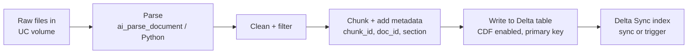
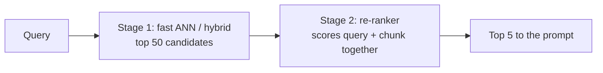

# Documentos de origem, extração e avaliação da recuperação

## Visão geral

Uma aplicação RAG é tão boa quanto os documentos dos quais recupera informações. Este arquivo aborda os itens de Preparação de dados que vêm *antes* e *depois* do chunking: identificar de quais documentos de origem a aplicação realmente precisa, extrair seu conteúdo com o pacote Python adequado, filtrar conteúdo que prejudica a recuperação, gravar o resultado no Unity Catalog na sequência correta e medir a qualidade da recuperação — inclusive o papel do re-ranking e do chunking avançado.

> [!abstract]
>
> - **Seleção de fontes** — comece pelas perguntas dos usuários; fatos estruturados por entidade pertencem a tabelas, e conhecimento explicativo, a documentos
> - **Pacotes de extração** — OCR (`pytesseract`) para imagens digitalizadas, `pypdf` / PyMuPDF para PDFs digitais, BeautifulSoup para HTML, `unstructured` para formatos mistos ou `ai_parse_document` em SQL
> - **Filtragem** — remova cabeçalhos, rodapés, navegação, textos padronizados, duplicatas e ruído de OCR antes do chunking
> - **Avaliação da recuperação** — precision@k, recall@k, MRR, NDCG e juízes de recuperação do MLflow (`RetrievalRelevance`, `RetrievalSufficiency`, `RetrievalGroundedness`)
> - **Re-ranking** — um modelo em segunda etapa reordena um conjunto maior de candidatos para que os melhores chunks cheguem ao prompt

> [!tip] O que o exame avalia
>
> - Escolher o pacote de extração conforme o **formato do arquivo** (na questão oficial de exemplo: `.jpeg` / `.png` digitalizado → `pytesseract`, pois é necessário fazer OCR)
> - Reconhecer quando a solução é **usar outros dados de origem**, e não outro modelo (questão oficial de exemplo sobre datas de entrega)
> - Qual métrica de recuperação responde a cada pergunta e quais juízes do MLflow precisam de ground truth
> - Em que ponto do pipeline ocorre o re-ranking e qual é sua relação de compromisso com a latência

---

## Identificação dos documentos de origem necessários para uma aplicação RAG

Item do guia do exame: *"Identificar os documentos de origem necessários para fornecer o conhecimento e a qualidade exigidos por determinada aplicação RAG."*

Parta das perguntas e trabalhe de trás para frente:

1. **Liste perguntas representativas** (de usuários, chamados de suporte e logs de pesquisa)
2. **Para cada pergunta, identifique o fato que a responde** e onde esse fato está atualmente
3. **Classifique o fato**:
   - *Conhecimento explicativo que muda lentamente* (políticas, manuais, FAQs) → documentos → chunk + embedding → retriever
   - *Fatos por entidade que mudam com frequência* (status do pedido, data de entrega, saldo da conta) → tabela estruturada indexada por ID → ferramenta de consulta ou tabela de feature store/online
4. **Verifique a qualidade** de cada fonte candidata

| Critério de qualidade | Pergunta a fazer | Risco se ignorado |
| :--- | :--- | :--- |
| **Cobertura** | O corpus contém a resposta para cada pergunta representativa? | “Não sei” ou alucinação |
| **Autoridade** | Esta é a fonte oficial dos dados ou uma cópia desatualizada? | Respostas conflitantes |
| **Atualidade** | Com que frequência os dados mudam e o índice consegue acompanhar? | Respostas desatualizadas |
| **Limpeza** | A fonte contém principalmente conteúdo ou textos padronizados e ruído? | Recuperação irrelevante |
| **Direitos e sensibilidade** | Podemos usar a fonte (licença, termos) e ela contém PII? | Exposição legal e de privacidade — consulte [Governança](../../../../../certifications/genai-engineer-associate/06-governance/01-governance-overview.md) |

> [!note]
> Na questão oficial de exemplo, um assistente de peças automotivas responde bem a perguntas de faturamento, mas falha em perguntas sobre envio e datas de chegada. As datas previstas de entrega são **fatos estruturados por transação**; portanto, a solução é uma **tabela de feature store indexada por `transaction_id`**, preenchida com dados da fatura e a data prevista de entrega — não um armazenamento vetorial de políticas de envio, fine-tuning ou uma regra fixa “+14 days” no prompt.

## Escolha de um pacote Python para extrair conteúdo de documentos

Item do guia do exame: *"Escolher o pacote Python adequado para extrair conteúdo de documentos de determinada fonte e formato."*

| Formato de origem | Pacote / ferramenta | Motivo |
| :--- | :--- | :--- |
| **Imagens digitalizadas** (`.jpeg`, `.png`, PDFs somente com imagens) | `pytesseract` (Tesseract OCR) | O texto existe somente como pixels — é necessário fazer OCR |
| **PDFs digitais** (com camada de texto) | `pypdf` (`PyPDF`), PyMuPDF (`fitz`) | Extração rápida de texto por página; PyMuPDF também fornece layout e imagens |
| **PDFs com tabelas** | `pdfplumber`, `unstructured` com inferência de tabelas, `ai_parse_document` | Preservam a estrutura das tabelas em vez de achatá-las |
| **HTML / páginas da Web** | `beautifulsoup4`, `lxml` | Analisam o DOM e mantêm somente o conteúdo principal |
| **Word / PowerPoint** | `python-docx`, `python-pptx` | Acesso nativo a parágrafos, títulos e slides |
| **Vários formatos em escala** | `unstructured` (funções `partition`) | Uma API para vários formatos; retorna elementos tipados (Title, NarrativeText, Table, …) |
| **Qualquer documento, em SQL e sob governança** | `ai_parse_document` (Databricks AI Function) | Retorna texto, tabelas, descrições de figuras e layout; desde outubro de 2026, também dados de gráficos em JSON |

Bibliotecas de web scraping como `scrapy` ou `pyquery` *buscam ou consultam HTML*; elas não fazem OCR e, por isso, são respostas incorretas para imagens digitalizadas.

```python
import pytesseract
from PIL import Image

text = pytesseract.image_to_string(Image.open("/Volumes/main/docs/raw/invoice_0001.png"))
```

```sql
-- Parse every file in a volume with the Databricks AI Function
CREATE OR REPLACE TABLE main.rag.parsed_docs AS
SELECT
  path,
  ai_parse_document(content) AS parsed
FROM READ_FILES('/Volumes/main/docs/raw/', format => 'binaryFile');
```

Fontes: [AI Functions no Databricks](https://docs.databricks.com/aws/en/large-language-models/ai-functions) (lista `ai_parse_document` e a função Beta de chunking `ai_prep_search`) e [notas de versão de outubro de 2026](https://docs.databricks.com/aws/en/release-notes/product/2026/october) (extração de dados de gráficos).

## Filtragem de conteúdo supérfluo

Item do guia do exame: *"Filtrar conteúdo supérfluo nos documentos de origem que prejudica a qualidade de uma aplicação RAG."* O ruído nos chunks vira ruído nos embeddings: um chunk composto pela metade por um rodapé de página corresponderá a consultas sobre rodapés.

| Conteúdo supérfluo | Como removê-lo |
| :--- | :--- |
| Cabeçalhos, rodapés e números de página repetidos | Detecte linhas repetidas entre páginas; remova as regiões de layout identificadas pelo parser como cabeçalho/rodapé |
| Menus de navegação, banners de cookies e barras laterais (HTML) | Mantenha somente `<main>` / `<article>`; remova `<nav>`, `<footer>`, `<script>`, `<style>` |
| Sumários, índices e textos jurídicos padronizados | Remova por tipo de elemento ou título; mantenha uma cópia canônica dos avisos legais |
| Documentos duplicados ou quase duplicados | Gere hashes do texto normalizado; mantenha a versão mais recente ou oficial |
| Ruído de OCR | Descarte chunks com baixa proporção de palavras reconhecíveis ou muito curtos |
| Documentos fora do tema ou do escopo | Filtre por metadados (departamento, produto, idioma) antes da indexação |

```python
from bs4 import BeautifulSoup

def main_text(html: str) -> str:
    soup = BeautifulSoup(html, "html.parser")
    for tag in soup(["nav", "header", "footer", "script", "style", "aside"]):
        tag.decompose()
    body = soup.find("main") or soup.find("article") or soup.body
    return body.get_text(separator="\n", strip=True)
```

Mantenha metadados úteis (título, cabeçalho da seção, URL, data da última atualização) como colunas — eles permitem filtragem e citações posteriormente.

## Gravação de texto dividido em chunks no Delta Lake com Unity Catalog

Item do guia do exame: *"Definir as operações e a sequência para gravar determinado texto dividido em chunks nas tabelas do Delta Lake no Unity Catalog."* A ordem é importante porque o índice Delta Sync do Vector Search lê o change feed da tabela.



1. Armazene os arquivos brutos em um **volume do Unity Catalog**
2. **Analise** e **limpe** os dados
3. Divida em **chunks** e associe um `chunk_id` estável (chave primária) e colunas de metadados
4. **Crie a tabela Delta** em `catalog.schema` com **Change Data Feed** habilitado (endpoints padrão exigem isso; tabelas com rastreamento de linhas o habilitam automaticamente) e grave os chunks (`MERGE` em `chunk_id` para atualizações)
5. **Crie ou sincronize** o índice Delta Sync (acionado ou contínuo)

O código das etapas 3–5 está em [Processamento de documentos e chunking](01-document-processing-chunking.md) e [Databricks Vector Search](03-databricks-vector-search.md). Fonte dos requisitos: [Databricks AI Search](https://docs.databricks.com/aws/en/ai-search/ai-search).

## Avaliação do desempenho da recuperação

Item do guia do exame: *"Usar ferramentas e métricas para avaliar o desempenho da recuperação."* Avalie o retriever **separadamente** do gerador para identificar qual parte precisa de ajustes.

### Métricas de classificação (exigem chunks relevantes rotulados)

| Métrica | O que mede | Como interpretar |
| :--- | :--- | :--- |
| **Precision@k** | Fração dos resultados do top-k que são relevantes | O contexto contém ruído? |
| **Recall@k** | Fração de todos os chunks relevantes encontrados no top-k | Encontramos tudo o que era necessário? |
| **Hit rate@k** | Fração das consultas com pelo menos um chunk relevante no top-k | A recuperação funciona? |
| **MRR** (mean reciprocal rank) | Média de 1 / posição do primeiro resultado relevante | O melhor chunk está perto do topo? |
| **NDCG@k** | Relevância ponderada pela posição, normalizada em relação à ordenação ideal | Toda a classificação é boa, considerando graus de relevância? |

### Juízes de recuperação do MLflow

O MLflow 3 oferece juízes de LLM que pontuam a recuperação com base nos spans do retriever do trace ([juízes de LLM integrados](https://docs.databricks.com/aws/en/mlflow3/genai/eval-monitor/concepts/judges/)):

| Juiz | Pergunta | Precisa de ground truth? |
| :--- | :--- | :---: |
| `RetrievalRelevance` | O contexto recuperado é relevante para a solicitação? | Não |
| `RetrievalSufficiency` | O contexto contém tudo o que é necessário para produzir os fatos esperados? | **Sim** (`expectations`) |
| `RetrievalGroundedness` | A resposta está fundamentada no contexto recuperado (sem alucinações)? | Não |

```python
import mlflow
from mlflow.genai.scorers import RetrievalRelevance, RetrievalSufficiency, RetrievalGroundedness

eval_data = [
    {
        "inputs": {"question": "What is the return window for opened items?"},
        "expectations": {"expected_facts": ["Opened items can be returned within 15 days."]},
    },
]

mlflow.genai.evaluate(
    data=eval_data,
    predict_fn=rag_app,  # traced app with a RETRIEVER span
    scorers=[RetrievalRelevance(), RetrievalSufficiency(), RetrievalGroundedness()],
)
```

### Diagnóstico com as métricas

| Padrão | Diagnóstico | Correção |
| :--- | :--- | :--- |
| Recall / suficiência baixos | Os fatos necessários não são recuperados | Refaça o chunking, adicione fontes, use busca híbrida, reescreva consultas ou aumente k |
| Bom recall, baixa precisão / relevância | Há muito ruído no contexto | Re-ranking, filtros de metadados, chunks menores |
| Boa recuperação, baixa fundamentação | O gerador ignora o contexto | Instruções de fundamentação mais fortes, outro LLM |
| MRR baixo, recall@k bom | O melhor chunk está presente, mas em posição baixa | Re-ranking |

## Design da recuperação com chunking avançado e re-ranking

Itens do guia do exame: *"Projetar sistemas de recuperação com estratégias avançadas de chunking"* e *"Explicar o papel do re-ranking no processo de recuperação de informações."*

| Técnica | O que faz | Detalhes em |
| :--- | :--- | :--- |
| **Chunking sensível à estrutura** | Divide por títulos e seções; mantém os títulos das seções como metadados | [Processamento de documentos e chunking](01-document-processing-chunking.md) |
| **Chunking semântico** | Divide onde diminui a similaridade entre os embeddings das frases | [Processamento de documentos e chunking](01-document-processing-chunking.md) |
| **Pai-filho (do pequeno ao grande)** | Cria embeddings de chunks filhos pequenos para correspondências precisas e retorna o chunk pai maior como contexto | [Padrões de design de RAG](../03-design-applications/01-rag-design-patterns.md) |
| **Compressão contextual** | Mantém somente as frases relevantes de cada chunk recuperado | [Padrões de design de RAG](../03-design-applications/01-rag-design-patterns.md) |
| **Busca híbrida** | Combina similaridade vetorial com correspondência por palavras-chave (estilo BM25) para IDs e termos raros | [Estratégias de recuperação e aumento](../../../../../certifications/genai-engineer-associate/01-application-development/03-retrieval-augmentation-strategies.md) |

### O papel do re-ranking



- **Etapa 1** (busca vetorial com bi-encoder) é rápida e otimizada para **recall**
- **Etapa 2** (um cross-encoder ou modelo reranker) analisa a consulta e cada candidato *em conjunto*; é mais lenta, mas mais precisa e otimiza a **precisão no topo da lista**
- Use-o quando recall@50 é bom, mas o melhor chunk não está entre os primeiros; ignore-o quando a latência for a restrição dominante (a questão oficial de exemplo sobre uma busca crítica em latência e com 80 QPS mantém a busca híbrida e o re-ranking **desativados**)
- O Databricks AI Search (antigo Vector Search) oferece suporte nativo a reranking ([Databricks AI Search](https://docs.databricks.com/aws/en/ai-search/ai-search))

## Casos de uso

- **Arquivo de faturas digitalizadas** — `pytesseract` (ou `ai_parse_document`) extrai o texto das imagens antes do chunking; a filtragem de ruído de OCR remove chunks sem sentido
- **Assistente baseado em wiki** — BeautifulSoup remove navegação e rodapés; recall@5 aumenta porque os chunks passam a conter somente o conteúdo dos artigos
- **Perguntas sobre datas de entrega** — uma consulta a tabela indexada substitui a recuperação vetorial de fatos por pedido
- **Ajuste da precisão** — o MRR está baixo apesar do bom recall@20; adicionar um re-ranker leva o melhor chunk à primeira posição

## Problemas e erros comuns

### Texto vazio em arquivos de imagem

**Cenário:** um leitor de PDF retorna strings vazias para uma pasta com imagens digitalizadas `.png`.
**Correção:** imagens não têm camada de texto. Use OCR (`pytesseract`) ou `ai_parse_document` e valide uma amostra do texto extraído.

### Textos padronizados dominam a recuperação

**Cenário:** muitas consultas recuperam chunks compostos principalmente por avisos de direitos autorais no rodapé.
**Correção:** remova cabeçalhos e rodapés repetidos antes do chunking e gere novamente os embeddings. Adicione um filtro de tamanho mínimo de conteúdo.

### Falha ao criar índice Delta Sync em uma tabela nova

**Cenário:** a criação do índice falha na tabela de chunks.
**Correção:** habilite Change Data Feed na tabela de origem (`delta.enableChangeDataFeed = true`) para endpoints padrão e confirme que a tabela tem uma coluna de chave primária.

## Dicas para o exame

> [!tip] Dicas para o exame
>
> - **Imagens → OCR → `pytesseract`.** HTML → BeautifulSoup. PDF digital → `pypdf` / PyMuPDF. Vários formatos → `unstructured`. SQL nativo → `ai_parse_document`.
> - **Fatos por entidade → tabela estruturada indexada por ID**, não um armazenamento vetorial.
> - **Recall** = encontramos o que era necessário; **precision** = o contexto está limpo; **MRR** = o melhor resultado aparece primeiro.
> - `RetrievalSufficiency` precisa de **ground truth**; `RetrievalRelevance` e `RetrievalGroundedness`, não.
> - O re-ranking melhora a **precisão no topo** e aumenta a **latência**.

## Principais conclusões

- Escolha as fontes com base nas perguntas dos usuários e verifique cobertura, autoridade, atualidade, limpeza e direitos de uso
- Escolha o pacote de extração conforme o formato do arquivo; imagens digitalizadas exigem OCR
- Filtre textos padronizados e duplicatas antes do chunking para que os embeddings representem o conteúdo real
- Grave os chunks em uma tabela Delta com CDF habilitado e chave primária; em seguida, sincronize o índice do Vector Search
- Avalie o retriever separadamente com métricas de classificação e juízes de recuperação do MLflow; use re-ranking quando o chunk correto for encontrado, mas estiver em posição muito baixa

## Tópicos relacionados

- [Processamento de documentos e chunking](01-document-processing-chunking.md)
- [Databricks Vector Search](03-databricks-vector-search.md)
- [Estratégias de recuperação e aumento](../../../../../certifications/genai-engineer-associate/01-application-development/03-retrieval-augmentation-strategies.md)
- [Scorers, juízes e feedback de SMEs do MLflow](../../../../../certifications/genai-engineer-associate/05-evaluation-and-monitoring/03-mlflow-scorers-judges-and-feedback.md)

## Documentação oficial

- [AI Functions no Databricks](https://docs.databricks.com/aws/en/large-language-models/ai-functions)
- [Databricks AI Search (antigo Vector Search)](https://docs.databricks.com/aws/en/ai-search/ai-search)
- [Juízes de LLM integrados](https://docs.databricks.com/aws/en/mlflow3/genai/eval-monitor/concepts/judges/)
- [Guia do exame Databricks Certified Generative AI Engineer Associate (PDF)](https://www.databricks.com/sites/default/files/2026-10/databricks-certified-gen-ai-associate-exam-guide-august-2026.pdf)

---

**[← Anterior: Databricks Vector Search](03-databricks-vector-search.md) | [↑ Voltar para Preparação de dados](README.md)**
