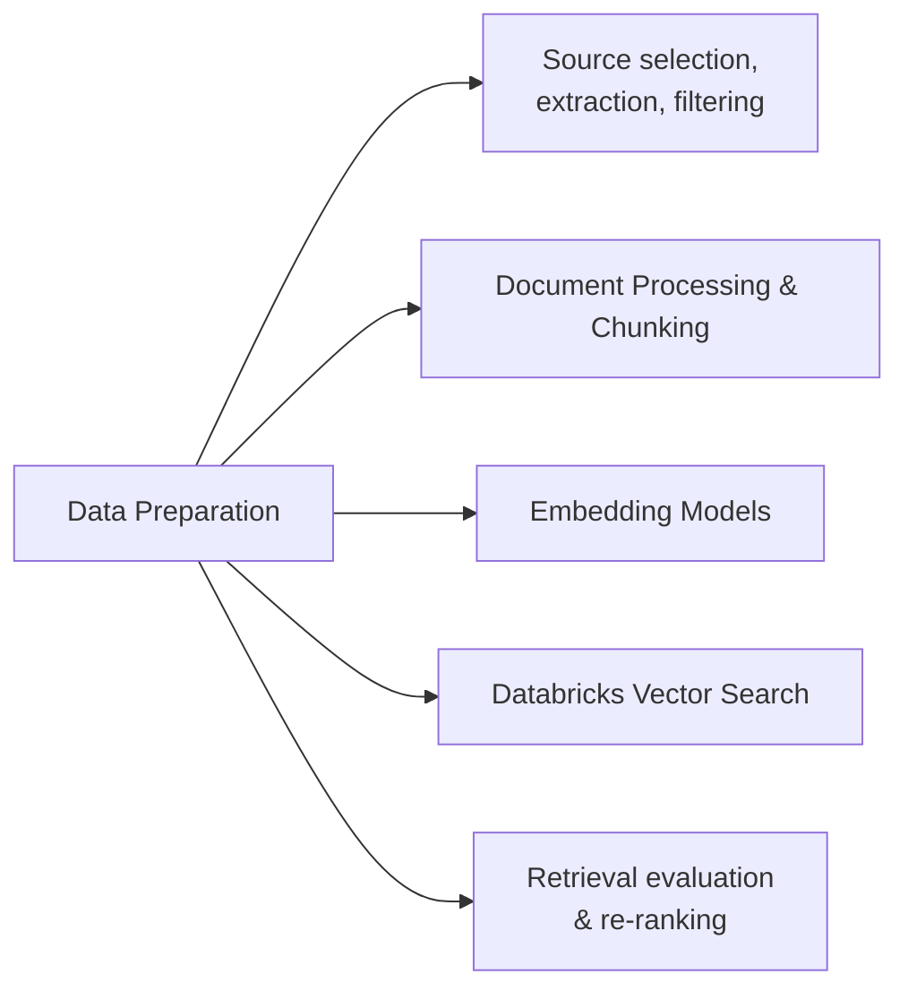

# Preparação de dados (14 % do exame)

Seção 2 do guia do exame: a etapa de construção do RAG — escolher os documentos de origem certos, extrair e limpar seu conteúdo, fazer **chunking** e **embedding**, gravar os fragmentos no Delta Lake com Unity Catalog, criar índices do **Vector Search** e medir a qualidade da recuperação (inclusive re-ranking).

## Visão geral dos tópicos

## Conteúdo da seção

| Arquivo | Tópico | Prioridade |
| :--- | :--- | :--- |
| [01-document-processing-chunking.md](01-document-processing-chunking.md) | Análise, tamanho e sobreposição dos chunks, chunking sensível à estrutura e semântico, gravação dos chunks no Delta | Alta |
| [02-embeddings-models.md](02-embeddings-models.md) | Escolha de modelos de embedding, dimensionalidade, endpoints de embedding FMAPI, consistência | Alta |
| [03-databricks-vector-search.md](03-databricks-vector-search.md) | Endpoints, índices Delta Sync versus Direct Vector Access, modos de sincronização, `similarity_search` | Alta |
| [04-source-documents-extraction-and-retrieval-eval.md](04-source-documents-extraction-and-retrieval-eval.md) | Seleção de fontes, pacotes de extração (OCR, PDF, HTML, `ai_parse_document`), filtragem, sequência de gravação, métricas de recuperação, re-ranking *(guia de 2026)* | Alta |

## Cobertura do guia do exame

| Item do guia do exame (Seção 2) | Onde é abordado |
| :--- | :--- |
| Aplicar uma estratégia de chunking para determinada estrutura de documento e restrições do modelo | [01](01-document-processing-chunking.md) |
| Filtrar conteúdo supérfluo nos documentos de origem que prejudica a qualidade de uma aplicação RAG | [04](04-source-documents-extraction-and-retrieval-eval.md#filtragem-de-conteúdo-supérfluo) |
| Escolher o pacote Python adequado para extrair conteúdo de documentos de determinada fonte e formato | [04](04-source-documents-extraction-and-retrieval-eval.md#escolha-de-um-pacote-python-para-extrair-conteúdo-de-documentos) |
| Definir as operações e a sequência para gravar determinado texto dividido em chunks nas tabelas do Delta Lake no Unity Catalog | [01](01-document-processing-chunking.md), [04](04-source-documents-extraction-and-retrieval-eval.md#gravação-de-texto-dividido-em-chunks-no-delta-lake-com-unity-catalog) |
| Identificar os documentos de origem necessários para fornecer o conhecimento e a qualidade exigidos por determinada aplicação RAG | [04](04-source-documents-extraction-and-retrieval-eval.md#identificação-dos-documentos-de-origem-necessários-para-uma-aplicação-rag) |
| Usar ferramentas e métricas para avaliar o desempenho da recuperação | [04](04-source-documents-extraction-and-retrieval-eval.md#avaliação-do-desempenho-da-recuperação) |
| Projetar sistemas de recuperação com estratégias avançadas de chunking | [04](04-source-documents-extraction-and-retrieval-eval.md#design-da-recuperação-com-chunking-avançado-e-re-ranking), [Padrões de design de RAG](../03-design-applications/01-rag-design-patterns.md) |
| Explicar o papel do re-ranking no processo de recuperação de informações | [04](04-source-documents-extraction-and-retrieval-eval.md#o-papel-do-re-ranking), [Padrões de design de RAG](../03-design-applications/01-rag-design-patterns.md) |

## Conceitos-chave

| Conceito | Por que é importante |
| :--- | :--- |
| **Tamanho e sobreposição de chunks** | Chunks menores → correspondências mais precisas, mas mais vetores; a sobreposição preserva o contexto entre limites; chunks maiores e menos sobreposição → menos embeddings |
| **Chunking sensível à estrutura / semântico** | Divide por títulos ou mudanças de tópico, em vez de contagens fixas |
| **Pacote de extração por formato** | Imagens → OCR (`pytesseract`); HTML → BeautifulSoup; PDFs → `pypdf` / PyMuPDF; SQL → `ai_parse_document` |
| **Índice Delta Sync versus Direct Vector Access** | Sync = atualização automática a partir de uma tabela Delta com CDF; Direct = envio de vetores pela API |
| **Métricas de recuperação** | Recall@k, precision@k, MRR, NDCG; `RetrievalSufficiency` do MLflow exige ground truth |
| **Re-ranking** | Um modelo em segunda etapa melhora a precisão no topo da lista, ao custo de latência |

## Recursos relacionados

- [Fundamentos de RAG / Vector Search (compartilhado)](../../../../../shared/fundamentals/rag-vector-search-basics.md)
- [Desenvolvimento de aplicações (recuperação em tempo de execução)](../../../../../certifications/genai-engineer-associate/01-application-development/README.md)
- [Documentação do Databricks AI Search (antigo Vector Search)](https://docs.databricks.com/aws/en/ai-search/ai-search)
- [Vector Search em tempo de execução (domínio de desenvolvimento de aplicações)](../../../../../certifications/genai-engineer-associate/01-application-development/04-vector-search-runtime.md) — a etapa de consulta do Vector Search; este arquivo aborda a *criação* do índice, aquele aborda a recuperação *em tempo de execução*

---

**[← Anterior: Design de aplicações](../03-design-applications/README.md) | [↑ Voltar para GenAI Engineer Associate](../../../../../certifications/genai-engineer-associate/README.md) | [Próximo: Avaliação e monitoramento](../../../../../certifications/genai-engineer-associate/05-evaluation-and-monitoring/README.md) →**
