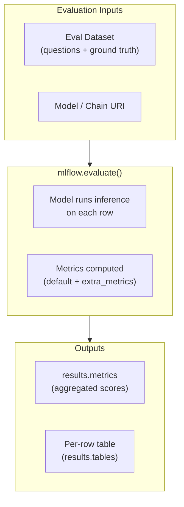

# Avaliação de aplicativos de LLM

A avaliação é a medição sistemática da qualidade de um aplicativo de GenAI. Como as saídas dos LLMs são textos livres, a avaliação exige métricas especializadas e costuma usar outro LLM como juiz. Este arquivo aborda métricas específicas de RAG, a API `mlflow.evaluate()` do MLflow 2 e o Databricks Review App.

> [!note] Atualização da plataforma (out. de 2026)
> `mlflow.evaluate()` com `mlflow.metrics.genai` (mostrado abaixo) é a API de avaliação do **MLflow 2**. Os itens do guia do exame de março de 2026 — *scoring e tracing do MLflow*, *juízes que exigem ground truth*, *Scorers personalizados*, *feedback de SME* — correspondem à API do **MLflow 3**: `mlflow.genai.evaluate(data=..., predict_fn=..., scorers=[...])` com juízes como `Correctness` e `RetrievalGroundedness` ([Scorers e juízes LLM](https://docs.databricks.com/aws/en/mlflow3/genai/eval-monitor/concepts/scorers)). Aprenda aqui as definições das métricas e, em seguida, veja a API atual em [Scorers, juízes, feedback de SME e Agent Monitoring do MLflow](./03-mlflow-scorers-judges-and-feedback.md).

## Diagrama geral



## Métricas de avaliação RAG

Quatro métricas formam o conjunto padrão de avaliação de RAG. Saiba a definição de todas as quatro para o exame.

| Métrica | Pergunta respondida | O que indica sobre alucinações |
| ------ | ------------------- | ----------------------- |
| **Fidelidade** | Cada afirmação na resposta é sustentada pelo contexto recuperado? | Detecta conteúdo inventado pelo modelo |
| **Relevância da resposta** | A resposta realmente aborda a pergunta do usuário? | Detecta respostas fora do tópico |
| **Precisão do contexto** | Que fração dos trechos recuperados é relevante para a pergunta? | Mede a precisão do retriever |
| **Recall do contexto** | Que fração das informações necessárias para responder estava nos trechos recuperados? | Mede o recall do retriever |

**Dica para o exame**: Fidelidade e relevância da resposta avaliam o **gerador** (LLM). Precisão e recall do contexto avaliam o **retriever**. Uma pontuação de fidelidade baixa com recall de contexto alto significa que o LLM está ignorando o conteúdo recuperado.

### Definições detalhadas das métricas

**Fidelidade** — Para cada frase da resposta, verifique se ela pode ser inferida do contexto. Fidelidade = frases sustentadas / total de frases. Intervalo da pontuação: 0–1.

**Relevância da resposta** — Mede a similaridade semântica entre a pergunta e a resposta (não o contexto). Uma pontuação alta significa que a resposta está no tópico. Intervalo da pontuação: 0–1.

**Precisão do contexto** — Dos K trechos recuperados, quantos são realmente úteis para responder à pergunta? Penaliza a recuperação ruidosa. Intervalo da pontuação: 0–1.

**Recall do contexto** — Compara as frases da resposta de referência com o contexto recuperado. Todos os fatos necessários estavam nos trechos recuperados? Intervalo da pontuação: 0–1.

## `mlflow.evaluate()` para aplicativos de LLM

`mlflow.evaluate()` é a API principal do MLflow para medir a qualidade de aplicativos de LLM.

### Uso básico

```python
import mlflow
import pandas as pd

eval_data = pd.DataFrame({
    "inputs": [
        "What is RAG?",
        "How does chunking work?",
        "What is a vector store?",
    ],
    "ground_truth": [
        "RAG is Retrieval-Augmented Generation, a technique that combines retrieval of relevant documents with LLM generation.",
        "Chunking splits documents into smaller pieces so they fit in the LLM context window and can be indexed individually.",
        "A vector store indexes embeddings for fast approximate nearest-neighbour similarity search.",
    ],
})

with mlflow.start_run():
    results = mlflow.evaluate(
        model="runs:/<run_id>/rag_chain",
        data=eval_data,
        targets="ground_truth",
        model_type="question-answering",
        evaluators="default",
    )

print(results.metrics)

# {'exact_match/v1': 0.0, 'token_count/v1': 42.3, ...}

# Per-row results

print(results.tables["eval_results_table"])
```

### Referência de parâmetros

| Parâmetro | Descrição |
| --------- | ----------- |
| `model` | URI do modelo MLflow (`runs:/<id>/artifact`) ou callable |
| `data` | `pd.DataFrame` com colunas de entrada e ground truth opcional |
| `targets` | Nome da coluna que contém respostas de ground truth |
| `model_type` | `"question-answering"`, `"text-summarization"`, `"text"` |
| `evaluators` | `"default"` usa métricas integradas; passe uma lista para avaliadores personalizados |
| `extra_metrics` | Lista de objetos de métricas adicionais (por exemplo, `faithfulness()`) |

## LLM como juiz

Um **LLM como juiz** usa um LLM para pontuar respostas segundo critérios subjetivos. O MLflow fornece métricas de juízes integradas em `mlflow.metrics.genai`.

```python
from mlflow.metrics.genai import faithfulness, answer_relevance

with mlflow.start_run():
    results = mlflow.evaluate(
        model="runs:/<run_id>/rag_chain",
        data=eval_data,
        targets="ground_truth",
        model_type="question-answering",
        extra_metrics=[faithfulness(), answer_relevance()],
    )

print(results.metrics["faithfulness/v1/mean"])
print(results.metrics["answer_relevance/v1/mean"])
```

### Métrica personalizada de juiz LLM

```python
from mlflow.metrics.genai import make_genai_metric

conciseness = make_genai_metric(
    name="conciseness",
    definition="A concise answer uses the fewest words necessary to answer the question correctly.",
    grading_prompt=(
        "Score the answer from 1 (verbose) to 5 (highly concise).\n"
        "Question: {input}\nAnswer: {output}"
    ),
    model="endpoints:/databricks-meta-llama-3-1-70b-instruct",
    parameters={"temperature": 0.0},
    greater_is_better=True,
)

with mlflow.start_run():
    results = mlflow.evaluate(
        model="runs:/<run_id>/rag_chain",
        data=eval_data,
        targets="ground_truth",
        model_type="question-answering",
        extra_metrics=[faithfulness(), conciseness],
    )
```

**Dica para o exame**: O prompt de avaliação de `make_genai_metric` usa os espaços reservados `{input}` e `{output}`. O parâmetro `model` especifica qual LLM atua como juiz.

## Integração com RAGAS

**RAGAS** (Retrieval-Augmented Generation Assessment) é uma estrutura de código aberto que fornece métricas específicas para RAG. Ela complementa `mlflow.evaluate()` e pode ser usada em conjunto.

```python
from ragas import evaluate
from ragas.metrics import faithfulness, answer_relevancy, context_precision, context_recall
from datasets import Dataset

# RAGAS expects specific column names

ragas_data = Dataset.from_dict({
    "question": eval_data["inputs"].tolist(),
    "answer": predictions,           # Model outputs collected separately
    "contexts": retrieved_contexts,  # List[List[str]] — chunks per question
    "ground_truth": eval_data["ground_truth"].tolist(),
})

ragas_result = evaluate(
    dataset=ragas_data,
    metrics=[faithfulness, answer_relevancy, context_precision, context_recall],
)

print(ragas_result.to_pandas())
```

**RAGAS vs. MLflow evaluate**:

| Dimensão | RAGAS | `mlflow.evaluate()` |
| --------- | ----- | ------------------- |
| Foco principal | Métricas específicas de RAG | Avaliação geral de LLM |
| Integração com MLflow | Manual — registre os resultados separadamente | Nativa — registra automaticamente na execução ativa |
| Acompanhamento do contexto | Exige a coluna `contexts` | Opcional por meio de métricas personalizadas |
| Relevância para o exame | Saiba que existe e conheça suas quatro métricas | Maior peso no exame — conheça a API |

## Testes de regressão

Os testes de regressão garantem que uma nova versão da chain não reduza a qualidade em relação a uma linha de base.

```python
import mlflow

BASELINE_RUN_ID = "abc123"
THRESHOLD_FAITHFULNESS = 0.85

# Evaluate new chain

with mlflow.start_run(run_name="chain-v2-eval") as run:
    results = mlflow.evaluate(
        model="runs:/<new_run_id>/rag_chain",
        data=eval_data,
        targets="ground_truth",
        model_type="question-answering",
        extra_metrics=[faithfulness()],
    )
    new_faithfulness = results.metrics["faithfulness/v1/mean"]

# Compare against baseline

baseline = mlflow.get_run(BASELINE_RUN_ID)
baseline_faithfulness = baseline.data.metrics.get("faithfulness/v1/mean", 0)

if new_faithfulness < baseline_faithfulness - 0.05:
    raise ValueError(
        f"Regression detected: faithfulness dropped from "
        f"{baseline_faithfulness:.2f} to {new_faithfulness:.2f}"
    )
```

**Prática recomendada**: Armazene o ID da execução de referência em um arquivo de configuração ou em uma tag do MLflow. Condicione a implantação à aprovação da verificação de regressão no CI/CD.

## Avaliação A/B

Compare duas versões da chain lado a lado no mesmo conjunto de dados de avaliação:

```python
chain_a_uri = "runs:/run_a_id/rag_chain"
chain_b_uri = "runs:/run_b_id/rag_chain"

with mlflow.start_run(run_name="ab-eval-chain-a"):
    results_a = mlflow.evaluate(
        model=chain_a_uri,
        data=eval_data,
        targets="ground_truth",
        model_type="question-answering",
        extra_metrics=[faithfulness(), answer_relevance()],
    )

with mlflow.start_run(run_name="ab-eval-chain-b"):
    results_b = mlflow.evaluate(
        model=chain_b_uri,
        data=eval_data,
        targets="ground_truth",
        model_type="question-answering",
        extra_metrics=[faithfulness(), answer_relevance()],
    )

print("Chain A faithfulness:", results_a.metrics["faithfulness/v1/mean"])
print("Chain B faithfulness:", results_b.metrics["faithfulness/v1/mean"])
```

As duas execuções aparecem no mesmo experimento do MLflow, permitindo comparação direta nos gráficos de coordenadas paralelas e de comparação de métricas da interface do MLflow.

## Databricks Review App

O **Review App** é uma interface para coletar feedback humano, criada automaticamente quando uma chain é implantada com `agents.deploy()`.

```python
from databricks import agents

agents.deploy(
    model_name="catalog.schema.my_rag_agent",
    model_version=1,
    environment_vars={"DATABRICKS_HOST": "https://<workspace>.azuredatabricks.net"},
)
```

Após a implantação:

- Uma interface web é criada para que revisores humanos avaliem as respostas (curtidas/não curtidas e comentários de texto livre)
- O feedback é armazenado em uma tabela Delta no Unity Catalog
- O feedback pode ser carregado em um `pd.DataFrame` e fornecido ao `mlflow.evaluate()` como ground truth adicional ou usado para ajustar o modelo

**Dica para o exame**: O Review App é diferente da avaliação automatizada. Ele coleta dados de **preferência humana**, que são mais caros, mas mais confiáveis do que um LLM como juiz para avaliar qualidade subjetiva. No MLflow 3, o feedback do Review App é anexado aos traces como avaliações, e o Databricks recomenda filas de revisão (Beta) para novos fluxos de revisão humana ([Coletar feedback e criar conjuntos de dados](https://docs.databricks.com/aws/en/mlflow3/genai/human-feedback/)).

## Resumo do fluxo de avaliação

```text
1. Prepare eval dataset (questions + ground truth)
2. Log chain to MLflow with mlflow.langchain.log_model()
3. Run mlflow.evaluate() with extra_metrics=[faithfulness(), answer_relevance()]
4. Compare metrics against baseline (regression gate)
5. If passing: register model version, deploy with agents.deploy()
6. Collect human feedback via Review App
7. Use feedback to improve prompts or retriever — repeat cycle
```

## Questões de prática

> [!success]- Questão 1
> **P:** Um sistema RAG tem recall de contexto alto, mas baixa fidelidade. O que isso indica?
>
> A) O retriever não encontra documentos relevantes, mas o LLM gera respostas precisas
> B) O retriever encontra documentos relevantes, mas o LLM não fundamenta as respostas neles
> C) Tanto o retriever quanto o LLM estão funcionando bem
> D) A estratégia de chunking é grosseira demais, causando baixa precisão
>
> **Resposta correta: B**
>
> Recall de contexto alto significa que o retriever está recuperando documentos que contêm as informações necessárias. Fidelidade baixa significa que a resposta do LLM contém afirmações não sustentadas por esse contexto — o modelo está alucinando apesar de ter acesso às informações corretas. Normalmente, a solução é uma restrição mais forte no prompt de sistema ou uma mudança de modelo.

---

> [!success]- Questão 2
> **P:** Qual parâmetro de `mlflow.evaluate()` aceita uma lista de objetos de métricas `faithfulness()` e `answer_relevance()`?
>
> A) `evaluators`
> B) `targets`
> C) `extra_metrics`
> D) `model_type`
>
> **Resposta correta: C**
>
> `extra_metrics` aceita objetos de métricas adicionais de `mlflow.metrics.genai`. `evaluators` seleciona a estratégia de avaliação (por exemplo, `"default"`). `targets` identifica a coluna de ground truth. `model_type` controla quais métricas padrão são aplicadas.

---

> [!success]- Questão 3
> **P:** Qual é o objetivo principal do Databricks Review App criado por `agents.deploy()`?
>
> A) Executar automaticamente `mlflow.evaluate()` em uma programação
> B) Fornecer uma interface web para revisores humanos avaliarem respostas do agente e coletarem dados de preferência
> C) Exibir métricas de experimentos do MLflow e visualizações de traces
> D) Expor o agente como um endpoint de API REST público para tráfego de produção
>
> **Resposta correta: B**
>
> O Review App é uma interface de feedback com participação humana. Revisores avaliam respostas (curtidas/não curtidas, comentários), e esse feedback é armazenado em Delta para análise posterior ou ajuste fino. A avaliação automatizada usa `mlflow.evaluate()`. A interface do MLflow trata da visualização de métricas. O Model Serving (não o Review App) trata do tráfego REST de produção.

## Casos de uso

- **Barreira de qualidade pré-implantação**: executar `mlflow.evaluate()` em um conjunto de avaliação selecionado com 200 pares de perguntas e respostas antes de cada implantação, bloqueando a promoção se a fidelidade cair abaixo de 0.85 ou a relevância da resposta cair abaixo de 0.80.
- **Monitoramento contínuo em produção**: programar execuções semanais de `mlflow.evaluate()` em amostras da tabela de inferência, acompanhar tendências de fidelidade e latência ao longo do tempo e gerar alertas quando as métricas de qualidade caírem mais de 5 % em relação à linha de base.

## Problemas e erros comuns

### As métricas de avaliação divergem do julgamento humano

**Cenário:** `mlflow.evaluate()` relata pontuações altas de fidelidade, mas revisores humanos no Review App avaliam consistentemente as respostas como incorretas ou inúteis.
**Solução:** Revise o modelo de prompt do LLM como juiz para garantir que ele avalie os mesmos critérios valorizados pelos humanos. Calibre executando o juiz em um pequeno conjunto de exemplos anotados por humanos e ajustando o prompt até que as pontuações do juiz correspondam às avaliações humanas. Considere adicionar métricas personalizadas que representem melhor a qualidade específica do domínio (por exemplo, “a resposta cita a seção correta da política?”).

### O conjunto de dados de avaliação é pequeno demais para detectar regressões

**Cenário:** Um conjunto de avaliação com apenas 20 perguntas não mostra diferença significativa entre versões do modelo, ocultando uma regressão real relatada pelos usuários após a implantação.
**Solução:** Amplie o conjunto de avaliação para pelo menos 100–200 perguntas variadas, cobrindo casos extremos, raciocínio de várias etapas e consultas fora do escopo. Inclua perguntas cuja resposta esperada seja “não sei” para testar a fidelidade quando o contexto estiver ausente.

## Principais conclusões

- **Quatro métricas RAG**: fidelidade (a resposta está fundamentada no contexto?), relevância da resposta (responde à pergunta?), precisão do contexto (os trechos recuperados são relevantes?) e recall do contexto (todas as informações necessárias foram recuperadas?)
- **`mlflow.evaluate()`**: executa inferência do modelo em um conjunto de avaliação e calcula métricas em uma chamada; os resultados são armazenados no tracking do MLflow para comparação
- **LLM como juiz**: use um LLM avançado para pontuar respostas livres quando métricas determinísticas não conseguem avaliar a qualidade
- **Fidelidade vs. alucinação**: baixa fidelidade = o modelo faz afirmações não sustentadas pelo contexto recuperado (alucinação)
- **Databricks Review App**: interface de anotação humana implantada com `agents.deploy()` — captura curtidas/não curtidas e feedback textual para cada predição
- **Avaliação on-line**: programe execuções periódicas de `mlflow.evaluate()` em amostras da tabela de inferência para acompanhar fidelidade e latência em produção
- **Conjunto de dados de avaliação**: conjunto de perguntas com respostas esperadas de ground truth — necessário para métricas de recall do contexto e relevância da resposta

---

**[↑ Voltar para Avaliação e monitoramento](./README.md) | [Próximo: Monitoramento on-line](./02-online-monitoring.md) →**
