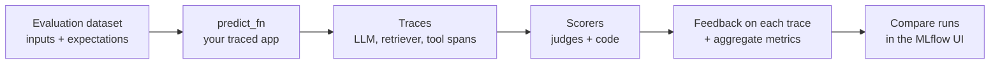

# Scorers, juízes, feedback de SME e Agent Monitoring do MLflow

## Visão geral

O guia do exame de 2026 reformulou a maior parte do domínio Avaliação e monitoramento em torno da **avaliação de GenAI do MLflow 3**: *“Avaliar o desempenho de agentes usando scoring e tracing do MLflow”*, *“Identificar juízes de avaliação que exigem ground truth”*, *“Usar Scorers personalizados do Databricks para avaliar agentes e LLMs”*, *“Incorporar feedback de SME para melhorar o desempenho de agentes”* e a parte de Agent Monitoring de *“Usar tabelas de inferência e Agent Monitoring para acompanhar um endpoint de LLM ativo.”* No MLflow 3, um **scorer** recebe um **trace**, avalia-o e anexa **feedback** — e o mesmo scorer é executado em `mlflow.genai.evaluate()` durante o desenvolvimento e no monitoramento de produção após o lançamento.

> [!abstract]
>
> - **`mlflow.genai.evaluate(data, predict_fn, scorers)`** — executa seu aplicativo em um conjunto de dados de avaliação, rastreia cada chamada e pontua cada trace
> - **Juízes integrados** — `Correctness`, `RetrievalSufficiency`, `ToolCallCorrectness` **precisam de ground truth**; `RelevanceToQuery`, `RetrievalRelevance`, `RetrievalGroundedness`, `Safety`, `Guidelines`, `ToolCallEfficiency` não precisam
> - **Scorers personalizados** — funções Python decoradas com `@scorer` para verificações determinísticas e `make_judge()` para juízes LLM personalizados
> - **Feedback de SME** — especialistas rotulam traces no Review App, o feedback é registrado com `mlflow.log_feedback()` e os juízes são **alinhados** ao julgamento dos especialistas com `judge.align()`
> - **Agent Monitoring** — `scorer.register()` e, depois, `.start(sampling_config=...)` pontua continuamente uma amostra de traces ativos

> [!tip] O que o exame cobra
>
> - Quais juízes precisam de **expectativas** (ground truth) e, portanto, não podem ser executados em tráfego de produção sem rótulos
> - Quando escrever um **scorer baseado em código**, um **juiz LLM personalizado** ou usar um juiz integrado
> - Como tornar o feedback de SME confiável (rubricas, calibração) e incorporá-lo à avaliação (a questão de exemplo oficial)
> - O padrão register → start e a amostragem para monitoramento de produção

---

> [!note] Atualização da plataforma (out. de 2026)
> As APIs do MLflow 2 em [Avaliação de aplicativos de LLM](./01-evaluation-llm-apps.md) — `mlflow.evaluate()` com `mlflow.metrics.genai` e `model_type="databricks-agent"` — são da geração anterior. A documentação atual do Databricks usa o MLflow 3: `mlflow.genai.evaluate()`, scorers de `mlflow.genai.scorers`, `make_judge()` e monitoramento de produção (Beta) ([Scorers e juízes LLM](https://docs.databricks.com/aws/en/mlflow3/genai/eval-monitor/concepts/scorers)). O modelo legado de feedback do Review App e os logs de solicitações/avaliações foram descontinuados em favor de `mlflow.log_feedback()` ([Implantar um agente, Model Serving](https://docs.databricks.com/aws/en/agents/custom-agents/model-serving/deploy-agent)).

## Como funciona a avaliação no MLflow 3



1. **Conjunto de dados** — linhas com `inputs` e, opcionalmente, `expectations` (`expected_response`, `expected_facts`, diretrizes)
2. **`predict_fn`** — seu aplicativo; o MLflow o chama para cada linha e captura um **trace** (spans para cada etapa de LLM, retriever e ferramenta)
3. **Scorers** — cada um lê o que precisa do trace e retorna **feedback** (aprovação/reprovação, número, categoria) com uma justificativa
4. **Resultados** — feedback por trace e métricas agregadas em uma execução do MLflow; compare versões lado a lado

```python
import mlflow
from mlflow.genai.scorers import Correctness, RelevanceToQuery, RetrievalGroundedness, Safety, Guidelines

eval_dataset = [
    {
        "inputs": {"question": "Can I return an opened item?"},
        "expectations": {"expected_facts": ["Opened items can be returned within 15 days."]},
    },
    # ...
]

results = mlflow.genai.evaluate(
    data=eval_dataset,
    predict_fn=support_agent,  # traced application function
    scorers=[
        Correctness(),            # needs expectations
        RelevanceToQuery(),
        RetrievalGroundedness(),
        Safety(),
        Guidelines(name="cites_policy", guidelines="The answer must cite the policy section."),
    ],
)
```

**O tracing é o que torna a avaliação consciente dos agentes:** como os scorers recebem o trace completo, podem avaliar separadamente a recuperação (spans do retriever), o uso de ferramentas (spans das ferramentas) e a resposta final — e você pode abrir qualquer trace com falha para ver em qual etapa ocorreu o problema.

## Quais juízes precisam de ground truth?

| Juiz integrado | O que avalia | Precisa de ground truth? |
| :--- | :--- | :---: |
| `RelevanceToQuery` | A resposta é relevante para a solicitação? | Não |
| `RetrievalRelevance` | O contexto recuperado é relevante para a solicitação? | Não |
| `RetrievalGroundedness` | A resposta está fundamentada no contexto recuperado (sem alucinação)? | Não |
| `Safety` | O conteúdo está livre de material nocivo ou tóxico? | Não |
| `Guidelines` | A resposta atende às regras em linguagem natural fornecidas? | Não |
| `ExpectationsGuidelines` | A resposta atende às regras **por exemplo** armazenadas em expectations? | Não (precisa de diretrizes em expectations) |
| `ToolCallEfficiency` | As chamadas de ferramentas são eficientes, sem redundâncias? | Não |
| `Correctness` | A resposta está correta em relação à resposta/fatos esperados? | **Sim** |
| `RetrievalSufficiency` | O contexto contém tudo o que é necessário para os fatos esperados? | **Sim** |
| `ToolCallCorrectness` | As chamadas de ferramentas e seus argumentos estão corretos para a solicitação? | **Sim** |

Juízes para várias interações (`ConversationCompleteness`, `UserFrustration`, `KnowledgeRetention`, `ConversationalGuidelines`, `ConversationalRoleAdherence`, `ConversationalSafety`, `ConversationalToolCallEfficiency`) pontuam uma **sessão** inteira e não precisam de ground truth. Fonte: [Juízes LLM integrados](https://docs.databricks.com/aws/en/mlflow3/genai/eval-monitor/concepts/judges/).

> [!important]
> Juízes que precisam de ground truth só podem ser executados quando houver **rótulos** — em um conjunto de dados de avaliação selecionado. No tráfego de produção ativo, use juízes que não precisam de ground truth e scorers baseados em código.

Cada juiz usa por padrão um LLM hospedado pelo Databricks; altere-o com `model=`, por exemplo, `Correctness(model="databricks:/databricks-gpt-5-mini")`.

## Scorers personalizados

Escolha a opção mais simples que atenda à necessidade ([Scorers e juízes LLM](https://docs.databricks.com/aws/en/mlflow3/genai/eval-monitor/concepts/scorers)):

| Abordagem | Use para | Exemplo |
| :--- | :--- | :--- |
| **Juiz integrado** | Dimensões de qualidade comuns | `Safety()`, `Correctness()` |
| Juiz **`Guidelines`** | Regras em linguagem natural de aprovação/reprovação | “Não deve prometer reembolsos” |
| **Juiz LLM personalizado** (`make_judge`) | Critérios específicos do domínio, escalas de avaliação, saídas categóricas | Qualidade de descrição de produto: excelente / boa / razoável / ruim |
| **Scorer baseado em código** (`@scorer`) | Verificações determinísticas — correspondência exata, validade de JSON, tamanho, latência, presença de citação | `contains_citation` |

### Scorer baseado em código

Uma função `@scorer` pode declarar qualquer um dos argumentos nomeados `inputs`, `outputs`, `expectations` e `trace`, e pode retornar um `bool`, `int`, `float`, `str`, um `Feedback` ou uma lista de `Feedback` ([Scorers personalizados do MLflow](https://mlflow.org/docs/latest/genai/eval-monitor/scorers/custom/)).

```python
from mlflow.genai.scorers import scorer
from mlflow.entities import Feedback

@scorer
def contains_citation(outputs: str) -> str:
    return "yes" if "[source]" in outputs else "no"

@scorer
def within_length(outputs: str) -> Feedback:
    words = len(outputs.split())
    return Feedback(value=words <= 120, rationale=f"{words} words")
```

### Juiz LLM personalizado

```python
from mlflow.genai.judges import make_judge

product_quality = make_judge(
    name="product_quality",
    instructions=(
        "Evaluate if the product description in {{ outputs }} "
        "is accurate and helpful for the query in {{ inputs }}. "
        "Rate as: excellent, good, fair, or poor"
    ),
    model="databricks:/databricks-gpt-oss-120b",
)
```

Para monitoramento de produção, use juízes integrados ou funções `@scorer`; subclasses de `Scorer` baseadas em classe **não são compatíveis** com esse monitoramento, e funções `@scorer` devem ser definidas e registradas em um notebook do Databricks ([Scorers baseados em código](https://docs.databricks.com/aws/en/mlflow3/genai/eval-monitor/custom-scorers)).

## Incorporar feedback de SME

Especialistas no assunto definem o que significa “bom”. O MLflow registra o julgamento deles **no trace** ([Coletar feedback e criar conjuntos de dados](https://docs.databricks.com/aws/en/mlflow3/genai/human-feedback/)):

| Forma de feedback | Significado | Uso |
| :--- | :--- | :--- |
| **Feedback** | Avaliação da saída real do aplicativo (foi boa?) | Medir a qualidade, alinhar juízes |
| **Expectation** | Saída correta, de ground truth | Transformar um trace em caso de teste de avaliação |

Como os SMEs contribuem:

- **Review App** — especialistas conversam com o agente ou rotulam traces existentes; agora o Databricks recomenda **filas de revisão** (Beta), que encaminham traces um de cada vez
- **Interface de traces** — *Assess → Add expectation* e, em seguida, *Add to dataset* transforma uma interação real em um teste de regressão
- **Programaticamente** — `mlflow.log_feedback(trace_id=..., name=..., value=..., rationale=..., source=AssessmentSource(source_type=AssessmentSourceType.HUMAN, ...))`
- **Agent Bricks** — Knowledge Assistant e Supervisor aceitam **diretrizes** de SME diretamente

### Tornar confiável o feedback de SME

A questão de exemplo oficial descreve quatro especialistas cujas avaliações divergem. A solução é o processo, não a média:

1. **Defina rubricas claras** para cada dimensão (o que significa ser *factualmente preciso*, *completo*, *útil*)
2. **Calibre os SMEs** usando exemplos compartilhados até que haja concordância
3. Use os **julgamentos alinhados** em `mlflow.genai.evaluate()` — como expectations e como dados para alinhar juízes

Calcular a média de avaliações ruidosas, descartar casos contestados ou confiar em um juiz LLM não calibrado como fonte da verdade não corrige a causa raiz.

### Alinhar um juiz ao feedback dos especialistas

O alinhamento de juízes ensina um juiz integrado ou personalizado a concordar com seus especialistas ([Alinhar juízes ao feedback humano](https://docs.databricks.com/aws/en/mlflow3/genai/eval-monitor/align-judges)):

1. Execute o juiz nos traces para obter avaliações de referência
2. Os especialistas registram feedback **com o mesmo nome** do juiz (por exemplo, `relevance_to_query` ou `product_quality`)
3. Chame `aligned_judge = judge.align(traces)` — o otimizador padrão é o MemAlign; cerca de 10 traces funcionam, 50–100 funcionam melhor

O Databricks relata uma concordância 30–50 % maior com as avaliações humanas após o alinhamento. Juízes no nível de sessão (várias interações) não podem ser alinhados. Requer MLflow 3.14.0 ou superior.

## Agent Monitoring: pontuação do tráfego ativo

O monitoramento de produção (Beta) executa scorers em traces de um agente implantado, usando uma amostra do tráfego, e anexa os resultados como feedback ([Configurar monitoramento de produção](https://docs.databricks.com/aws/en/mlflow3/genai/eval-monitor/production-monitoring)).

```python
from mlflow.genai.scorers import Safety, RelevanceToQuery, ScorerSamplingConfig

safety = Safety().register(name="safety")
safety = safety.start(sampling_config=ScorerSamplingConfig(sample_rate=1.0))  # 100 % for critical checks

relevance = RelevanceToQuery().register(name="relevance")
relevance = relevance.start(sampling_config=ScorerSamplingConfig(sample_rate=0.2))
```

| Configuração | Orientação |
| :--- | :--- |
| `sample_rate` | `1.0` para verificações de segurança; valores menores para juízes caros |
| `filter_string` | Pontua somente traces correspondentes (mesma sintaxe de `mlflow.search_traces()`) |
| Limite | No máximo **20 scorers** por experimento para monitoramento contínuo |
| Pré-requisitos | Traces registrados em um experimento do MLflow; scorers testados; política de orçamento serverless; ID de SQL warehouse quando os traces são armazenados no Unity Catalog |

Agent Monitoring acompanha a **qualidade**. Combine-o com **tabelas de inferência** (cargas úteis de solicitações/respostas) e **tabelas de uso** (tokens, latência, custo) para obter a visão operacional — consulte [Monitoramento on-line](./02-online-monitoring.md) e [AI Gateway: acompanhamento de uso e controle de custos](./04-ai-gateway-usage-and-cost-control.md).

## Escolher um LLM com base em métricas quantitativas de avaliação

Item do guia do exame: *“Selecionar um LLM (tamanho e arquitetura) com base em um conjunto de métricas quantitativas de avaliação.”* Avalie cada candidato com o **mesmo conjunto de dados e scorers**, descarte os que não passarem na verificação de segurança, mantenha os que ultrapassarem o limite de qualidade e, então, escolha a opção mais barata e rápida. As compensações entre tamanho e arquitetura estão em [Seleção de modelos e qualidade das respostas](../../../../../certifications/genai-engineer-associate/01-application-development/06-model-selection-and-response-quality.md).

## Casos de uso

- **Barreira de lançamento** — o CI executa `mlflow.genai.evaluate()` com `Correctness` e `RetrievalGroundedness`; uma versão só é lançada se ambas superarem a produção
- **Verificação de voz da marca** — um juiz `Guidelines` impõe “nunca mencione nomes de concorrentes”; um `@scorer` verifica o tamanho da resposta
- **Qualidade alinhada por especialistas** — farmacêuticos rotulam 80 traces; o juiz alinhado `product_quality` pontua milhares de traces de produção
- **Monitoramento de segurança ao vivo** — `Safety` monitora 100 % do tráfego; `RelevanceToQuery` monitora 20 %

## Problemas e erros comuns

### Pontuações de correção ausentes na produção

**Cenário:** Um job de monitoramento registrou `Correctness`, mas não aparecem pontuações úteis.
**Solução:** `Correctness` precisa de expectations (ground truth), indisponíveis no tráfego ativo. Use `RelevanceToQuery`, `RetrievalGroundedness`, `Safety`, `Guidelines` ou scorers baseados em código em produção.

### O alinhamento do juiz não surte efeito

**Cenário:** `align()` não altera o comportamento do juiz.
**Solução:** O feedback humano foi registrado com outro nome. O nome do feedback deve corresponder exatamente ao `name` do juiz.

### Scorer baseado em classe não é registrado para monitoramento

**Cenário:** Uma subclasse de `Scorer` funciona em `evaluate()`, mas não pode ser usada para monitoramento.
**Solução:** Reescreva-a como uma função decorada com `@scorer`, definida em um notebook do Databricks.

## Dicas para o exame

> [!tip] Dicas para o exame
>
> - **Exigem ground truth:** `Correctness`, `RetrievalSufficiency`, `ToolCallCorrectness`. Todos os demais da lista integrada pontuam sem rótulos.
> - **Regra determinística → `@scorer`**; **critério subjetivo do domínio → `make_judge()` ou `Guidelines`**.
> - **Divergência entre SMEs → rubricas + calibração**; depois, use os julgamentos alinhados em `mlflow.genai.evaluate()`.
> - **Agent Monitoring** = `register()` + `start(sampling_config=ScorerSamplingConfig(sample_rate=...))`, máximo de 20 scorers por experimento.
> - Os mesmos scorers são executados na avaliação e no monitoramento, mantendo os resultados comparáveis.

## Principais conclusões

- A avaliação do MLflow 3 executa seu aplicativo rastreado em um conjunto de dados e anexa feedback dos scorers a cada trace
- Saiba quais juízes integrados precisam de ground truth; somente os que dispensam isso podem ser executados no tráfego de produção sem rótulos
- Há dois tipos de scorers personalizados: funções `@scorer` baseadas em código e juízes LLM personalizados por meio de `make_judge()`
- O feedback de SME fica nos traces, cria conjuntos de dados de avaliação e alinha juízes; rubricas e calibração o tornam confiável
- Agent Monitoring amostra traces ativos e os pontua continuamente com os mesmos scorers

## Tópicos relacionados

- [Avaliação de aplicativos de LLM](./01-evaluation-llm-apps.md)
- [Monitoramento on-line](./02-online-monitoring.md)
- [AI Gateway: acompanhamento de uso e controle de custos](./04-ai-gateway-usage-and-cost-control.md)
- [Sistemas agênticos com MLflow, Agent Framework e Genie](../../../../../certifications/genai-engineer-associate/01-application-development/05-agentic-systems-mlflow-and-genie.md)

## Documentação oficial

- [Scorers e juízes LLM](https://docs.databricks.com/aws/en/mlflow3/genai/eval-monitor/concepts/scorers)
- [Juízes LLM integrados](https://docs.databricks.com/aws/en/mlflow3/genai/eval-monitor/concepts/judges/)
- [Scorers baseados em código](https://docs.databricks.com/aws/en/mlflow3/genai/eval-monitor/custom-scorers)
- [Alinhar juízes ao feedback humano](https://docs.databricks.com/aws/en/mlflow3/genai/eval-monitor/align-judges)
- [Coletar feedback e criar conjuntos de dados](https://docs.databricks.com/aws/en/mlflow3/genai/human-feedback/)
- [Configurar monitoramento de produção](https://docs.databricks.com/aws/en/mlflow3/genai/eval-monitor/production-monitoring)

---

**[← Anterior: Monitoramento on-line](./02-online-monitoring.md) | [↑ Voltar para Avaliação e monitoramento](./README.md) | [Próximo: AI Gateway: acompanhamento de uso e controle de custos](./04-ai-gateway-usage-and-cost-control.md) →**
