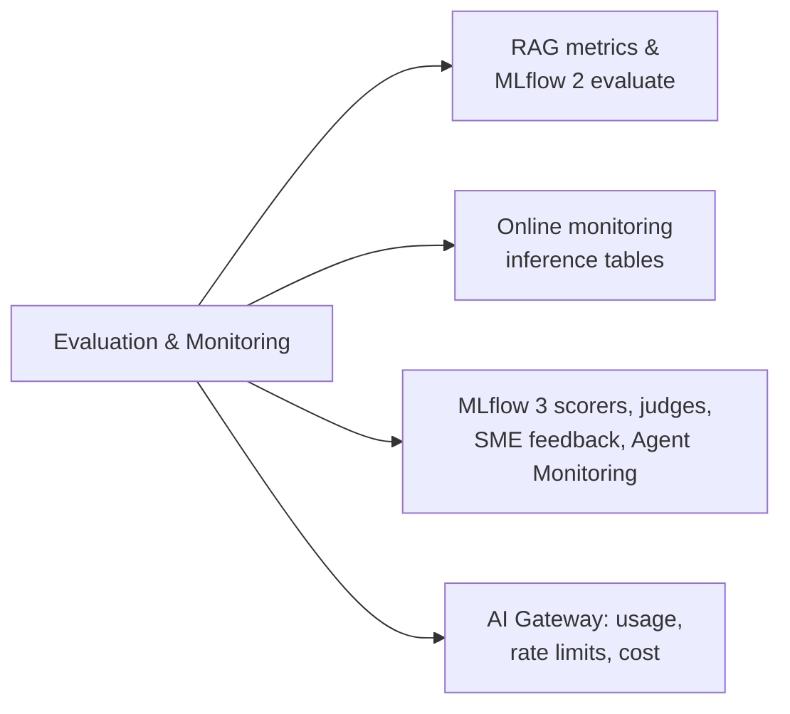

# Avaliação e monitoramento (12 % do exame)

Seção 6 do guia do exame: medir se um aplicativo de GenAI funciona — antes do lançamento (avaliação do MLflow com juízes e scorers, feedback de especialistas no assunto) e depois do lançamento (tabelas de inferência, tabelas de uso, Agent Monitoring, limites de taxa e controles de custo por meio do AI Gateway).

## Visão geral dos tópicos

## Conteúdo da seção

| Arquivo | Tópico | Prioridade |
| :--- | :--- | :--- |
| [01-evaluation-llm-apps.md](./01-evaluation-llm-apps.md) | Métricas RAG (fidelidade, relevância, precisão/recall do contexto), `mlflow.evaluate()` do MLflow 2, RAGAS, Review App | Alta |
| [02-online-monitoring.md](./02-online-monitoring.md) | O que monitorar; consultas a tabelas de inferência e tabelas de sistema; alertas via DBSQL + Lakeflow Jobs | Alta |
| [03-mlflow-scorers-judges-and-feedback.md](./03-mlflow-scorers-judges-and-feedback.md) | `mlflow.genai.evaluate()`, juízes que precisam de ground truth, scorers personalizados, feedback de SME e alinhamento de juízes, Agent Monitoring *(guia de 2026)* | Alta |
| [04-ai-gateway-usage-and-cost-control.md](./04-ai-gateway-usage-and-cost-control.md) | Tabelas de inferência e de uso do AI Gateway, limites de taxa, alavancas de custo, divisão de tráfego *(movido para cá de Assembling; guia de 2026)* | Alta |

## Cobertura do guia do exame

| Item do guia do exame (Seção 6) | Onde é abordado |
| :--- | :--- |
| Selecionar um LLM (tamanho e arquitetura) com base em um conjunto de métricas quantitativas de avaliação | [03](./03-mlflow-scorers-judges-and-feedback.md#escolher-um-llm-com-base-em-métricas-quantitativas-de-avaliação), [Seleção de modelos](../../../../../certifications/genai-engineer-associate/01-application-development/06-model-selection-and-response-quality.md#size-and-architecture-trade-offs) |
| Selecionar métricas importantes para monitorar em um cenário específico de implantação de LLM | [02](./02-online-monitoring.md) |
| Avaliar o desempenho de agentes usando scoring e tracing do MLflow | [03](./03-mlflow-scorers-judges-and-feedback.md#como-funciona-a-avaliação-no-mlflow-3) |
| Usar o registro de inferência para avaliar o desempenho de um aplicativo RAG implantado | [02](./02-online-monitoring.md), [04](./04-ai-gateway-usage-and-cost-control.md#tabelas-de-inferência-acompanhar-a-atividade-de-um-endpoint-ativo) |
| Usar recursos do Databricks para controlar custos de LLM | [04](./04-ai-gateway-usage-and-cost-control.md#controlar-custos-de-llm) |
| Usar tabelas de inferência e Agent Monitoring para acompanhar um endpoint de LLM ativo | [03](./03-mlflow-scorers-judges-and-feedback.md#agent-monitoring-pontuação-do-tráfego-ativo), [04](./04-ai-gateway-usage-and-cost-control.md) |
| Identificar juízes de avaliação que exigem ground truth | [03](./03-mlflow-scorers-judges-and-feedback.md#quais-juízes-precisam-de-ground-truth) |
| Usar AI Gateway (Inference Tables, Usage Tables e limites de taxa) para acompanhar um LLM ou agente implantado via Agent Framework | [04](./04-ai-gateway-usage-and-cost-control.md) |
| Usar scorers personalizados do Databricks para avaliar agentes e LLMs | [03](./03-mlflow-scorers-judges-and-feedback.md#scorers-personalizados) |
| Incorporar o feedback de SME para melhorar o desempenho de agentes | [03](./03-mlflow-scorers-judges-and-feedback.md#incorporar-feedback-de-sme) |

## Conceitos-chave

| Conceito | Por que é importante |
| :--- | :--- |
| **`mlflow.genai.evaluate()`** | MLflow 3: executa seu aplicativo rastreado em um conjunto de dados e atribui pontuação a cada trace |
| **Juízes que exigem ground truth** | `Correctness`, `RetrievalSufficiency`, `ToolCallCorrectness` precisam de expectativas; os demais não |
| **Scorers personalizados** | `@scorer` para verificações determinísticas; `make_judge()` para juízes LLM personalizados |
| **Feedback de SME** | Rubricas + calibração, registrados nos traces e usados para alinhar juízes |
| **Agent Monitoring** | Scorers registrados no experimento pontuam uma amostra de traces ativos |
| **Tabelas de inferência** | Cargas úteis de solicitações/respostas de cada chamada em uma tabela Delta do UC |
| **Tabelas de uso + limites de taxa** | Tokens e solicitantes por chamada; limites de QPM/TPM para controlar custos |

## Recursos relacionados

- [Fundamentos do MLflow (compartilhado)](../../../../../shared/fundamentals/mlflow-basics.md)
- [Avaliação e monitoramento de GenAI com MLflow (Databricks)](https://docs.databricks.com/aws/en/mlflow3/genai/eval-monitor/)
- [Tabelas de inferência para endpoints de serving](https://docs.databricks.com/aws/en/ai-gateway/inference-tables-serving-endpoints)
- [Governança — a trilha de auditoria](../06-governance/01-governance-overview.md#a-trilha-de-auditoria) — mesmas tabelas, perspectiva de governança (auditoria, verificações de exposição de PII)

---

**[← Anterior: Preparação de dados](../04-data-preparation/README.md) | [↑ Voltar para GenAI Engineer Associate](../README.md) | [Próximo: Governança](../06-governance/README.md) →**
