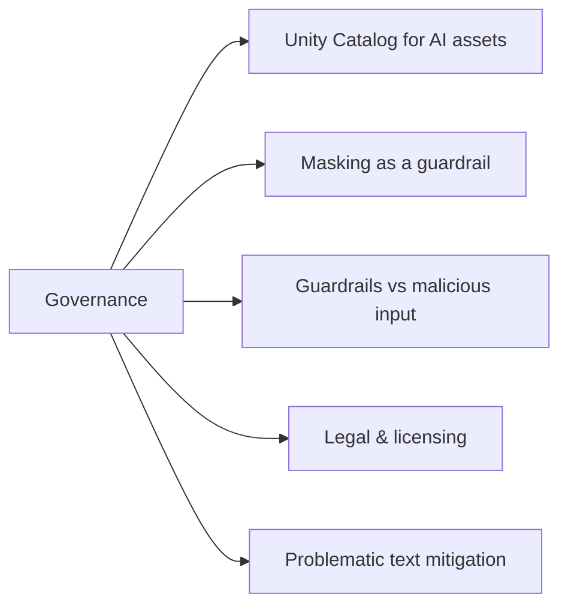

# Governança (8 % do exame)

> [!important]
> Seção 5 do guia do exame. A governança abrange técnicas de mascaramento usadas como guardrails, proteções contra entradas maliciosas de usuários, requisitos legais e de licenciamento para fontes de dados e mitigação de texto problemático nos dados de origem — tudo baseado na governança de ativos de IA do Unity Catalog. O *monitoramento* do AI Gateway (tabelas de inferência, tabelas de uso, limites de taxa) é cobrado em [Avaliação e monitoramento](../05-evaluation-and-monitoring/README.md).

## Visão geral dos tópicos

## Conteúdo da seção

| Arquivo | Tópico | Prioridade |
| :--- | :--- | :--- |
| [01-governance-overview.md](./01-governance-overview.md) | UC para ativos de IA, mascaramento (ingestão, máscaras de coluna, `MASK` do gateway), guardrails contra jailbreaks e prompt injection, licenciamento, texto problemático, trilha de auditoria | Alta |

## Cobertura do guia do exame

| Item do guia do exame (Seção 5) | Onde é abordado |
| :--- | :--- |
| Usar técnicas de mascaramento como guardrails para atingir um objetivo de desempenho | [01](./01-governance-overview.md#camada-2--técnicas-de-mascaramento-como-guardrails) |
| Selecionar técnicas de guardrail para proteger contra entradas maliciosas de usuários em um aplicativo de GenAI | [01](./01-governance-overview.md#camada-3--guardrails-contra-entradas-maliciosas-de-usuários) |
| Usar requisitos legais/de licenciamento para fontes de dados e evitar riscos legais | [01](./01-governance-overview.md#camada-4--requisitos-legais-e-de-licenciamento-para-fontes-de-dados) |
| Recomendar uma alternativa para mitigar texto problemático em uma fonte de dados que alimenta um aplicativo de GenAI | [01](./01-governance-overview.md#camada-5--mitigação-de-texto-problemático-nos-dados-de-origem) |

## Conceitos-chave

| Conceito | Por que é importante |
| :--- | :--- |
| **UC para ativos de IA** | Tabelas, volumes, índices, modelos, funções, prompts e serviços MCP compartilham um modelo único de `GRANT` / `REVOKE` |
| **Mascarar antes de gerar embeddings** | PII em um índice pode ser recuperada em qualquer prompt; mascarar na ingestão também não gera custo no momento da consulta |
| **Mascarar vs. bloquear** | O mascaramento mantém as solicitações respondíveis; o bloqueio impõe tolerância zero |
| **Guardrails em camadas** | Filtros de segurança, prompts resistentes a injeção, ferramentas com privilégio mínimo, limites de taxa, aprovação humana |
| **Licenças e termos** | Verifique licenças de dados e modelos, termos de serviço e base legal de privacidade antes da ingestão |
| **Corrigir texto problemático na origem** | Exclua, substitua ou redija a montante; filtros de saída são a última proteção |

## Recursos relacionados

- [Fundamentos do Unity Catalog (compartilhado)](../../../../../shared/fundamentals/unity-catalog-basics.md)
- [Folha de referência do Unity Catalog (compartilhada)](../../../../../shared/cheat-sheets/unity-catalog-quick-ref.md)
- [Governança de IA com Unity Gateway](https://docs.databricks.com/aws/en/ai-gateway/)
- [Governança para endpoints de model serving (AI Gateway legado)](https://docs.databricks.com/aws/en/ai-gateway/overview-serving-endpoints)

---

**[← Anterior: Avaliação e monitoramento](../05-evaluation-and-monitoring/README.md) | [↑ Voltar para GenAI Engineer Associate](../README.md)**
